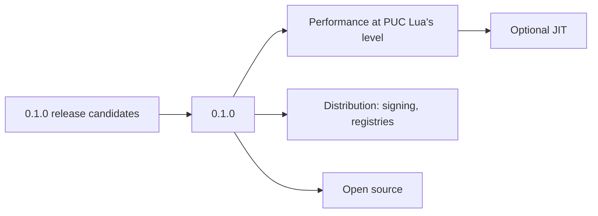

# Roadmap

One semantic core, two syntaxes: the Lua 5.5 and OrbitScript front ends both lower to a shared HIR, and everything after that (compiler, VM, GC, standard library) is shared.

## Where we are (0.1.0)

The first release covers:

- **Lua 5.5.** The full language and standard library. The official 5.5 test suite passes, minus its internal (`T`) and C-library parts; every skip is in [`tests/lua-5.5/SKIPS.md`](../tests/lua-5.5/SKIPS.md) and every known difference in [`tests/lua-5.5/DEVIATIONS.md`](../tests/lua-5.5/DEVIATIONS.md).
- **OrbitScript.** The language in [the language design](design/orbitscript-syntax/proposal.md), calling and called from Lua, with the optional type checker `orbit-check` and the formatter `orbit-fmt`.
- **Runtime.** Our own garbage collector (`orbit-gc`, incremental with a generational mode), a stackless interpreter with coroutines that can yield across anything Lua allows, `std.json`, C modules built for Lua 5.5 (ADR-8) and the `ffi` library (ADR-9).
- **Embedding.** The Rust API in the `orbit` crate (ADR-11), and `liborbit`, which also stands in for Lua 5.5's shared library (ADR-10).
- **Tooling.** The language server, the debugger (DAP) and the VS Code extension (ADR-12).
- **Releases** for Linux (x86_64, ARM64), macOS (Apple silicon) and Windows (x64, ARM64), built by [`.github/workflows/release.yml`](../.github/workflows/release.yml) ([`releasing.md`](releasing.md)).

## Before 0.1.0

- Release candidates (`v0.1.0-rc...`) until they hold up in use.
- A user guide: getting started, the command line, an OrbitScript tour and an embedding quickstart.

## After 0.1.0

- **Performance.** Match or beat PUC Lua's speed with a smaller footprint, on the benchmarks in [`bench/`](../bench/README.md). Work continues in the interpreter loop, table lookups and start-up time.
- **JIT.** An optional Cargo feature. Prototypes with Cranelift and with a smaller template compiler exist on branches; whether and how one ships is decided once the interpreter work settles.
- **Distribution.** Signed and notarized binaries, the VS Code extension on the Marketplace and Open VSX, crates on crates.io, and more targets (Intel macOS, musl Linux).
- **Open source** under the MIT license, in the `orbitscript-lang` GitHub organization.

## Lua 5.5 changes that matter (versus 5.4)

Checked against the Lua 5.5.1 manual and the reference interpreter (the `v5.5.1` tag of the lua/lua mirror).

Incompatibilities the manual lists (section 8):
- Language:
  - `global` is a reserved word. The default build defines `LUA_COMPAT_GLOBAL`, which keeps `global` a regular name and only reads it as a declaration when `<`, a name, `*` or `function` follows. The suite relies on the default (its files both declare globals and parse under it), so the Lua front end must follow the default, and can reserve the word as an option.
  - The control variable of a `for` loop is read-only (assigning to it is a compile error).
  - A chain of `__call` metamethods can have at most 15 objects.
  - A `nil` error object is replaced by a string message.
- Libraries: GC parameters are set through the new `collectgarbage("param", ...)` option, not the `incremental` and `generational` options, and the parameters themselves changed.
- C API: several changes (`lua_newstate` seed, `nresults` limit of 250, deprecated `lua_resetthread` and `lua_setcstacklimit`, `lua_dump`, `LUA_GCPARAM`, `lua_pushvfstring`). None applies, since embedding is Rust-only.

New syntax:
- `global` declarations: `global x`, `global x, y = 1, 2` (which fails at run time if a global already has a value), `global <const> x`, `global function f`, and `global *` / `global <const> *`. Once a declaration is in scope, undeclared free names are compile errors, and `<const>` globals cannot be assigned. Globals cannot be `<close>`.
- An attribute can prefix a whole name list: `local <const> a, b = 1, 2`.
- Named vararg tables: `function f(a, ...args)`. The table holds the extra arguments plus `n`, the name is read-only, and the compiler can avoid building a real table when the name is only indexed.

Other changes (not incompatibilities, from the release notes):
- Floats print with enough digits to round-trip.
- `table.create`; `utf8.offset` also returns the end position.
- Incremental major GCs, compact arrays (tags stored apart from payloads).
