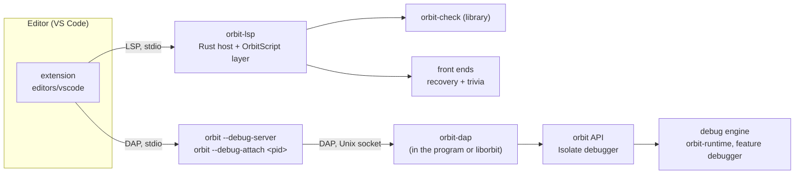

# ADR-12: Developer tooling: language server and debugger

Status: Accepted (Tym, 2026-10-18 22:51Z; proposed the same day). Tym asked on 2026-10-16 what OrbitScript needs for the tooling developers expect: a language server with completion and navigation, and debugging with breakpoints and stepping. He decided the plan's questions D1 to D13 on 2026-10-18. The full plan, with measurements and the options weighed, is `planning/dev-tooling/plan.md` in the project files; this record keeps the decisions. Accepting it amends ADR-6 (one more `unsafe` exception, D12), adds `serde_json` to the dependencies of `orbit-std` and the tooling crates, and adds `orbit_newstate` and `orbit_debug_listen` to `liborbit`'s `orbit_` exports (ADR-10).

## Context

Neither front end keeps what an editor needs: both parsers stop at the first error and drop comments, and name resolution lives in private front-end scopes that are dropped after lowering. The type checker (`orbit-check`, `planning/type-checking/proposal.md`) will resolve names, build the module graph and type expressions, which is most of what a language server needs.

For debugging, the runtime already has Lua's hooks (`debug.sethook`, `lua_sethook`, `orbit::stack`), but the hooked run loop calls `hook_point` before every instruction. Measured on the cloud x86_64 container (`71488eb`), a breakpoint debugger written in Lua over `debug.sethook` runs programs 22 to 74 times slower, and an armed hook that never fires costs 1.9 to 4.1 times. A debugger has to cost nothing in functions without breakpoints.

The runtime ships as `liborbit`, which is also `liblua` (ADR-10), so C hosts built for Lua 5.5 load it without knowing about Orbit. Programs can't choose the library's Cargo features.

## Decision

### Language server

- **A dedicated binary, `orbit-lsp`** (D2), outside `default-members`. It reuses the other crates instead of duplicating them: the front ends for parsing, `orbit-check`'s library for analysis, a formatter crate later, and the `orbit` API.
- **The type checker is fully reused** (D1). `orbit-lsp` links `orbit-check`'s library, which is shaped for editor use: it accepts ASTs with error nodes (treated as `any`, never a panic), keeps what it resolves (each reference's definition, each expression's type), answers position queries and rechecks one file and its dependents. There is no second resolver. Lua files get go-to-definition for locals from the HIR, which already links each reference to its declaration, until the checker covers Lua.
- **Error recovery and comment keeping live in the shared parsers** (D3), behind `ParseOptions` flags that `load` never sets, so the runtime's behaviour and messages don't change. Comments go to a trivia side table next to the AST; the tree doesn't change. The same parser builds type trees for the checker behind its own flag (type checker T2): one parser per language.
- **The protocol and feature layer is written in OrbitScript** (D9), running in a small Rust host. The host owns stdio framing and calls into the checker; the scripts use the stdlib `json` module.
- **JSON is `serde_json`** (D4), used by `orbit-std` and the tooling crates (`orbit-lsp`'s host, `orbit-dap`), so binaries carry one copy. `orbit-runtime` takes no JSON dependency and is reached only through the public `orbit` API. The PR that adds it adds its `DEPS.md` row with the measured size.
- **A stdlib `json` module** (D13) in `orbit-std`, backed by `serde_json`, behind a `json` feature that the CLIs and the `build.sh` package turn on, so every script gets it, not only the language server. It is reached as `require "std.json"` (Tym 2026-10-19: `std.` leaves room for a fuller standard library) rather than a global or the bare name `json`, so Lua programs that ship their own `json.lua` keep loading theirs. `encode(value [, options])` and `decode(text [, options])`; JSON `null` decodes to a `json.null` sentinel; an empty table encodes as `[]` unless marked as an object; integers and floats keep their subtype; decode errors return `nil, message`.
- **Transport**: JSON-RPC 2.0 over stdio with `Content-Length` framing, one thread with a short debounce on edits.

### Debug engine

- **In `orbit-runtime`, behind a `debugger` feature** that implies `hooks`. On in the CLI's static build and in the `build.sh` package, off by default for Rust embedders.
- **A Rust event interface, `DebugEvents`, beside the Lua hook slot.** It is called directly from the run loop with no Lua call, so a script's `debug.sethook` and a C host's `lua_sethook` keep working while a debugger is attached.
- **The hooked loop runs only in functions with breakpoints, or while stepping** (D6). Setting a breakpoint resolves `(source, line)` to the prototypes whose line tables contain the line and flags them; the run loop's existing switch points (frame entry at `'reload`, return from a native) pick the hooked loop for flagged functions. Other functions run at full speed. Prototypes compiled later (`require`, `load`) are matched by source name when they are linked.
- **No opcode patching** (D6). A `Break` opcode written into the bytecode would cost nothing even inside debugged functions, but could conflict with a future JIT that translates from the bytecode.
- **Stepping** compares frame depth and line with where the program stopped. **Pause** reuses the interrupt flag (`Control::interrupt_flag`), stopping at the next line instead of raising the interrupt error. **Break on error** is a pre-unwind event raised before any frame is popped, saying whether a `pcall`, `xpcall` or boundary will catch the error. Conditions, hit counts and logpoints are evaluated in the engine.
- **Built-ins written in OrbitScript** carry the built-in mark and look like C: no breakpoints or line events inside them, and step in stops only at user callbacks they call (a `table.sort` comparator).
- **Lua and OrbitScript are debugged alike**, since both produce the same bytecode and line tables. Watch expressions compile in the frame's language. C module functions and `ffi` calls are `[C]` frames.

### Debugger API

- **On `Isolate`**: `set_breakpoints`, `resume`, `step`, `pause` and `set_debug_events(impl DebugEvents)`. Callbacks (stopped, error, output, new source) receive a paused view with `activations()`, `frame_info(level)`, `locals(level)`, `upvalues(level)`, `set_local` and `globals()`, built on what `orbit::stack` already offers.
- **Values handed to the editor are pinned handles** (ADR-11's `Pinned`) held while paused and dropped on resume, which matches DAP's rule that variable references are valid only while stopped. Hidden compiler and lowering locals are not shown.
- **In the shared layout** these are a few methods and one callback trait in `orbit::abi`. They land in one change, since every `abi.rs` change needs `liborbit` and the programs rebuilt together (the interface hash, ADR-10).

### The DAP server and who turns it on

- **`orbit-dap`** is a crate on the public `orbit` API and `serde_json`, with its own I/O (stdio and local sockets). It builds over either backend, like `orbit-std`.
- **Launch**: `orbit --debug-server` is the editor's debug adapter, speaking DAP on stdio. It never runs the program itself: it starts `orbit --debug-connect <socket> <program> <args>` in the editor's terminal (`runInTerminal`) or, with `console` `"internalConsole"`, as its own child with no input, and relays to it over a local socket (D11), so the program's standard input and output never carry the protocol (Tym, 2026-10-19). The CLI links `orbit-dap` behind a `dap` feature, on by default.
- **`liborbit` carries `orbit-dap` too** (D5), behind an `orbit-lib` feature that `build.sh` turns on, so C hosts can be debugged: `orbit_debug_listen(lua_State *L, const char *addr)` for hosts that add a debug option, and `ORBIT_DEBUG=1`, read when a state is created through the C API, for unmodified hosts. Rust programs call `orbit_dap::serve`. Without the feature both C functions still exist, and listening fails.
- **Suppressed per isolate, at creation only** (D5). Rust: `Config::debugger` on `Runtime::new_isolate`, `Debugger::Allowed` (default), `Debugger::Disabled`, or `Debugger::FromEnv` (only isolates with this read `ORBIT_DEBUG`). C: `orbit_newstate(lua_Alloc f, void *ud, unsigned flags)` with `ORBIT_STATE_NO_DEBUGGER`, exported in the `ORBIT_0` symbol version; `lua_newstate` and `luaL_newstate` behave as `orbit_newstate` with no flags. A disabled isolate has no engine state. There is no process-wide switch and no way to disable it later.
- **The host decides when the server starts** (D11). The library never opens a socket on its own. The start functions are safe to call from any thread at any time.
  - The `orbit` CLI owns its process, so `kill -USR1 <pid>` starts the server (its existing `signal-hook` thread handles it). `--debug-listen` starts it at launch and `--no-debug-signal` removes the handler.
  - On Windows the CLI waits on a named event, `Local\orbit-debug-<pid>`, instead.
  - `orbit --debug-attach` checks that the target is an `orbit` CLI that catches `SIGUSR1` before signalling, since the signal terminates processes that don't handle it. On macOS, which has no `/proc`, it asks the kernel through libproc and `sysctl` (amended 2026-10-23, Tym: no `ps` process).
  - Other hosts use `ORBIT_DEBUG` or call the start function from their own trigger.

### Transport and attaching

- **Local Unix domain sockets only, no TCP** (D11). The server listens on `$XDG_RUNTIME_DIR/orbit/<pid>-<nonce>.sock`, falling back to `$TMPDIR/orbit-<uid>` or `/tmp/orbit-<uid>` on Linux, `$TMPDIR/orbit` on macOS and `%TEMP%\orbit` on Windows (amended 2026-10-24 from `%LOCALAPPDATA%\orbit`, which packaged apps see virtualized, where AF_UNIX sockets can't be connected to). The directory is 0700 and the socket 0600, so only the same user can connect, with no token. Remote devices are reached by the user forwarding the socket over SSH.
- **Stale sockets**: a crashed process leaves its socket behind, and on some platforms it survives a reboot. The random nonce means a reused pid never lands on an old name. Clients trust a socket only if its `describe` answer gives the expected pid and process start time. Each server start, and the lister, delete sockets that refuse connections.
- **Discovery**: `orbit --debug-attach --list` sends each socket one `describe` request (program, arguments, start time, versions, isolates, whether a debugger is attached) before any DAP traffic. It also lists `orbit` CLIs without a running server, found by process name. The runtime writes no discovery files.
- **The editor connects through a stdio relay**, `orbit --debug-attach <pid>`, which signals the target if needed, connects to its socket and relays DAP over stdio. It works the same on every platform and in every editor, and avoids Node treating Windows socket paths as named pipes.
- **Windows AF_UNIX via our own Winsock wrapper** (D12): `socket`, `bind`, `listen`, `accept`, `recv`, `send` and `closesocket` through `windows-sys` (already a dependency of `orbit-virtmem`), about 150 lines in one file with an `unsafe` exception, which also holds the named-event code. It is deleted when `std`'s Windows Unix sockets (nightly feature `windows_unix_domain_sockets`) are stable. Every supported Windows (10 build 17063 and later) has AF_UNIX.

### Several isolates in one process

- **One DAP session per process** (D10), shared by every isolate that allows debugging. The first one to start serving opens the listener; later ones register with it.
- **Each isolate is one independent DAP thread**, named from `Config` or numbered in creation order. Its coroutines appear inside its call stack. Showing coroutines as threads of their own may be revisited after research into how M:N runtimes (Go, Kotlin coroutines, Java virtual threads) present them in debuggers. Breakpoints are per file and apply to every isolate that loaded the file.
- **Isolates stop independently** (`allThreadsStopped: false`). The server runs on its own OS thread and never touches an isolate: each isolate has an agent on its own thread, reached over channels. A paused isolate answers requests from its own thread; a running one is reached only through its interrupt flag and a queue of breakpoint changes applied at its next switch point. Nothing needs `Send`.

### Editor

- **A VS Code extension in this repository**, `editors/vscode` (D7), self-contained so it can move to its own repository later. It starts `orbit-lsp`, `orbit --debug-server` and `orbit --debug-attach`, and fills its process picker from `orbit --debug-attach --list`.

### Order

The language server and the debugger are built in parallel (D8). The language server starts with parser recovery and trivia (owned by the front-end threads), then diagnostics and outline, then the checker-backed tiers. The debugger starts with the engine and the `Isolate` API, then `orbit --debug-server`, then attach.

## Not planned

- TCP or any network listener, and tokens for remote connections.
- Attaching to processes that never asked by injecting code (`ptrace`, Python's PEP 768 approach), and `liborbit` installing signal handlers.
- A process-wide switch to disable the debugger, or turning it off after an isolate exists.
- Opcode patching for breakpoints.
- Column breakpoints and `stepInTargets`, which need a column table in debug info that every program would pay for. Later, behind the `debugger` feature.
- Listing suspended coroutines as separate DAP threads, and an "all stop" mode across isolates. Both are possible later.
- `lsp-types` and `tower-lsp`, which bring an async runtime.

## Consequences

- Programs pay nothing for the debugger in functions without breakpoints, and nothing at all with no debugger attached. The engine's exit criterion is benchmarks and binary size matching main in both layouts, with `cargo testkit pgo check` passing.
- The front ends gain recovery, trivia and doc-comment attachment. `orbit` grows by their code, with a target under 10 KiB. `load` is unchanged.
- `orbit-check`'s library takes on editor-facing duties (error nodes, kept symbols and types, position queries, incremental rechecks), which the type checker thread designs for.
- `liborbit` grows by the DAP server, a few tens of KiB to be measured, unused unless a host turns it on. A debug connection can run any code, so it is protected by file permissions and the documentation says not to ship it enabled.
- `orbit-runtime` stays free of JSON and I/O. `orbit-std` (feature `json`), `orbit-dap` and `orbit-lsp`'s host take `serde_json`, recorded in `DEPS.md`.
- Scripts gain a standard `json` module, an Orbit extension beyond Lua's standard library.
- One more `unsafe` exception, the Windows socket and event wrapper, until `std` covers it. A second (amended 2026-10-23): `orbit-dap/src/process.rs`, `libc` calls that send `SIGUSR1` and, on macOS, list processes and read their executable, arguments and caught-signals mask, since no crate exposes the mask.
- The debugger ABI is added to `orbit::abi` in a single change, so `liborbit` and its programs are rebuilt once.
- A known front-end bug shows up in the debugger: OrbitScript items visible in the whole block are reported live before they are assigned, so they show a stale register value. It needs fixing in the compiler or lowering before the debugger ships.
