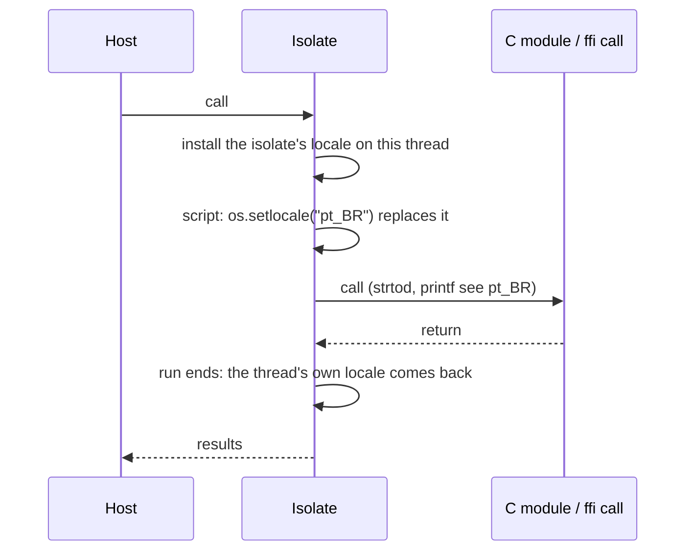

# ADR-13: Locales

Status: Proposed

## Context

Lua 5.5 leaves locales to the C library: `os.setlocale` calls `setlocale`, and the rest of the interpreter reads whatever locale the process has. Observed in lua5.5, a locale changes:

- the decimal point of `tostring`, `..`, `print`, `io.write` and `string.format`'s `%a %e %f %g` (not `%q`), and the one `tonumber`, string arithmetic, `io.read "n"` and the lexer accept. A `.` is still read when the locale's point is a single other byte, but not when it is longer (`ps_AF`'s U+066B: `tonumber "3.5"` is nil and `load "return 3.5"` fails);
- the `%a %l %u %p %s %w %x %c %g` classes and `string.upper`/`lower`, byte by byte (single-byte locales such as `pt_BR.ISO-8859-1`; glibc's UTF-8 locales leave bytes from 0x80 unclassified);
- `<` and `<=` on strings, through `strcoll`, compared piece by piece across embedded zeros;
- `os.date`'s names (`%a %A %b %B %p`), formats (`%c %x %X %r`) and the `E` and `O` conversions (eras, alternative digits).

The names are the C library's, `""` picks the locale from the environment, and the categories are `all`, `collate`, `ctype`, `monetary`, `numeric` and `time`.

A process-wide locale doesn't fit OrbitScript: isolates on different threads would race, and one script's `os.setlocale` would change its host's number formatting. Lua's C modules, however, run C code that reads the process or thread locale (`strtod`, `printf`, `isalpha`), and expect it to be the script's.

## Decision

### Each isolate has a locale
- **The runtime keeps a safe `Locale`** per isolate: the decimal point, 256-entry class and case tables, and an optional collator (`orbit_runtime::locale`). Everything listed above reads it, so the C locale costs no more than before: the fast paths check one flag and fall through to the code they always ran.
- **Source code doesn't follow the locale.** Both lexers always read `.`, so a chunk compiles the same everywhere; lua5.5 rejects `3.5` in source under a locale like `ps_AF` (`tests/lua-5.5/DEVIATIONS.md`).
- **A `LocaleProvider` makes locales.** The runtime's own knows only `C` (and `POSIX`). `orbit-locale` is the C library's, behind `orbit`'s `locale` feature, on by default and in every binary we ship; without it a build has only `C`, which is what the core needs for no-I/O embedders.
- **`orbit-locale` uses locale objects**, never the process locale: `newlocale` and `uselocale` on Linux and macOS, `_create_locale` with `_strcoll_l`, `_strftime_l` and a per-thread `setlocale` on Windows. It builds the tables once per `os.setlocale` and asks the C library again only for collation and the `E`/`O` date conversions. Other dates expand the locale's `nl_langinfo` patterns in `orbit-std`, so `%Z` and `%z` keep using our time zone reader.

### Native code sees the script's locale
- **The isolate's locale is on the thread while the isolate runs.** When a run starts (the host's call, a nested resume or close, a finalizer; all go through `Vm::with_thread_locale`), the isolate's locale object goes on the thread (`uselocale`, or `_configthreadlocale` and `setlocale` on Windows). It stays for everything the run does, so C modules, `ffi` calls and callbacks into Lua need no code of their own, and `os.setlocale` while running replaces it at once. When the outermost run returns, the thread gets its own locale back, so the host's C code between calls is untouched. Runs nest: an isolate entered from another's native code puts the other's back when it returns.

- An isolate in the C locale installs nothing.

### Two modes
- **`LocaleMode::Isolate`**, the default for Rust hosts (`Isolate::new`): as above.
- **`LocaleMode::Process`**, the default for C hosts of `liborbit` (`lua_newstate`, ADR-10): `os.setlocale` calls `setlocale` as lua5.5 does, nothing is installed or restored, and each run takes on changes the host made to the process's locale. This keeps existing C hosts' behavior.
- Either host can switch: `Isolate::set_locale_mode` in Rust, `orbit_setlocalemode` in `orbit.h` for C.

### Scripts can ask for more
- `os.setlocale(locale, category, scope)` takes an optional third argument, which lua5.5 ignores:
  - `"process"` changes the process's locale with `setlocale`, as PUC Lua does, whatever the mode; the isolate takes it on. With no locale, it asks the process.
  - `"thread"` (isolate mode) changes the isolate's locale and leaves it on the calling thread when the run returns, for scripts written to set up their host thread. A thread's own locale takes precedence over the process's on it, as with `uselocale`. Each such change that outlives its run keeps its locale object for the life of the process.
- A host that must not let scripts change process or thread state leaves out `os.setlocale` (or `os`).

### `unsafe`
- Allowed only in `orbit-locale/src/sys.rs` (ADR-6): the C library's locale calls, reading the strings it returns, and `strcoll`/`strftime` on our buffers.

### Windows
- Names are the C runtime's (`English_United States.1252`, `""` from the user's settings), as for lua5.5 built there. Only `%c`, `%x` and `%X` go through `strftime`, since the runtime has no patterns to expand.

## Alternatives rejected

- **The process locale with `setlocale`**: the races and host interference above, and every number conversion would read it.
- **A pure-Rust locale database** (`pure-rust-locales`): about 194 KiB, no collation or character classes, and names that differ from the system's.
- **ICU4X**: about 1.25 MiB for collation and decimal formatting, with CLDR behavior rather than the C library's, so scripts would see different results from lua5.5.
- **Only `C`**: the suite's locale checks and C modules that read the locale would not match lua5.5.

## Consequences

- Scripts, the suite's locale sections and C modules see the same locales as under lua5.5 on the same machine.
- The release `orbit` grows by about 37 KiB (cloud x86_64, with or without PGO): 12 KiB for the runtime's side, 25 KiB for `orbit-locale`. A C-locale script runs as fast as before; start-up costs about 18,000 more instructions, mostly binding the new C library symbols.
- One isolate's locale can't affect another's or the host's, except in process mode, which a host chooses, or when a script asks with `"process"` or `"thread"`.
