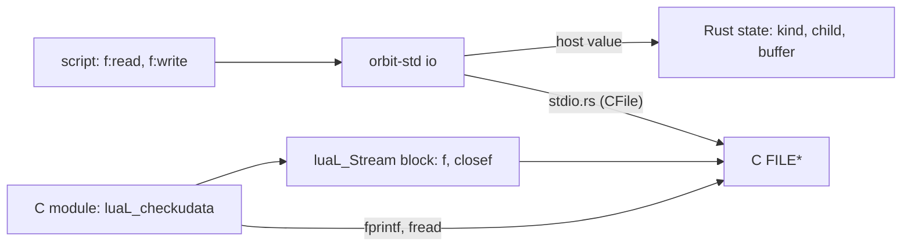

# ADR-15: File handles are C streams

Status: Proposed

## Context

The Lua manual makes a file handle a full userdata whose memory is a `luaL_Stream`, `{ FILE *f; lua_CFunction closef; }`, with the `LUA_FILEHANDLE` (`"FILE*"`) metatable. `closef` is `NULL` once the file is closed. C modules depend on this in both directions:

| Code | Direction | What it does |
|---|---|---|
| LuaFileSystem `lfs.lock`, `lfs.setmode` | Lua to C | `luaL_checkudata(L, i, "FILE*")`, then `fileno(p->f)`; tests `closef` for a closed file |
| luaposix `posix.stdio.fdopen`, `fileno` | both | wraps a descriptor in a new `luaL_Stream` with its own `closef`; reads `p->f` |
| Hosts such as SWUpdate's Lua handlers | both | pass `FILE*` handles between C and scripts |
| Any module that `fprintf`s or `fread`s a script's file | Lua to C | shares the buffer and the file position with the script |

`orbit-std`'s handles were Rust objects (a `Class` with Rust buffers), so `luaL_checkudata(L, i, "FILE*")` on an `io.open` handle raised "FILE* expected", and a `luaL_Stream` C code built was no file to `io`. C's `printf` and `print` also wrote through separate buffers, so their output came out in a different order than under lua5.5. Documenting this as a deviation is not acceptable: real modules and hosts depend on it.

The last row of the table rules out handing C a copy of the descriptor. A script and a C module writing to one file must write into one buffer, or their output interleaves wrongly; a script reading after C has read must see the bytes C's read-ahead buffered.

## Options compared

| Option | Shared buffer and position | Verdict |
|---|---|---|
| **A. Handles are C streams.** The handle is a `luaL_Stream` block; `io` reads and writes through C stdio on its `FILE*` | Yes, as in lua5.5 | **Chosen** |
| B. A shadow `FILE*` made when C asks (`fdopen(dup(fd))`), Rust keeping its own buffers | No: two buffers hold data for one file, and Rust can't tell when C is done | Rejected: wrong output order, read-ahead lost |
| C. A shadow `FILE*`, Rust unbuffered after the first hand-off | Partly: C's own read-ahead is invisible to Rust | Rejected: slow after the hand-off and still wrong for reads |
| D. Document the difference | No | Rejected: modules depend on it |

## Decision

### A handle is a `luaL_Stream` over a C stream
- **The handle's memory is the 16-byte `luaL_Stream`**, made with `Stack::new_userdata_with_host`, with the `FILE*` metatable from the registry. `lua_touserdata` returns that memory, so `luaL_checkudata(L, i, "FILE*")` works on `io`'s handles unchanged. `f` is the stream; `closef` is set while the file is open and `NULL` once it is closed.
- **Every read, write, seek and buffering change goes through C stdio on that `FILE*`**: `fread`, `fwrite`, `getc` and `ungetc`, `getdelim` for lines on Unix, `fseeko`/`ftello` (`_fseeki64`/`_ftelli64`), `setvbuf`, `fflush`, `fclose`. Errors come from C's `errno` and get the text `crt.rs` gives them.
- **Rust still opens files.** `io.open` opens with `std::fs::OpenOptions`, `io.popen` starts the command with `std::process::Command`, and `io.tmpfile` makes its file as before; the open descriptor (on Windows, the handle through `_open_osfhandle`) goes to `fdopen` with the mode. This keeps UTF-8 paths on Windows (the C runtime's `fopen` takes the ANSI code page), the error mapping, the `a+` handling and the shell quoting. A pipe's child is waited for at close, as before.
- **Each call locks the stream once.** A `read` format or a whole `write` call takes the stream's lock (`flockfile`, `_lock_file`) once and uses the calls that don't lock again (`fread_unlocked` and the like on glibc and musl, `_fread_nolock` and the like on Windows). Nothing in a locked section allocates on the heap or runs a script, so a finalizer can't reach the same handle meanwhile.

### Rust's state stays out of reach
- **What Rust keeps beside the stream** (the owned `FILE*`, whether it is a file, a pipe with its child or a standard stream, a buffer kept between reads) **rides in the userdata as a host value** that only Rust reaches (`Stack::userdata_host`). Scripts can't see it, `debug.setuservalue` can't swap it with another handle's, and C sees only the 16 bytes.
- **A handle is ours only if it carries that host value and still has the `FILE*` metatable.** A userdata that a script gives the `FILE*` metatable with `debug.setmetatable` is "FILE* expected", as in lua5.5. Rust never reads `f` back out of the block for its own handles; it writes `f` and `closef` there for C.

### C code
- **`closef`.** C may call `p->closef(L)` itself, as Lua's own library does. While `orbit-capi` is installed, an open handle's `closef` is a C function of `orbit-capi`'s that closes the handle at index 1 as `file:close` does; handles made before it installed get it then. Without `orbit-capi` no C code can run, and `closef` holds a function that is never called.
- **Streams C code makes.** While `orbit-capi` is installed, a userdata with the `FILE*` metatable and at least 16 bytes that `io` didn't make is a stream C code made: `io` uses its `f` and closes it by calling its `closef` through the C API, at `file:close` and at collection, as lua5.5 does. Without `orbit-capi` such a block can't exist (only C code and `ffi` write raw userdata memory), so it stays "FILE* expected".

### The standard streams
- **`io.stdin`, `io.stdout` and `io.stderr` are C's `stdin`, `stdout` and `stderr`**, reached through `extern` declarations per platform (glibc and musl `stdin`, Apple's `__stdinp`, the UCRT's `__acrt_iob_func`). `orbit-std` needs no C compiler. They are never closed.
- **The isolate's standard output becomes C's `stdout`.** `orbit_std::install` makes C's `stdout` the isolate's default writer unless the host set one (`Isolate::set_stdout`), so `print`, `io.write` and a C module's `printf` share one buffer.
- **A host that redirects standard output** still gets `print` and `io.write` to `io.stdout`; a C module that writes to `io.stdout`'s `FILE*` reaches the process's real standard output. A `FILE*` that writes into the host's writer exists on glibc (`fopencookie`) and macOS (`funopen`) but not on Windows, so it isn't offered.
- **An isolate with `LineEndings::Binary` on Windows** (`orbit-lsp`) keeps its Rust writer, and its standard handles are binary streams of their own over copies of the standard descriptors: C's standard streams are text streams process-wide there, and changing them would change the host's.
- Several isolates in a process share C's standard streams, as they shared Rust's.

### Windows
- **Text mode is the C runtime's.** A stream opened without `b`, and both ends of `io.popen`, is a C text stream (`_O_TEXT`) unless the isolate's line endings are `Binary`, so C code sees the same bytes the script does. We inherit the C runtime's behaviour, including `seek("cur")` after a read that stopped at a Ctrl-Z, which lua.exe shows too.
- **A C module must use the C runtime `orbit` uses**, the rule lua.exe has. Rust's MSVC targets link the shared UCRT, so modules built with `/MD` share our streams; a module built with `/MT` has a private C runtime and misbehaves on our `FILE*`, as it would under lua.exe. MinGW builds (`-gnu` targets) link `msvcrt.dll`, so their modules must come from the same MinGW toolchain. `orbit-capi` can't detect a mismatch.
- **Console output** is bytes in the console's code page, as lua.exe writes it; Rust's `stdout` converted UTF-8 for consoles. Redirected output is unchanged.

### `unsafe`
- The C stdio calls live in **`orbit-std/src/stdio.rs`**, an ADR-6 exception: the `extern` declarations and `CFile`, which owns or borrows a non-null `FILE*` and offers safe methods over Rust slices with their lengths. No script value becomes a pointer or a format string there: a `FILE*` comes from `fdopen` on a descriptor Rust opened, from C's standard streams, or, for a stream C code made, from that stream's block, which exists only once native code is loaded.
- `orbit-capi/src/ffi.rs` (ADR-8) gains the `closef` C function and the call through a foreign stream's `closef`.

## Consequences

- C modules and hosts that pass `FILE*` handles work as under lua5.4 and lua5.5, in both directions, and `print` and C's `printf` come out in lua5.5's order.
- Release `orbit` grows by about 4 KiB (Linux x86_64); a build without `c-modules` doesn't grow.
- Instruction counts against the Rust buffers this replaces (callgrind, Linux x86_64, release builds without PGO): `io.lines`, `read("n")`, many small writes and `print` loops within 1%; `read("a")` 28% fewer; a loop of `f:read(7)` 13% more and a loop of single `io.write`s 6% more, mostly the native call into C stdio and the stream lock. glibc locks a stream only once a process has a second thread, and `orbit` has threads for Ctrl-C and the debugger's signal, so its calls lock where lua5.5's don't.
- Every C runtime rule about `FILE*` now applies to `io`: on Windows, modules must share the C runtime, and text mode is the C runtime's.
- `io` keeps no buffers of its own, and `flush_all` is C's `fflush(NULL)`.
