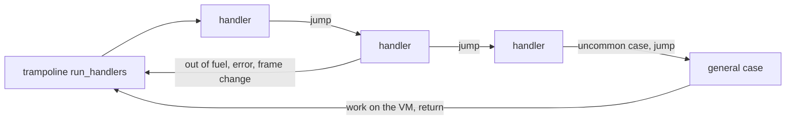

# ADR-15: The plain interpreter as chained handlers with raw pointers

Status: Proposed

## Context

The plain interpreter was one function, `Vm::run_loop`: one `match` over every instruction inside one loop. The compiler makes one set of decisions for that whole function: which values live in registers across the loop, which arms spill, how the blocks are laid out. An edit to one arm changes the inputs to those decisions, so it can change the machine code of arms it did not touch. Measured on this code base, small edits moved benchmark programs by several percent in either direction, differently on x86-64 and arm64, and only a freshly trained profile and a per-architecture measurement could tell a real regression from a reshuffle. Performance work on the loop turned into work on the compiler's choices.

Interpreters that are both fast and stable under edits compile each instruction separately: assembly (LuaJIT, JavaScriptCore), a code generator (V8, Deegen), or one function per instruction chained by tail calls (CPython 3.14, Wasm3, Wasmtime's Pulley, Wasmi). Rust has no guaranteed tail calls on stable, but LLVM turns a call in tail position into a jump when caller and callee have the same signature and nothing is live across it.

A first version of that design in safe Rust (register window as a slice, instruction index instead of a pointer) is stable under edits but runs about 20% more instructions than the `match` loop, and about 20% more cycles on an Apple M2 Max. The cost is the bounds test on the window and on the code at every instruction, and calls and returns that cannot hand a slice back to the caller.

## Decision

### One function per instruction
- **The plain interpreter runs handlers** (`orbit-runtime/src/vm/handlers/`). A handler is `fn(&mut Vm, Regs, Ip, Op) -> Step`: the VM, the running frame's registers, the place in the code after its own instruction, and its own instruction. It does the common case of its instruction and ends by calling the next instruction's handler in tail position.
- **Four arguments**, so the same code keeps its jump under the Windows x86-64 calling convention, which passes four in registers.
- **The instruction is `Op` itself.** `Op` is 8 bytes and `#[repr(u8)]`, so it is handed over in one machine register and a handler takes its operands apart with an ordinary pattern (`let Op::Add { dst, a, b } = op else { .. }`). There is no second instruction format and no decoder.
- **Dispatch is one table per VM**, 256 function pointers indexed by the instruction's first byte, which for a `#[repr(u8)]` enum says which variant it is. The table is filled when the VM is made from a `match` from `Op` to the handler (`handlers::handler`), which names every instruction, so a new one does not compile until it has a handler. A handler finds the next one at a fixed offset from the VM it was handed. (Dispatching through the `match` itself compiles to the same lookup, but with a separate copy of the table in every handler.)
- **Common case and general case sit together.** What the common case does not cover (an error, a metamethod, a stack that must grow) the handler leaves, by a call in tail position, to a function written next to it. That one reads the instruction again from the code, gives up the registers (`leave`), works on the whole VM in safe code, and returns to the trampoline, which starts a new chain from the frame on top.
- **The hooked loop is unchanged**: `run_loop::<true>` still serves hooks, breakpoints and stepping.

### Correctness never depends on the jump
- A chain spends **fuel** on every backward jump and every call (on every instruction in a debug build) and returns to the trampoline when it runs out. A general case always returns to the trampoline, and a run nested inside a native (a callback) leaves the outer chain's fuel as it found it. If the compiler makes a real call instead of a jump, the program is slower and uses native stack in proportion to the fuel, and is otherwise the same.
- Open point: with real calls a release build's native stack also grows with the straight-line instructions between two fuel points. Whether to spend fuel on every instruction on targets where the jump is not confirmed is to be decided before this record is accepted.

### `unsafe`, and what it rests on
Two files of `orbit-runtime` allow `unsafe_code`; the crate denies it instead of forbidding it for that purpose. `vm/handlers/regs.rs` defines the two pointer types, `Regs` and `Ip`, whose methods the handlers call as safe code. `vm/handlers/calls.rs` holds the call and return handlers, which move both pointers from one frame to another. The handlers of every other instruction contain no `unsafe`.

| Use | Invariant | Who establishes it |
|---|---|---|
| Reading and writing registers through `Regs` | The stack covers `WINDOW` registers from the running frame's base and does not move while a `Regs` exists | `Regs::of_frame` sizes the stack when a chain starts; the call handler checks the callee's window against the stack's length and takes the general case otherwise; `Regs` is not `Copy`, and `leave` consumes it before anything that can move the stack, so the compiler rejects a use afterwards |
| Reading the next instruction through `Ip`, jumping by an instruction's offset | `Ip` stays inside the running function's code, which ends in a return | The bytecode verifier (`orbit_bytecode::verify`), which every chunk passes before it is linked |
| The running code as `*const ProtoCode` across calls and returns, with no reference count | The code outlives its use | A frame on the stack names the closure, the collector keeps the closure, the closure owns its code. The VM's own counted reference is brought up to date before any general case runs |
| Pushing a frame without the vector's growth path; copying a value as tag byte, boolean byte and payload | Room for one frame; `Value` is `repr(C, u8)` (ADR-1) | Checked in the handler; fixed by ADR-1 |

- **A handler handed the wrong instruction panics.** The pattern that takes `Op` apart has an `else` that returns `Step::Invalid`, on which the trampoline panics. It costs each handler a compare and a branch that is never taken; `unreachable_unchecked` there would save them and is not used.
- **Object handles stay checked.** Every table, closure, cell and string is reached through `Heap::get` and the write barriers as before: a stale handle is still a panic, not memory corruption. `orbit-gc` is unchanged.
- **No register or code pointer survives a general case**: anything that can grow the stack, switch the coroutine or raise runs there, and the chain restarts from the frame afterwards. A common case that allocates checks afterwards whether the collector is due and restarts the same way if so.

### Rules for writing a handler
A handler's hot path must save no registers. Four things silently break that, and each was found by reading the machine code:
- A handler returns one scalar (`Step`), and never the constant result of a callee the compiler can see through: the functions that end a chain return their step through `std::hint::black_box`.
- A handler does not pass its instruction on. A general case that were handed the `Op` would make the handler keep it in a register across the common case, so it reads the instruction from the code instead (`Ip::handled`).
- Anything that needs a real call (growing a vector, a write barrier, a lookup that misses, a panic with a message) lives in the general case or another `#[inline(never)]` function the handler calls in tail position. One call on any path gives every path a prologue.
- No value built on the handler's own stack is passed on by address.

`tools/check-handlers.py BINARY 8handlers` lists the functions of the module that have a prologue or a real call in a build, from its disassembly. The general cases belong on that list; a handler's common case does not.

Shared shapes are generic `#[inline(always)]` functions that take the per-instruction part as a closure (`on_numbers`, `compare_registers`), not macros.

### Builds
- Profile-guided builds pass `-Cllvm-args=-disable-icp` (`build.sh`). With a profile LLVM otherwise promotes the dispatch to a chain of compares and inlines handlers into each other.
- Handlers are `#[inline(never)]`.

## Consequences
- An edit to one instruction changes that instruction's handler. Adding a counter to a handler, with a fresh profile, moved no benchmark by more than the counter's own cost.
- Two implementations of every instruction exist while this is in progress: its handler and the hooked loop's arm. Moving hooks onto the handlers and deleting `run_loop` is follow-up work, as is a common case for more instructions (native calls without a fast path, generic `for` calls).
- `Op`'s layout is now part of the interpreter's speed: it must stay 8 bytes and `#[repr(u8)]` (asserted in `orbit-bytecode`).
- A new kind of regression exists and is checkable: a handler that loses its jump or gains a prologue.
- When Rust's guaranteed tail calls (`become`) are stable and within the MSRV, the handlers take them and the fuel becomes only the interrupt poll.

## Alternatives
- **Keep the `match` loop.** No new `unsafe`; the instability stays.
- **Safe handlers** (slices and indices). Stable under edits, about 20% slower than the `match` loop on arm64.
- **Assembly handlers.** Jumps by construction on every target; one implementation per architecture and calling convention. The Rust handlers are within one to three instructions of hand-written ones on the simple instructions, so this buys the guarantee and little speed. Dispatch by function pointer lets single handlers move to assembly later.
- **Unchecked object handles and raw table access.** A further 8% fewer instructions on x86-64. Not taken: it removes the check that turns a collector bug into a panic.
- **A packed instruction word generated from `Op`**, with a table indexed by its opcode byte. Built first and removed: the same machine code as handing over `Op`, at the price of a generator, a decoder per instruction shape and a second copy of every function's code.
