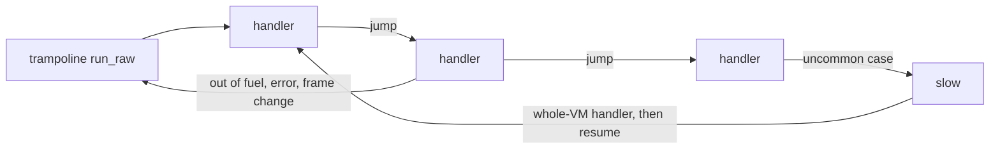

# ADR-15: The plain interpreter as chained handlers with raw pointers

Status: Proposed

## Context

The plain interpreter was one function, `Vm::run_loop`: one `match` over every instruction inside one loop. The compiler makes one set of decisions for that whole function: which values live in registers across the loop, which arms spill, how the blocks are laid out. An edit to one arm changes the inputs to those decisions, so it can change the machine code of arms it did not touch. Measured on this code base, small edits moved benchmark programs by several percent in either direction, differently on x86-64 and arm64, and only a freshly trained profile and a per-architecture measurement could tell a real regression from a reshuffle. Performance work on the loop turned into work on the compiler's choices.

Interpreters that are both fast and stable under edits compile each instruction separately: assembly (LuaJIT, JavaScriptCore), a code generator (V8, Deegen), or one function per instruction chained by tail calls (CPython 3.14, Wasm3, Wasmtime's Pulley, Wasmi). Rust has no guaranteed tail calls on stable, but LLVM turns a call in tail position into a jump when caller and callee have the same signature and nothing is live across it.

A first version of that design in safe Rust (register window as a slice, instruction index instead of a pointer) is stable under edits but runs about 20% more instructions than the `match` loop, and about 20% more cycles on an Apple M2 Max. The cost is the bounds test on the window and on the code at every instruction, and calls and returns that cannot hand a slice back to the caller.

## Decision

### One function per instruction
- **The plain interpreter runs handlers** (`orbit-runtime/src/vm/threaded/raw.rs`). A handler is `fn(&mut Vm, w: *mut Value, ip: *const Insn, Insn) -> Step`. It does the common case of its instruction and ends by calling the next instruction's handler, through a 256-entry table indexed by the opcode byte, in tail position.
- **Four arguments**, so the same code keeps its jump under the Windows x86-64 calling convention, which passes four in registers.
- **Instructions are packed words** (`orbit_bytecode::insn::Insn`, 8 bytes, generated from `Op` by `tools/gen_insn.py`): a handler reads each operand from a fixed place in the word it was handed. `ProtoCode` keeps the `Op` form too, for the hooked loop and the tools.
- **Two tiers.** What a handler does not cover (an error, a metamethod, an allocation, an instruction with no handler of its own) it leaves to `slow`, which runs the instruction on a handler that works on the whole VM (`vm/threaded.rs`, one per instruction, complete) and resumes the chain from the frame on top.
- **The hooked loop is unchanged**: `run_loop::<true>` still serves hooks, breakpoints and stepping.

### Correctness never depends on the jump
- A chain spends **fuel** on every backward jump and every call (on every instruction in a debug build) and returns to the trampoline when it runs out. If the compiler makes a real call instead of a jump, the program is slower and uses native stack in proportion to the fuel, and is otherwise the same.
- Open point: with real calls a release build's native stack also grows with the straight-line instructions between two fuel points. Whether to spend fuel on every instruction on targets where the jump is not confirmed is to be decided before this record is accepted.

### `unsafe`, and what it rests on
`raw.rs` is the only file of `orbit-runtime` that allows `unsafe_code`; the crate denies it instead of forbidding it for that purpose. The file uses it for four things:

| Use | Invariant | Who establishes it |
|---|---|---|
| Reading and writing registers through `w` | The stack covers `WINDOW` registers from the running frame's base | The trampoline sizes the stack before it starts a chain; the call handler checks the callee's window against the stack's length and leaves the call to `slow` otherwise; nothing a handler calls moves the stack, and `slow` derives `w` again |
| Reading the next instruction through `ip`, jumping by an instruction's offset | `ip` stays inside the running function's code, which ends in a return | The bytecode verifier (`orbit_bytecode::verify`), which every chunk passes before it is linked |
| The running code as `*const ProtoCode` across calls and returns, with no reference count | The code outlives its use | A frame on the stack names the closure, the collector keeps the closure, the closure owns its code. The VM's own counted reference is brought up to date before any whole-VM handler runs |
| Pushing a frame without the vector's growth path; copying a value as tag byte, boolean byte and payload | Room for one frame; `Value` is `repr(C, u8)` (ADR-1) | Checked in the handler; fixed by ADR-1 |

- **Object handles stay checked.** Every table, closure, cell and string is reached through `Heap::get` and the write barriers as before: a stale handle is still a panic, not memory corruption. `orbit-gc` is unchanged.
- **No register or code pointer survives a whole-VM handler**: anything that can grow the stack, switch the coroutine, collect or raise runs there, and the chain restarts from the frame afterwards.

### Rules for writing a handler
A handler's hot path must save no registers. Three things silently break that, and each was found by reading the machine code:
- A handler returns one scalar (`Step`), and never the constant result of a callee the compiler can see through.
- Anything that needs a real call (growing a vector, a write barrier, a lookup that misses, a panic with a message) lives in an `#[inline(never)]` function the handler calls in tail position. One call on any path gives every path a prologue.
- No value built on the handler's own stack is passed on by address.

`tools/check-handlers.py BINARY threaded3raw` lists the handlers of a build that have a prologue or a real call, from its disassembly.

### Builds
- Profile-guided builds pass `-Cllvm-args=-disable-icp` (`build.sh`). With a profile LLVM otherwise promotes the dispatch to a chain of compares and inlines handlers into each other.
- Handlers are `#[inline(never)]`.

## Consequences
- An edit to one instruction changes that instruction's handler. Adding a counter to a handler, with a fresh profile, moved no benchmark by more than the counter's own cost.
- Three implementations of the common instructions exist while this is in progress: the chained handler, the whole-VM handler, and the hooked loop's arm. Moving hooks onto the handlers and deleting `run_loop` is follow-up work, as is porting more instructions (allocation, native calls) to the first tier.
- `ProtoCode` holds its instructions twice, 8 bytes more per instruction.
- A new kind of regression exists and is checkable: a handler that loses its jump or gains a prologue.
- When Rust's guaranteed tail calls (`become`) are stable and within the MSRV, the handlers take them and the fuel becomes only the interrupt poll.

## Alternatives
- **Keep the `match` loop.** No new `unsafe`; the instability stays.
- **Safe handlers** (slices and indices). Stable under edits, about 20% slower than the `match` loop on arm64.
- **Assembly handlers.** Jumps by construction on every target; one implementation per architecture and calling convention. The Rust handlers are within one to three instructions of hand-written ones on the simple instructions, so this buys the guarantee and little speed. The table of function pointers lets single handlers move to assembly later.
- **Unchecked object handles and raw table access.** A further 8% fewer instructions on x86-64. Not taken: it removes the check that turns a collector bug into a panic.
