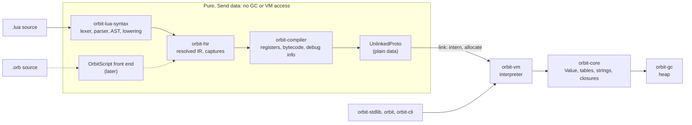

# Design documents

ADRs in [`docs/adr/`](../adr/) record decisions. The documents here describe how a piece of the system is built, within those decisions. Status **Proposed** means open for review; a design becomes **Accepted** when Tym approves it, and changes after that need his OK, like ADRs.

## First light: running a Lua subset end to end

The first goal after the Phase 0 foundations is "first light": a small but real part of Lua 5.5 running through our own pipeline, with output identical to the reference interpreter.

| Document | Covers |
|---|---|
| [first-light-subset.md](first-light-subset.md) | Which part of Lua 5.5 first light runs, and what's deliberately left out and where it goes later |
| [lua-front-end.md](lua-front-end.md) | `orbit-lua-syntax`: lexer, parser, AST, name resolution and lowering to HIR |
| [hir.md](hir.md) | `orbit-hir`: the language-neutral IR both front ends produce, and its shared analysis passes |
| [vm.md](vm.md) | `orbit-core` objects, the bytecode, `orbit-compiler`, the `orbit-vm` interpreter, the stdlib subset, and the CLI |



Everything in the box, before the link step, is plain `Send` data with no GC or VM access, which keeps a parallel front end open (see [lua-front-end.md](lua-front-end.md#parallel-and-async-front-end)).

Crate dependencies this implies: `orbit-hir` depends on nothing; `orbit-lua-syntax` depends on `orbit-hir` (the Phase 0 placeholder has it the other way round); `orbit-compiler` depends on `orbit-hir`; `orbit-vm` depends on `orbit-core` and `orbit-compiler`'s output types.

## Choices that need Tym's review

These designs stay inside the accepted ADRs. Five choices are worth a deliberate look, because they either settle something an ADR left open or differ from how PUC Lua does it:

1. **8-byte instructions as a Rust enum** ([vm.md](vm.md#bytecode-orbit-vmop)). ADR-4 left the instruction width open. Recording this in ADR-4 needs Tym's OK.
2. **Captured locals live in heap cells** ([vm.md](vm.md#locals-captures-and-cells)), instead of open upvalues that point into the stack and are closed at scope exit. Simpler and JIT-friendly, at one small allocation per captured binding.
3. **Native functions are registry ids** (`Value::Native(NativeId)`), which settles ADR-1's open question about light native functions for now.
4. **Error-message variable names come from compile-time debug info** ([vm.md](vm.md#error-messages)) rather than from analysing bytecode when an error happens.
5. **`os.clock` is monotonic wall time since start** at first light, because stable `std` can't read process CPU time. Stream D settles it for real.

Decided since: Tym asked (2026-09-30) for the designs to prepare for a future JIT. [vm.md](vm.md#jit-readiness) now covers it, ADR-1 is amended to pin `Value`'s layout, and instructions get an optional type-feedback side table.

## End-to-end demo

First light is done when these programs, in [`tests/first-light/`](../../tests/first-light/), produce output byte-identical to `lua5.5` (after the diff runner's usual normalisations), both normally and with the collector in stress mode:

| Program | Proves |
|---|---|
| `basics.lua` | Literals, integer/float arithmetic and formatting (`0.33333333333333331`, `9007199254740992.0`, `-0.0`), string escapes and long strings, coercions, comparisons, logic operators, the string and math subset |
| `closures.lua` | Locals and shadowing, upvalues shared between closures, fresh bindings per loop iteration, three-level captures, recursion, proper tail calls (200,000 deep), varargs and `select`, multiple results and truncation |
| `control.lua` | `if`/`elseif`, `while` with `break`, `repeat` whose condition sees body locals, integer, float, negative-step and near-`maxinteger` numeric `for`, nested `break`, generic `for` with a hand-written iterator, `ipairs` and `pairs` |
| `tables.lua` | Constructors with multi-value expansion, `#`, float-key normalisation, nested tables, method-call syntax on plain tables, table identity as keys, the table library subset, `next`, clearing a table while traversing it |
| `errors.lua` | `error` levels and non-string values, `pcall` (nested, and `pcall(pcall)`), `assert`, the reference's runtime error messages with variable names, catchable `stack overflow`, and an uncaught error ending the script with status 1 |
| `gc.lua` | Allocation-heavy code runs in bounded memory; `collectgarbage` |
| [`bench/fib.lua`](../../bench/fib.lua), [`bench/binary_trees.lua`](../../bench/binary_trees.lua) | Unmodified benchmark scripts run, giving the first timing against PUC Lua |

Every program was run against the reference `lua5.5` (5.5.1) when this design was written, so the subset is known to be valid Lua and the expected output is whatever the reference prints.

```sh
scripts/build-reference-lua.sh
cargo build --release -p orbit-cli
cargo testkit diff --corpus tests/first-light \
  --reference target/reference-lua/bin/lua5.5 --interp target/release/orbit
ORBIT_GC_STRESS=1 cargo testkit diff --corpus tests/first-light \
  --reference target/reference-lua/bin/lua5.5 --interp target/release/orbit
cargo testkit bench --interp lua5.5=target/reference-lua/bin/lua5.5 \
  --interp orbit=target/release/orbit fib.lua binary_trees.lua
```

The existing `tests/diff/` corpus keeps its ratchet: whichever of its files pass once first light lands go into `tests/diff/expected-orbit.txt`.
