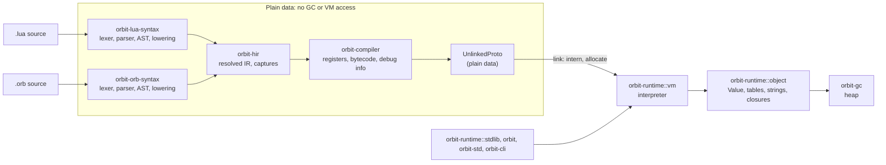

# Design documents

ADRs in [`docs/adr/`](../adr/) record the decisions that other work builds on. The documents here describe how each part of the system is built within those decisions, and why. Each starts with a status line: **Implemented** means the document describes the code as it is (where the two differ, the code is the authority); **Report** marks measurements or an analysis kept as the evidence for a decision.

## The pipeline

Everything before the link step is plain `Send` data with no GC or VM access, which keeps a parallel front end possible (see [lua-front-end.md](lua-front-end.md#plain-data-off-the-vm)).

Crate dependencies: `orbit-hir` and `orbit-bytecode` (the instruction set and `UnlinkedProto`) depend on nothing; both front ends depend on `orbit-hir`; `orbit-compiler` depends on `orbit-hir` and `orbit-bytecode`; `orbit-runtime` depends on `orbit-gc` and `orbit-bytecode`. The embedding API `orbit` sits on `orbit-runtime` and the compilers, and `orbit-std` on `orbit` (ADR-11).

## Front ends and the compiler

| Document | Covers |
|---|---|
| [lua-front-end.md](lua-front-end.md) | `orbit-lua-syntax`: lexer, parser, AST, name resolution and lowering to HIR, including `_ENV`, `global` declarations, named varargs, `goto`, `<close>` and attributes |
| [orbitscript-front-end.md](orbitscript-front-end.md) | `orbit-orb-syntax`: lexer, parser, AST and lowering to HIR, and the rules it follows where the language design is silent |
| [hir.md](hir.md) | `orbit-hir`: the language-neutral IR both front ends produce, and its shared analysis passes |
| [vm.md](vm.md) | The runtime objects, the bytecode, `orbit-compiler` and the interpreter loop |

## Lua 5.5 semantics and libraries

| Document | Covers |
|---|---|
| [vm-semantics.md](vm-semantics.md) | Metatables and metamethods, userdata, coroutines, to-be-closed variables, errors and `xpcall` (ADR-3) |
| [gc-semantics.md](gc-semantics.md) | Weak tables, ephemerons, `__gc` finalizers and `collectgarbage` |
| [stdlib-string-table-math.md](stdlib-string-table-math.md) | The `string`, `utf8`, `table` and `math` libraries: patterns, `format`, `pack`, resumable table functions, `sort`, random seeding, differential fuzzers |
| [chunks-io-os-cli.md](chunks-io-os-cli.md) | `load` and friends, `require` and `package`, binary chunks and their verifier, the `io` and `os` libraries, and the command line |
| [debug.md](debug.md) | The `debug` library, function names and levels, tracebacks, hooks, and the debugger's runtime side |
| [json.md](json.md) | The `std.json` module (`orbit-std` feature `json`): its API, how values map to JSON, and what it costs |
| [ffi.md](ffi.md) | The `ffi` library (`orbit-ffi`, ADR-9): binding C functions in shared libraries from Lua and OrbitScript |

## OrbitScript

| Document | Covers |
|---|---|
| [orbitscript-syntax/proposal.md](orbitscript-syntax/proposal.md) | The OrbitScript language: its syntax, how each construct maps onto Lua's runtime, and why it looks the way it does |
| [orbitscript-syntax/runtime-as.md](orbitscript-syntax/runtime-as.md) | `as` as a runtime cast, and `as bool` as truthiness |
| [orbitscript-syntax/indexing-report.md](orbitscript-syntax/indexing-report.md) | Report: 0-based against 1-based indexing, the analysis behind 1-based |

## Developer tooling (ADR-12)

| Document | Covers |
|---|---|
| [orbit-check/proposal.md](orbit-check/proposal.md) | `orbit-check`, the optional type checker: what it checks, the type language and the checking rules |
| [orbit-check/api.md](orbit-check/api.md) | The checker's library API, which the language server uses, and the diagnostic codes |
| [language-server.md](language-server.md) | `orbit-lsp`: the protocol layer over the checker, what it answers, positions, modules, editor setup |
| [formatter.md](formatter.md) | `orbit-fmt`: the style, how comments are kept, and how it checks its own output |

## Reports

| Document | Covers |
|---|---|
| [s0-spike.md](s0-spike.md) | The same micro-VM on our own arena, gc-arena and boa_gc, against PUC Lua 5.5: the evidence for ADR-2 and ADR-4 |
| [gc-spike-ephemerons.md](gc-spike-ephemerons.md) | How ephemerons are marked and finalizable objects found, measured before ADR-2's weak-tables amendment |
