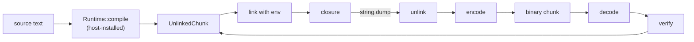

# Chunks, modules, IO, OS and the CLI

Status: Implemented. Crates: `orbit-runtime` (`load`, `require`, `string.dump`), `orbit-bytecode` (binary chunks and the verifier), `orbit-std` (`io`, `os`, files and the Lua searcher), `orbit-capi` (C modules), `orbit-cli`.

This covers the parts of Lua 5.5 that move code and data across the VM's edge: loading chunks (`load`, `loadfile`, `dofile`), modules (`require` and `package`), binary chunks (`string.dump` and loading its output), the `io` and `os` libraries, and the `orbit` command line. Everything here is observable behaviour taken from the manual, the reference `lua5.5` binary and the official suite (`literals.lua`, `constructs.lua`, `attrib.lua`, `files.lua`, `verybig.lua`, `main.lua`, `calls.lua`).

## Where the code lives

Everything that touches files, the environment or the process lives in `orbit-std`, built on the public `orbit` API (ADR-11); the runtime itself does no I/O.

| Piece | Crate | Notes |
|---|---|---|
| `load`, `chunk_id` | `orbit-runtime` (`stdlib/load.rs`, feature `load`) | Compiles through a hook, so the runtime stays free of the front ends |
| `loadfile`, `dofile`, `print`, `debug.debug` | `orbit-std` (`base.rs`) | |
| The compiler hooks | `orbit-runtime` (`Runtime::compile`, `Runtime::compile_orbitscript`) | Installed by the embedder; `orbit::Isolate` installs both front ends |
| Linking with an environment | `orbit-runtime` (`vm/link.rs`) | `Vm::load_with_env` |
| `require`, `package` | `orbit-runtime` (`stdlib/package.rs`, feature `package`): `require`, `loaded`, `preload`; `orbit-std` (`package.rs`): paths, `searchpath`, the Lua searcher; `orbit-capi` (`searchers.rs`): the C searchers and `loadlib` (ADR-8) | |
| Binary chunk format and verifier | `orbit-bytecode` (`format.rs`, `verify.rs`) | Plain data in, plain data out: no VM needed, so both are unit-testable and fuzzable |
| `string.dump` | `orbit-runtime` (`stdlib/dump.rs`, feature `dump`) | Rebuilds an `UnlinkedChunk` from a linked prototype, then encodes it |
| `io` | `orbit-std` (`io.rs`, feature `io`) | `FILE*` is an `orbit::Class` |
| `os` | `orbit-std` (`os.rs`, `time.rs`, `tz.rs`, feature `os`) | Local time and CPU time: ADR-7 |
| CLI | `orbit-cli` | Hand-written option parsing, no dependency |



## Loading chunks

`load(chunk [, chunkname [, mode [, env]]])` follows the manual. Details checked against `lua5.5`:

- A string chunk's default name is the string itself; a reader function's is `=(load)`. Messages show the name through `chunk_id` (Lua's `short_src`): `=name` shows `name` cut to 59 bytes, `@file` shows the file name or `...` plus its last 56 bytes, and anything else shows `[string "first line"]`, cut to 45 bytes plus `...` when it is longer or has more lines.
- `mode` is any string; text is allowed when it contains `t`, binary when it contains `b`. Otherwise `attempt to load a text chunk (mode is 'x')`.
- A given `env`, even an explicit nil, becomes the main function's first capture. Without one, the global table does.
- A reader is called until it returns nil or an empty string. Numbers count as strings. Anything else, or an error in the reader, makes `load` return nil and a message.
- Text and binary are told apart by the first byte: binary chunks start with `\27`, which text can't.

A reader is driven with `CallThen` continuations (ADR-3), so it never grows the Rust stack and can yield. Pieces read so far stay in the native's window, where the collector sees them.

`loadfile` and `dofile` read the file, drop a UTF-8 byte-order mark and a first line starting with `#` (keeping its line break, so line numbers stay right), and name the chunk `@path`. With no file name they read standard input as `=stdin`. The CLI reads scripts the same way, so byte-order marks and `#!` lines behave as in `lua`.

### The compiler hooks

The runtime must not depend on the front ends: a host that only runs precompiled chunks can leave the compiler out. So the VM holds optional function pointers:

```rust
pub type CompileFn = fn(src: &[u8], chunk_name: &str) -> Result<UnlinkedChunk, String>;
// Runtime::compile, Runtime::compile_orbitscript: Option<CompileFn>
```

An `orbit::Isolate` installs both: the Lua front end, and the OrbitScript front end, which has no Cargo feature because it is the runtime's own language. A source chunk named `@path.orb` (from `loadfile`, `dofile`, `require` or the CLI's script) uses OrbitScript; everything else, including `load` of a string, `-e`, standard input and interactive mode, is Lua. The default `package.path` has `.orb` entries after the `.lua` ones (`/usr/local/share/orbit/?.orb;/usr/local/share/orbit/?/init.orb;./?.orb;./?/init.orb`), and the Lua searcher loads whichever file it finds, the loader picking the compiler by the name. There is no separate OrbitScript path or searcher, so `#package.searchers` is 4 as in `lua`. A script that sets `package.path` (or `LUA_PATH`) itself decides whether `.orb` files are searched; a missing module's message lists the `.orb` files tried along with the others.

### Environments and captures

`Vm::load_with_env` gives the main function's first capture a fresh cell holding `env`, and every other capture a fresh cell holding nil. That is Lua's rule for `load` ("the first upvalue is set to env, other upvalues are initialized with nil"), and it is what a dumped nested function needs. A compiled main function captures only `_ENV`, so nothing changes for source chunks. The debug library lists upvalues in Lua's first-use order ([debug.md](debug.md#upvalues)), so `debug.getupvalue` on a reloaded dump names them as the reference does.

## Modules: `require` and `package`

Standard behaviour throughout, built on the registry table, so `package.loaded` and `package.preload` survive reassignment of the `package` fields, as in Lua.

- `package.path` comes from `LUA_PATH_5_5`, then `LUA_PATH`, then the default; `;;` expands to the default. `package.cpath` is the same with `LUA_CPATH*`. The defaults are the reference build's (plus the `.orb` entries), so scripts and the suite see the same strings. `-E` ignores the variables.
- `package.config` is `/\n;\n?\n!\n-\n`.
- `package.searchers`: preload, Lua files, C files, C root. With `orbit-capi` installed (the CLI's `c-modules` feature, on by default), the C searchers load C modules through the Lua C API shim (ADR-8). Without it they still search `cpath` like `lua`, so a missing module's error lists the same `no file '...'` lines, and `package.loadlib` returns `nil, msg, "absent"`, the manual's result for a build without dynamic libraries.
- `package.searchpath` as in the manual, including the `no file '...'` lines.
- `require` passes the loader the module name and the file name, stores its result (or `true`) in `package.loaded`, and returns both values.

## Binary chunks

Our own format, and a verifier that runs on load at a level the build and the environment choose. The suite round-trips files through `string.dump` and `load`, so the format carries everything, debug information included unless stripped.

### Format

```
"\27Orbit"            signature (the first byte is how load detects binary)
u8  format version    bumped whenever the encoding or the instruction set changes
u8  flags             bit 0: stripped
... the UnlinkedChunk: chunk name, then each prototype in order
u32 checksum          FNV-1a of every byte before it, little-endian
```

Integers are LEB128 varints (zig-zag for signed), floats their IEEE bits, strings a length and bytes. A string constant equal to one already written in the chunk is a back-reference to it, so a long string that several functions share is stored once (`calls.lua` checks this). Each `Op` is a tag byte and its operands. Encoding is little-endian and size-independent, so a chunk dumped on x86_64 loads on aarch64.

The checksum makes any single damaged byte fail to load (`bad binary format (malformed chunk: checksum mismatch)`), as lua5.5's header checks do for its header; `calls.lua` damages each header byte in turn.

`string.dump(f, strip)` rebuilds an `UnlinkedChunk` from the closure's linked `Proto` tree (code, constants with strings turned back into bytes, children, captures, debug info) and encodes it; `strip` drops lines, locals, capture names and operand origins. The dumped function becomes the main function, keeping its capture count. Natives can't be dumped: `unable to dump given function`.

A chunk from a different format version fails with `bad binary format (version mismatch)`, a truncated one with `truncated chunk`, and PUC Lua's own binary chunks with `not a binary chunk`. Those are the reference's phrases (the suite matches `truncated`); the reasons inside them are our own.

### The verifier

A binary chunk is untrusted input. The interpreter is safe Rust, so bad bytecode can't corrupt memory, but it can panic (an out-of-range constant, a jump past the end, a `ForLoop` whose state was never set up), which `panic = "abort"` turns into a crash, or quietly break invariants the VM relies on, such as the top being set before a `MULTI` operand reads it. The verifier rejects every chunk that could do either, with `bad binary format (...)`, before anything is linked.

It runs on plain `UnlinkedChunk` data, so it also checks the compiler: debug builds verify every compiled chunk, and tests run it over everything the compiler produces from the suite and the corpora, which keeps the two in agreement.

It checks two layers:

1. **Structure.** Every operand in range: registers below `nregs`, constants below the pool size and of the right kind (string keys for `GetField`, `SetField`, `GetGlobal`, `SetGlobal` and `SelfCall`), cache, cell, capture and child indexes in range, jump targets inside the code. Every prototype reachable exactly once from the main function, children after parents. `TailCall` followed by `Return { count: MULTI }`. The last instruction can't fall through. Debug tables sorted and in range.
2. **Data flow.** A forward pass over the control-flow graph tracking, per register, what the VM assumes: numeric-`for` state set by `ForPrep` and not overwritten before `ForLoop`, generic-`for` state set before `GenericCall`/`GenericLoop`, a table in `SetList`'s target, and the top defined by an open call or `Vararg` before any `MULTI` operand reads it. It also tracks the set of registers marked to be closed: every path into an instruction must carry the same set, a `Tbc` must be above every open one (`Close` closes newest first, down to its register), nothing may write a marked register, and no `Return`, `Return0`, `Return1` or `TailCall` may run with one still open, or a chunk could leave a stale entry on the VM's to-be-closed list after its frame is gone.

**Why both layers.** The alternative was the structural layer alone, with the VM's few assumptions reachable from bad bytecode turned into runtime errors. A mutation fuzzer (`crates/orbit/examples/fuzz_chunks.rs`) that damages compiled chunks (instruction bytes; swapped, duplicated and deleted instructions; register, cell and cache counts; captures; constants) and runs each mutant in a debug-build child process decided it, cloud x86_64:

| 20,000 mutants (4 seeds) | Rejected | Ran | VM panics | Panic sites |
|---|---|---|---|---|
| No verifier | 0 | 15,096 | 4,807 | 26 |
| Layer 1 (structure) | 11,974 | 7,883 | 98 | 6 |
| Layers 1 + 2 (full) | 12,572 | 7,383 | **0** | 0 |

The six sites structure alone leaves are all things only data flow can see: the top underflowing in `Call`, `Return` and `SetList` with a `MULTI` operand, `ForLoop` on state `ForPrep` didn't set up, and `SetList` on a register that isn't a table. Handling them in the VM would have put checks on the `MULTI` call and return paths, and the next VM invariant would need another such change. The full verifier keeps the VM's assumptions written down in one place. It costs 4.3 KB of code and about 1.7 ms per 86 KB of bytecode, on binary loads only; decoding takes 0.6 ms and compiling the same sources 19.9 ms, so a verified binary load is still about 8 times faster than compiling. Mutants may hang, which bad bytecode is allowed to do (an infinite loop is a legal program).

**Levels.**

- **Cargo features.** `orbit-runtime` (and `orbit`, which forwards them) has `verify` for layer 1 and `verify-flow` for both layers, on by default. Layer 2 lives in `orbit_bytecode::verify::flow` behind `orbit-bytecode`'s own `verify-flow` feature, so a build without it doesn't carry the code. Release sizes of the `orbit` CLI when this was built (cloud x86_64): no verifier 1,036,504 bytes, layer 1 1,041,928, both layers 1,047,160.
- **Environment.** `ORBIT_VERIFY=full`, `structure` or `none` lowers the level at run time (ignored with `-E`); anything else keeps the most the build has. A host can set it per isolate (`Isolate::set_binary_checks`). The level lives in the runtime, not the registry, so scripts can't change it.

Below both layers, a malformed chunk can make the VM panic (and abort the process), but never corrupt memory. Every new instruction needs an encode, a decode and a verify arm; the matches are exhaustive, so adding an `Op` without them doesn't compile.

## `io`

File handles are userdata of the `FILE*` class (`__index` methods, `__gc`, `__close`, `__name`, `__tostring` printing `file (0x...)` or `file (closed)`).

- A handle is an enum: standard streams (writes to standard output go through the same buffer as `print`, so output order is kept), a `std::fs::File` with our own read and write buffers, a child process from `io.popen`, and closed.
- `io.open` modes are checked as the manual says (`r`, `w`, `a`, optional `+`, optional `b`); errors return `nil, "name: reason", errno`, where the reason is the C library's text (`No such file or directory`) and the number is the OS error code.
- `read` and `lines` formats: `n`, `l`, `L`, `a`, and counts. Reading a number follows the manual's numeral grammar, consuming at most 200 characters, as `files.lua` checks.
- `setvbuf` (`no`, `full`, `line`), `seek` (`set`, `cur`, `end`), `flush`, `io.type`, `io.input`/`io.output` defaults, `io.lines` closing its file at the end, `io.tmpfile` (removed when closed or collected).
- `io.popen(cmd, mode)` runs `/bin/sh -c cmd` through `std::process` (`cmd /C` on Windows); `close` returns `true|nil, "exit"|"signal", code` like `os.execute`.

## `os`

`os.getenv`, `remove`, `rename`, `tmpname`, `execute`, `exit` and `difftime` map directly onto `std`. `os.tmpname` creates the file (as the reference does, so the name can't be raced) under the temporary directory. `os.execute()` with no command returns true; with one, `true|nil, "exit"|"signal", code`. `os.exit(code, close)` flushes output and exits with `true` as success and `false` as failure; with `close`, it closes the state first: the main thread's variables still to close (newest first; the first handler gets no error, later ones the latest handler error, and the last error is dropped), then the finalizers. `os.setlocale` knows only the `C` locale: `"C"` and `""` return `"C"`, other names return nil.

`os.time`, `os.date` and `os.clock` are where stable `std` falls short (ADR-7):

- **Local time.** `os.date` without `!`, `os.date("*t")` and `os.time{...}` work in the local time zone, which `std` can't read. We read it ourselves, with no dependency: the `TZ` variable's POSIX rules and the TZif files under `/usr/share/zoneinfo`. Windows has no such source and uses UTC.
- **CPU time.** `os.clock` is wall time since the VM started, because stable `std` has no process CPU-time API and the dependencies that provide one weren't worth their cost. The suite only checks that `os.clock` is a number that doesn't go backwards.

Both gaps (wall-time `os.clock`, UTC on Windows) are in `tests/lua-5.5/DEVIATIONS.md`. `strftime` formatting itself is our own code: every conversion C99 and POSIX `strftime` define, with `invalid conversion specifier` for the rest, as `files.lua` checks.

## The command line

`orbit` follows `lua`'s documented options so `main.lua` passes against it: `-e stat`, `-l mod` and `-l g=mod`, `-i`, `-v`, `-E`, `-W`, `--`, `-` for standard input, and the script with its arguments. `LUA_INIT_5_5` or `LUA_INIT` run first (`@file` runs a file), unless `-E`. The `arg` table puts the script at 0, the interpreter and options at negative indexes, and the arguments from 1. With no script, `orbit` runs interactively when standard input is a terminal and reads standard input as a script otherwise, as `lua` does. OrbitScript's own options: `--no-ffi` ([ffi.md](ffi.md)), `--lock-cpath` (ADR-8), and the debugger's `--debug-listen`, `--no-debug-signal`, `--debug-server` and `--debug-attach` ([debug.md](debug.md)).

Interactive mode prints `_PROMPT` and `_PROMPT2` (defaults `> ` and `>> `), tries a line as `return line` first so expressions print their values, and keeps reading while the error says the chunk ended early (`<eof>`). On a terminal, lines are edited with the CLI's own line editor (`crates/orbit-cli/src/editor.rs`): Emacs keys, history, Ctrl-R search and Tab completion of Lua names. It puts the terminal in character-at-a-time mode with `stty`, so it needs no `unsafe` and no dependency; without a terminal it reads plain lines. Interactive mode and the editor are `orbit-cli` features (`repl` and `line-editing`, both default) so a distribution can leave them out: about 57 KiB together on x86_64 Linux, 49.5 KiB of it the editor. Exit status is 0 on success and 1 after an uncaught error, with `lua`'s message format (`orbit: msg` plus a traceback on standard error).

The compiler stages (`--ast`, `--hir` and the `-l` listing) live in a separate `orbitc` binary, after `luac`, which also writes binary chunks (`-o`, `-s`, `-p`); keeping them out of `orbit` keeps the printers and the disassembler out of the interpreter. Argument parsing is hand-written, since `lua`'s rules (options glued to their values, `-` as a script name, stopping at the first non-option) are short and specific, and a parser crate would be the CLI's only dependency for it.

## Deliberate differences

Each is in `tests/lua-5.5/DEVIATIONS.md`:

- Binary chunks are our own format: PUC's don't load in `orbit` and ours don't load in `lua`.
- `lua5.5` appends a traceback to the message `load` returns when a reader function raises an error. We return the message alone, since the traceback describes the reader's stack rather than the chunk.
- `os.clock` is wall time, and local time on Windows is UTC.
