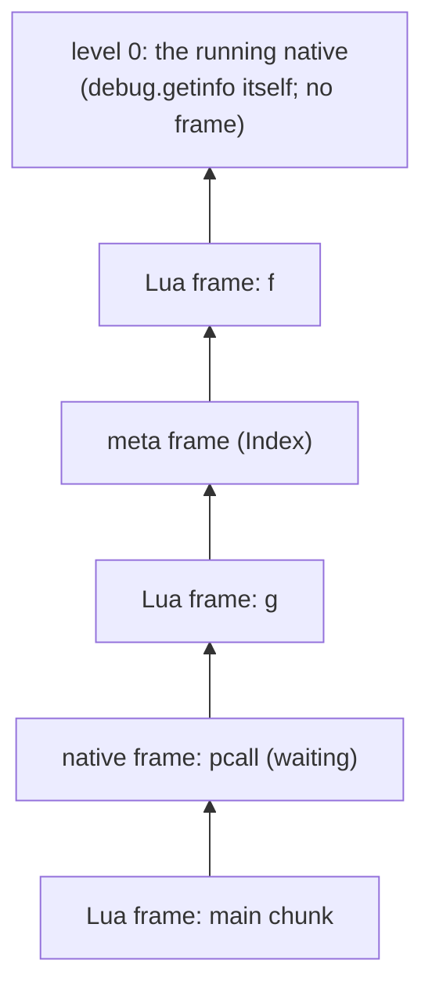

# Debug library, tracebacks and hooks

Status: Proposed. Milestones C5d (debug core) and C6 (hooks, tracebacks, error-message parity) of the Lua 5.5 compatibility plan. Crates: `orbit-vm` (introspection, hooks), `orbit-stdlib` (the `debug` library, behind its own Cargo feature), `orbit-compiler` and `orbit-bytecode` (a few debug-info fields), `orbit-cli` (the uncaught-error traceback).

This builds on the [VM design](vm.md) and [VM semantics](vm-semantics.md). Everything here was worked out from the manual, the reference `lua5.5` binary and the official suite (`db.lua`, `calls.lua`, `errors.lua`, `locals.lua`, `coroutine.lua`), never from PUC Lua's sources. It keeps the fast paths as they are (hooks cost nothing until one is set). Hooks are the one place Lua code runs in a nested call on the Rust stack: Lua hooks can't yield in the reference either (see [Hook calls](#hook-calls)).

## Summary

| Area | Design |
|---|---|
| Levels | One walk over the frame stack turns frames into *activations*: Lua frames and native frames count, meta and hook frames annotate the activation above them. Level 0 is the running native |
| Function names | From the caller's call instruction, using the operand origins the compiler already records for error messages. Fallback: search `package.loaded` for the function, as the reference does |
| `getinfo` | Every option letter (`S l u n r t L f`), read from the frame and the prototype's debug info |
| Locals | `getlocal`/`setlocal` from the compiler's local table (registers or cells), plus `(temporary)`, `(C temporary)` and `(vararg)` slots |
| Upvalues | `getupvalue`/`setupvalue` read and write capture cells; `upvaluejoin` swaps a closure's cell. Debug-visible upvalue order comes from the debug info, so `_ENV` can stay capture 0 inside the VM |
| `CapSelf` | A debug write that breaks the "self capture holds this closure" assumption swaps that closure's code for a copy where `CapSelf` reads the capture. No cost on the fast path |
| `upvalueid` | Needs a value type for "light userdata". Proposed as an ADR-1 amendment (tag 10); see [below](#upvalueid-and-light-userdata) |
| Tracebacks | `debug.traceback` and the CLI's uncaught-error traceback share one formatter, in the reference's exact shape (`in local 'f'`, `in metamethod 'index'`, `(...tail calls...)`, the 10 + 11 level elision) |
| Hooks | Per stack (so per coroutine). The dispatch loop is compiled twice from one generic function: a plain loop with no hook code, and a hooked loop that checks count and line before each instruction. Switching happens only where a hook can have been set: when the loop (re)starts on a frame and after a native call. Hook functions run as nested calls above a hook marker frame; like the reference's Lua hooks, they can't yield |

## Activations and levels

The frame stack ([VM design](vm.md#state)) holds Lua frames, native continuation frames (a native waiting on `CallThen`), and meta frames below metamethod calls. The debug library sees *activations*, numbered from the top:



- **Level 0** is the native that is running (`getinfo`, `getlocal`, `traceback`). Natives that don't call back into Lua have no frame, so `NativeCtx` supplies level 0 from its own id and window. In hooked mode natives do get a frame (below); the walk recognises the running native's frame by its position and treats it as level 0 either way.
- **Lua frames** and **native continuation frames** are one level each.
- **Meta frames** and **hook frames** are not levels. They name the activation above them: `metamethod 'index'`, or `hook '?'`.
- A frame entered by a **tail call** is marked (`Frame::tail`, one bool in existing padding), so `istailcall` is true and the frame has no name.

`error(msg, level)` already counts levels this way (`ops::where_`); it moves onto the same walk.

A native that raises an error has no frame, but the reference's tracebacks show it (`[C]: in global 'error'`). So when a native returns `Err`, the cold error path pushes a **native frame** for it (kind `NativeCall { id }`, no continuation) before unwinding starts. Tracebacks and, once thread 2's `xpcall` lands, message handlers see the stack exactly as it was. Unwinding pops it like any frame. The successful path is unchanged.

## Function names

The reference names a function by how it was called. The compiler already records, for every `Call`, where operand 0 (the function) came from: `Local`, `Global`, `Field`, `Method`, `Upvalue` or `Constant` ([error messages](vm.md#error-messages)). So the name of an activation is:

| Caller (the activation below) | `name`, `namewhat` |
|---|---|
| A Lua frame at a `Call` | the origin of operand 0: `'f'`, `local` / `global` / `field` / `method` / `upvalue` / `constant` |
| A Lua frame at a `GenericCall` | `'for iterator'`, `for iterator` |
| A meta frame | the event without underscores (`'index'`), `metamethod` |
| A hook frame | `'?'`, `hook` |
| A native, a tail call, or the bottom | none; tracebacks then search `package.loaded` (below) |

Tracebacks print a named activation as `in local 'f'`, `in method 'm'`, `in metamethod 'index'` and so on; the main chunk as `in main chunk`; an unnamed Lua function as `in function <file:line>`; an unnamed native as `in ?`. Before giving up on a name, the reference looks the function up in `package.loaded`, which gives `in function 'string.rep'` (and `_G.` is dropped: `in function 'print'`). OrbitScript does the same through the registry's `_LOADED` table (thread 4's `require` owns it); without `package`, it searches the globals.

`bad argument #1 to 'r'` already uses the call-site name (`NativeCtx::call_name`); it moves onto the same function so the two never disagree.

Finalizers (thread 5) are called by the collector rather than an instruction. They get the name `'__gc'` and `metamethod`, as `db.lua` expects; the GC thread's finalizer frames carry that.

## `getinfo`

| Option | Fields | Source |
|---|---|---|
| `S` | `source`, `short_src`, `what` (`Lua`, `C`, `main`), `linedefined`, `lastlinedefined` | The prototype. `source` is the chunk name as given to `load` (`@file`, `=stdin`, or the text); `short_src` is `chunk_id(source)`. Natives: `=[C]`, `[C]`, `C`, -1, -1 |
| `l` | `currentline` | Line table at the frame's pc; -1 for natives and stripped code |
| `u` | `nups`, `nparams`, `isvararg` | Prototype counts; natives are vararg with no parameters, and native closures (thread 2) report their upvalue count |
| `n` | `name`, `namewhat` | [Function names](#function-names) |
| `r` | `ftransfer`, `ntransfer` | Set by call and return hooks: the first local index and count of the values transferred |
| `t` | `istailcall`, `extraargs` | `Frame::tail`; `extraargs` is how many callables a `__call` chain inserted (`Frame::extra`, one byte in padding) |
| `L` | `activelines` | Every line in the line table, minus the line of instructions the compiler marks as function-entry bookkeeping |
| `f` | `func` | The frame's closure or native |

An invalid option raises `bad argument #2 to 'getinfo' (invalid option)` (`(invalid option '>')` for `>`, which Lua code can never pass). Out-of-range levels return `nil`.

Two prototype fields are new: `Proto::last_line` (already in `UnlinkedProto`) and `Proto::source`. `UnlinkedChunk` gains `source: Box<[u8]>`, which `load` (thread 4) fills with the name it was given; `name` stays the short form for messages. Stripped binary chunks (thread 4's `string.dump(f, true)`) have an empty `DebugInfo` and `source = "=?"`; every function here handles that (`currentline` -1, `?` as `short_src`, `(temporary)` names, `(no name)` upvalues), as `db.lua` checks.

## Locals

`getlocal(level, n)` and `setlocal(level, n, v)`:

- **Named locals** come from `DebugInfo::locals`, filtered to those live at the frame's pc, in declaration order, parameters first. A `LocalSlot::Reg` is read from the frame's registers; a `LocalSlot::Cell` through the frame's cell slot, so a captured local reads and writes the same cell its closures see ([cells](vm.md#locals-captures-and-cells)). The compiler starts a captured local's range after its `CellNew`, so the slot never holds the placeholder cell while the local is visible.
- **Temporaries.** Past the named locals, `n` reaches registers in use: up to the callee's function slot when the frame is calling, else the frame's register count. They are named `(temporary)`, as the reference names them. For a native frame the slots are its window, named `(C temporary)`.
- **Varargs.** Negative `n` reaches the extra arguments, which sit just below the frame's base: `(vararg)`. Named varargs (`...t`, thread 1) are an ordinary local called `(vararg table)` when unnamed.
- `getlocal(f, n)` with a function returns parameter names only (`nparams` of them).

## Upvalues

- `getupvalue(f, n)` / `setupvalue(f, n, v)`: read or write the cell of capture `n`. Natives have none; native closures (thread 2) have upvalues named `""`. Stripped functions name them `(no name)`.
- **Order.** The reference numbers upvalues by first use in the function body (`calls.lua:415`, `db.lua`'s `getupvalues`), while the compiler always puts `_ENV` in capture 0 so `GetGlobal` can read `U[0]` directly. Thread 1 decides the compiler side; this design proposes keeping capture 0 and adding the debug order as data: `DebugInfo::upvalues` lists, in Lua's order, the capture index and name of each upvalue. The debug library maps through it; the VM never looks at it. Zero runtime cost, and binary chunks (thread 4) keep the Lua order on disk.
- `upvaluejoin(f1, n1, f2, n2)` replaces capture `n1` of `f1` with `f2`'s cell. `upvalueid(f, n)` returns an identity for the cell.

### `CapSelf`

`CapSelf` ([VM design](vm.md#calls-and-returns-stackless-adr-3)) loads the running closure instead of reading a capture, which is valid because the compiler only emits it for a `local function` that is never assigned. The debug library is the only thing that can break that: `setupvalue` or `setlocal` writing that cell, or `upvaluejoin` replacing the capture. The fix costs nothing on the fast path:

- The compiler records the self capture's index in `UnlinkedProto::self_capture` (it already computes it).
- Before a debug write to a cell, the library checks whether the cell's current value is a closure whose self capture is that cell. If so, that closure's `code` is swapped for a copy in which every `CapSelf { dst }` is `CapGet { dst, cap }`. `upvaluejoin` does the same for the closure it changes.

Only one closure can be affected (the cell holds exactly that closure until the write), and other closures of the same prototype keep the fast code. A frame already running the closure keeps the old code until it next reloads, which can only matter if a function rewrites its own self-reference through `debug` and then recurses in the same activation; that edge is documented, not handled.

### `upvalueid` and light userdata

`upvalueid` must return a value that is equal for the same cell and different otherwise, and `errors.lua:264` expects its type to print as `light userdata` (`setuservalue` on it fails with `userdata expected, got light userdata`). OrbitScript has no light userdata. Options:

| Option | Behaviour | Cost |
|---|---|---|
| A. `Value::LightUserData(Opaque)` at tag 10 (proposed) | Exact: `type` is `userdata`, messages say `light userdata`, equality by identity, usable as a table key. Also gives embedders an allocation-free opaque token | ADR-1 amendment (a new tag; layout and size unchanged). One more arm in `pack`/`unpack`/`type_name`/display/hashing; no hot-path match changes |
| B. A full userdata per cell, cached | Equal for the same cell only while the cache holds it; needs a weak cache (thread 5) or leaks; `setuservalue` succeeds where the reference fails | No ADR change; a recorded deviation |
| C. Return the cell's index as an integer | Equality works; `type` is `number` | Deviation, and easy to misuse |

The proposed resolution is A, in its own small PR so it can be declined independently. Until Tym decides, `upvalueid` uses B's shape without a cache (equal only within one call), and `closure.lua`/`goto.lua` stay red on those lines.

## Metatables and user values

- `debug.getmetatable(v)` / `debug.setmetatable(v, mt)` bypass `__metatable`. For tables and userdata they set the object's own metatable; for every other type they set the per-type metatable in `Runtime::metas` (thread 2's `type_meta`). `setmetatable` returns its first argument.
- `debug.getuservalue(u, n)` / `setuservalue(u, v, n)`: OrbitScript userdata have at most one user value (`UserData::user_value`). The host chooses at creation: `new_userdata` gives one, as `lua_newuserdata` does, and `io` handles get none, as the reference's do (`db.lua` checks `setuservalue(io.stdin, 10)` fails). That needs one flag on `UserData`. Asking for a value the userdata doesn't have returns `nil` (and `setuservalue` returns `nil`), as the reference does; a non-userdata is a type error for `setuservalue`.
- `debug.getregistry()` returns `Runtime::registry`, a new table created with the VM (integer key 2 holds the globals table, as in the reference; thread 4 keeps `_LOADED` there). `_HOOKKEY` exists in it with weak keys because `db.lua` checks for it; hooks themselves live on the stack.

## Tracebacks

`debug.traceback([thread,] [msg [, level]])` and the CLI's uncaught-error traceback use one formatter:

```text
msg
stack traceback:
	[C]: in global 'error'
	t.lua:1: in upvalue 'f'
	t.lua:5: in metamethod 'index'
	t.lua:9: in function <t.lua:7>
	(...tail calls...)
	t.lua:12: in main chunk
	[C]: in ?
```

- Each activation is `short_src:currentline:` (or `[C]:` for natives), then `in` and its description ([names](#function-names)). An activation entered by a tail call is followed by `(...tail calls...)`.
- More than 22 levels print the first 10, `...\t(skipping N levels)`, and the last 11.
- A non-string `msg` that isn't `nil` is returned unchanged. The default level is 1 (the caller), or 0 for another coroutine.
- The bottom `[C]: in ?` stands for the host's call into the VM (the reference's C `main`); it is printed once per boundary frame when thread 2's boundaries land.
- The CLI prints `lua: msg` plus the traceback, as now, but the traceback is built before any frame is popped (`LuaError::traceback` is filled by the unwinder at the throw site, from the same formatter), so it shows the native that raised and every frame above the catch point.

## Hooks

### State

Each stack (each coroutine, once thread 2's `Thread` lands) has a hook:

```rust
pub(crate) struct Hook {
    func: Value,          // nil when off (traced with the stack)
    mask: u8,             // call, return, line, count bits, plus the interrupt bit
    base_count: i64,      // count interval as given (count events only when positive)
    count: u32,           // instructions left until the next count event
    active: bool,         // a hook is running: no hooks fire (the reference's rule)
    old_pc: u32, old_depth: u32,         // last instruction the line check saw
    call_pending: Option<bool>,          // a frame was just entered (true: a tail call)
    transfer: Option<(usize, u32, u32)>, // the frame and values a call or return hook reports
}
```

`debug.sethook([thread,] f, mask [, count])` sets it, `debug.gethook([thread])` reads it back (`f, mask, count`). The loops check `mask != 0` on the running stack. A new coroutine inherits its creator's mask and count but not the function, as in the reference: `debug.gethook(co)` returns `nil, mask, count` and no events fire until a function is set.

### Two loops from one source

The dispatch loop becomes `fn run_loop<const HOOKED: bool>(&mut self, stop)`. With `HOOKED = false` it compiles to today's loop plus two flag checks, each on a path that is already slow:

1. at `'reload`, where every non-inline call, return, metamethod and error resumes the loop;
2. after a native call returns in place (the `call!` macro's general branch; fast-path natives such as `math.sqrt` can't set hooks).

A hook can only be set by running a native (`debug.sethook`), or by a resume switching to a stack with hooks, which goes through `'reload`, so those two places see every change. When the flag disagrees with the loop it is in, the loop saves its pc and returns `Switch`, and `run` re-enters the other instantiation. No check at backward jumps or Lua-to-Lua calls is needed, so the fast paths keep their exact instruction sequences. The one exception is the [interrupt](#interrupts) check at backward jumps. The hooked loop is compiled only with the `hooks` feature of `orbit-vm` (enabled by `orbit-stdlib/debug`); without it, `run_loop::<true>` doesn't exist and the flag checks compile away.

`HOOKED = true` adds, before each instruction, a call to a cold `hook_point(pc, op)` when any of count, line, or (for return instructions) return events are on. It decides, in the reference's order:

1. **count**: decrement; at zero, reset and fire `"count"`.
2. **line**: fire `"line", n` when the instruction starts a new line (its line differs from the last checked instruction's in this frame), when it is the function's first instruction, or when control jumped backwards (`pc <= old_pc`, so `for i=1,4 do a=1 end` reports line 1 four times). Returning from a call doesn't count as a new line: when the frame depth differs from the one `old_pc` belongs to, `old_pc` is taken as the call instruction.
3. **return**: before `Return`, `Return0`, `Return1`, fire `"return"` with `ftransfer`/`ntransfer` covering the returned registers.

Call events fire when a frame is entered (`"call"`, or `"tail call"` for `TailCall`), with `ftransfer = 1` and `ntransfer` the number of parameters (for a native, the number of arguments). Observed from `lua5.5` and matched: a count event makes the same instruction report its line again; the line of a `Closure` instruction is the function's last line; the `for` instruction of a loop reports the `for` line.

### Hook calls

A hook runs as an ordinary nested call. The cold path pushes a **hook marker frame** (`FrameKind::Hook`) above everything live (the top frame's registers and any open results), calls the hook function with `(event, line)` above it, and pops the marker when the call returns. The marker names the hook's activation (`hook '?'`) for `getinfo` and tracebacks, and ends the nested call the way a boundary frame does. While a hook runs, `active` is set, so nothing inside fires hooks; errors unwind through the marker and clear it.

This replaces the stackless hook frame this document first proposed. The reference raises `attempt to yield across a C-call boundary` when a Lua hook function yields, so a nested call loses nothing observable, and it avoids re-running the hooked instruction with a record of which checks already fired. `coroutine.lua:622` yields from a hook set through the C testing library (`T.sethook`), which the suite skips without the C API.

Natives called while call or return hooks are on get a `NativeCall` frame, so the hook sees them at level 2 (`db.lua` records `assert` and `debug.getlocal` through `getinfo(2, "f")`). The call hook runs first (hook frame action: "then run the native"), the native runs, and the return hook runs before its results are placed (`ftransfer`/`ntransfer` point at its results in its window). Without call and return hooks, natives run exactly as now, frameless.

### Interrupts

`Vm::interrupt_handle()` returns an `Interrupt` (`Clone + Send + Sync`) whose `request()` sets an atomic flag, for a CLI's Ctrl-C handler or a watchdog thread. The plain loop checks the flag on backward jumps only (a relaxed load on a taken back-edge); when set, it saves its pc, sets the interrupt bit in the stack's hook mask and switches to the hooked loop, whose next hook point raises `interrupted!`. The hooked loop checks the flag at every hook point outside a running hook. The error is an ordinary catchable error, positioned at the interrupted function's caller, as the reference's Ctrl-C error is. A running native finishes first (the reference doesn't interrupt `string.find` either). Without the `hooks` feature, requests are ignored.

### Deviations

- **Count events** fire after the same number of *our* instructions, not the reference's. Bytecode is our own design (ADR-4), so a count hook fires at different points in the source.
- **`ftransfer` of a native's return** counts from the native's own window. For `debug.sethook`'s own return event the reference reports `ftransfer = 4`, a C stack detail; we report the first result's index.

### Cost

The plain loop's extra work is the two flag loads above and the interrupt check on taken backward jumps. The PR that adds hooks reports the five-benchmark table against `lua5.5` before and after on the cloud container, plus `orbit` binary size with and without the `debug` feature (two loop copies).

## Debugger engine

ADR-12 adds a debugger engine (`orbit-runtime` feature `debugger`, `src/vm/debugger.rs`) beside the hooks: breakpoints by source and line, step in, over and out, pause and stops on errors, reported to a host's `DebugEvents`. It shares the hooked loop but not the hook slot, so a script's `debug.sethook` keeps working while a debugger is attached.

- **Hooked only where it can stop.** `Vm::hooked_here(code, closure, depth)` decides which loop runs: a hook is set, the function has a breakpoint, or a step could stop at this depth. The loops ask at `'reload`, after a native returns, and, while a breakpoint or step is set (`Debugger::watch`), whenever a call or return enters other code. A recursive call or return keeps its loop, so a step keeps its own function hooked at every depth.
- **Breakpoints resolve lazily.** `set_breakpoints` scans the source's live prototypes (`Heap::for_each`) to move each line to the next one with code, and bumps a generation. Each `ProtoCode` keeps the generation it was last checked against and whether it has a breakpoint (`debug_mark`), so a function is checked once per change, when next entered. Chunks linked later resolve pending breakpoints and report them (`breakpoints_resolved`). No code is patched (D6).
- **Line events** follow the hook rules (a new line, a backward jump, a function's first instruction), with the engine's own last-seen instruction, reset when the hooked loop reloads. Built-ins and stripped functions have none: stepping in through `table.sort` stops in the comparator.
- **Stops** run the host's callback from a native under a hook marker frame, as a hook call is made, with Lua hooks and further stops off. The callback sees the stopped program through the debug interface (`Paused::level(0)` is the stopped function) and answers how to go on.
- **Pause** rides on the interrupt flag: the hooked loop's interrupt check takes a pending pause instead of raising `interrupted!` and stops at the next script instruction.
- **Errors** stop in `unwind` before anything unwinds, once per error, saying whether a `pcall`, `xpcall` or `coroutine.resume` catches it.

Cost, measured on the cloud x86_64 container without PGO: the feature on and nothing attached changes instruction counts by -1.4% to +1.0% across the benchmarks (callgrind, quick inputs); attached, with a breakpoint in a function the benchmark never calls, run times are 0.96x to 1.06x (`tests/debugger.rs`, `overhead_outside_breakpoints`).

### Embedding API

`orbit::debugger` (feature `debugger` of `orbit`, over either backend) is what hosts and the DAP server use:

- **On `Isolate`**: `set_debug_events(Option<Box<dyn DebugEvents>>)`, `set_breakpoints(source, lines)`, `set_error_break(ErrorBreak)` and `pause_handle()`, whose `PauseHandle` is `Send` and works from any thread. ADR-12's `resume` and `step` are the `Resume` that `DebugEvents::stopped` returns.
- **`Paused`** is the stopped program as the callback sees it, with levels from the function that stopped (0) outwards: `frame(level)` and `frames()` (`debug.getinfo`'s `FrameInfo`), `locals(level)` and `upvalues(level)` as `Variable`s holding pinned values, `set_local(level, index, value)`, `set_breakpoints` and `set_error_break` (requests that arrive while stopped), `globals()`, `error()` for an error stop, `scope(f)` for reading values or calling script code, and `stack()` for the rest of the stack API (whose level 0 is the reporting native). Locals named in parentheses (the compilers' hidden ones) are left out.
- **`Config::debugger(Debugger::Disabled)`** refuses a debugger for the isolate's whole life (`Vm::disable_debugger`, so the engine enforces it however it is reached): `set_debug_events` fails, breakpoints never resolve and pausing does nothing (D5).
- **Shared layout**: `IsolateAbi::set_debug_events` and `pause_handle`, `ControlAbi::set_breakpoints` and `set_error_break` (on `Control`, so they work both from the host and from inside a stop), the `DebugEventsAbi` callback trait a program implements, `PauseAbi`, and `ConfigAbi::debugger`. A stop hands the program the reporting native's window, with the error in slot 1, so `Paused` is the same code on both backends. A `liborbit` built without its `debugger` feature refuses `set_debug_events`.

## Error-message parity

Messages already match the reference for most runtime errors ([VM design](vm.md#error-messages)). What remains for `errors.lua` and `calls.lua` is finished last, as each case unblocks: `global 'x'` versus `field 'x'` for `_ENV` accesses through a local `_ENV`, upvalue and constant names in arithmetic and concatenation, `bad extra argument` for `__call` chains (`extraargs`), `for iterator` naming, and the `(...tail calls...)` lines. Where matching would need bytecode analysis after the fact, the compiler records one more origin instead, as the VM design intends.

## Cargo features

- `orbit-stdlib/debug` (default on): the `debug` table. Enables `orbit-vm/hooks`.
- `orbit-runtime/debugger`: the debugger engine. Enables `hooks`. Off by default; `orbit`, `orbit-cli` and `orbit-lib` forward it as `debugger`. In `orbit` it also adds the `orbit::debugger` API.
- `orbit-vm/hooks`: hook state, the hooked loop, hook frames. Introspection (`getinfo`, locals, upvalues, tracebacks) is always compiled: tracebacks and `error` levels need it anyway.

## Interfaces in other threads' areas

All small; each goes through the plan thread before it lands.

| Change | Owner | Why |
|---|---|---|
| `Frame::tail`, `Frame::extra` (padding bytes); `FrameKind::NativeCall`, `FrameKind::Hook` | thread 2 (frames) | Tail-call marks, `extraargs`, natives in tracebacks and hooks |
| `UserData` flag for "has a user value" | thread 2 (userdata), thread 4 (`io` handles) | `getuservalue`/`setuservalue` on `io.stdin` |
| `Runtime::registry` | thread 4 (`_LOADED`) | `debug.getregistry`, function names from `package.loaded` |
| `UnlinkedChunk::source`, `Proto::source`, `Proto::last_line` | thread 4 (`load`, binary chunks) | `getinfo` `source`, `lastlinedefined` |
| `DebugInfo::upvalues` (Lua order), `UnlinkedProto::self_capture` | thread 1 (compiler) | Upvalue numbering, `CapSelf` safety |
| `Value::LightUserData` (tag 10) | ADR-1, Tym | `upvalueid` |

## Implementation order

1. This document (PR, Proposed).
2. Debug core: activations, `getinfo`, locals, upvalues, metatables, user values, registry, `traceback`, native frames on error, the CLI traceback. Exit: the `db.lua` parts that don't need hooks, as `tests/diff/debug_*.lua` programs diffed against `lua5.5`.
3. Light userdata (ADR-1 amendment, separate PR).
4. Hooks, with the benchmark table. Exit: `db.lua`'s hook sections as diff programs.
5. Error-message parity. Exit: `db.lua`, `calls.lua`, `errors.lua`, and with thread 2 `coroutine.lua` and `locals.lua`, once the front-end and library gates in front of them are lifted.
