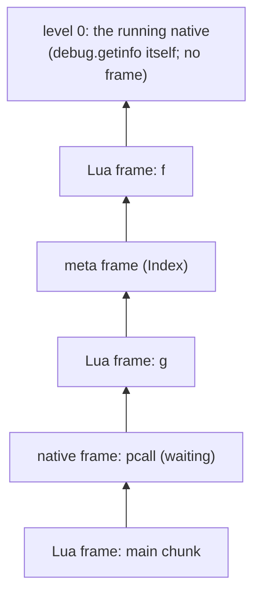
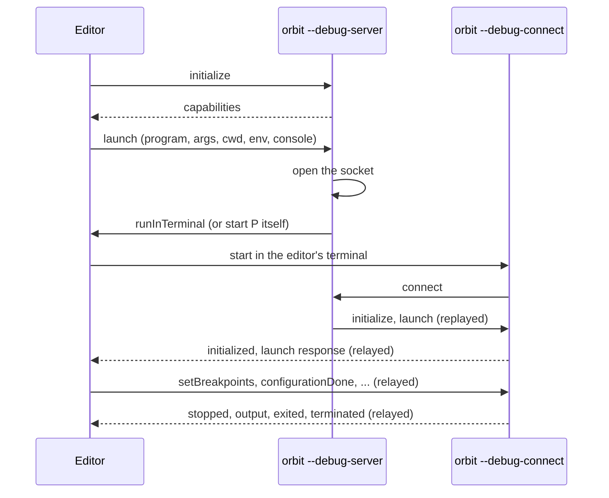
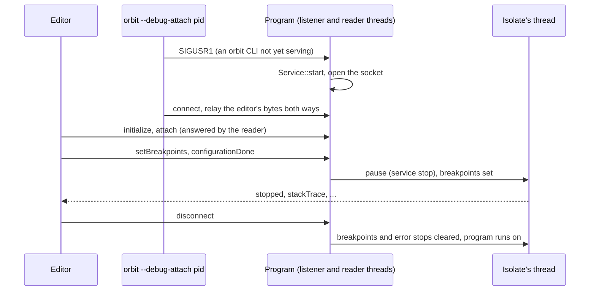
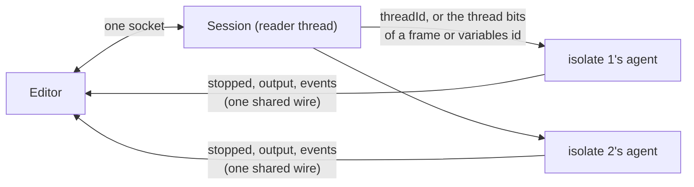

# Debug library, tracebacks, hooks and the debugger

Status: Implemented. Crates: `orbit-runtime` (introspection and hooks in `vm`, the `debug` library in `stdlib`, the debugger engine behind the `debugger` feature), `orbit` (the `orbit::debugger` API), `orbit-dap` (the Debug Adapter Protocol server), `orbit-cli` and `orbit-lib` (who turns the server on). The debugger's decisions are [ADR-12](../adr/0012-developer-tooling.md).

This builds on the [VM design](vm.md) and [VM semantics](vm-semantics.md). The `debug` library's behaviour was worked out from the manual, the reference `lua5.5` binary and the official suite (`db.lua`, `calls.lua`, `errors.lua`, `locals.lua`, `coroutine.lua`). The fast paths are unchanged: hooks cost nothing until one is set, and the debugger costs nothing in functions without breakpoints. Hooks are the one place Lua code runs in a nested call on the Rust stack; Lua hooks can't yield in the reference either (see [Hook calls](#hook-calls)).

## Summary

| Area | Design |
|---|---|
| Levels | One walk over the frame stack turns frames into *activations*: Lua frames and native frames count, meta and hook frames annotate the activation above them. Level 0 is the running native |
| Function names | From the caller's call instruction, using the operand origins the compiler records for error messages. Fallback: search `package.loaded` for the function, as the reference does |
| `getinfo` | Every option letter (`S l u n r t L f`), read from the frame and the prototype's debug info |
| Locals | `getlocal`/`setlocal` from the compiler's local table (registers or cells), plus `(temporary)`, `(C temporary)` and `(vararg)` slots |
| Upvalues | `getupvalue`/`setupvalue` read and write capture cells; `upvaluejoin` swaps a closure's cell; `upvalueid` gives a light userdata. Upvalues are listed in Lua's first-use order while `_ENV` stays capture 0 inside the VM |
| `CapSelf` | A debug write that breaks the "self capture holds this closure" assumption swaps that closure's code for a copy where `CapSelf` reads the capture. No cost on the fast path |
| Tracebacks | `debug.traceback` and the CLI's uncaught-error traceback share one formatter, in the reference's exact shape (`in local 'f'`, `in metamethod 'index'`, `(...tail calls...)`, the 10 + 11 level elision) |
| Hooks | Per stack (so per coroutine). The dispatch loop is compiled twice from one generic function: a plain loop with no hook code, and a hooked loop that checks events before each instruction. It switches only where a hook can have been set. Hook functions run as nested calls above a hook marker frame and can't yield |
| Debugger | A Rust event interface beside the hook slot. The hooked loop runs only in functions with breakpoints or while stepping; nothing is patched |

## Activations and levels

The frame stack holds Lua frames, native continuation frames (a native waiting on a call it asked for), and meta frames below metamethod calls. The debug library sees *activations*, numbered from the top:



- **Level 0** is the native that is running (`getinfo`, `getlocal`, `traceback`). Natives that don't call back into Lua have no frame, so `NativeCtx` supplies level 0 from its own id and window. When call or return hooks are on, natives do get a frame (below); the walk recognises the running native's frame by its position and treats it as level 0 either way.
- **Lua frames** and **native continuation frames** are one level each.
- **Meta frames** and **hook frames** are not levels. They name the activation above them: `metamethod 'index'`, or `hook '?'`.
- A frame entered by a **tail call** is marked (`Frame::tail`), so `istailcall` is true and the frame has no name.

`error(msg, level)` counts levels the same way.

A native that raises an error has no frame, but the reference's tracebacks show it (`[C]: in global 'error'`). So when a native returns an error, the cold error path pushes a **native frame** for it (`FrameKind::NativeCall`, no continuation) before unwinding starts. Tracebacks and `xpcall` message handlers see the stack exactly as it was, and unwinding pops the frame like any other. The successful path is unchanged.

## Function names

The reference names a function by how it was called. The compiler records, for every call, where the called function came from ([error messages](vm.md#error-messages)), so the name of an activation is:

| Caller (the activation below) | `name`, `namewhat` |
|---|---|
| A Lua frame at a `Call` | the origin of the function operand: `'f'`, `local` / `global` / `field` / `method` / `upvalue` / `constant` |
| A Lua frame at a `GenericCall` | `'for iterator'`, `for iterator` |
| A meta frame | the event without underscores (`'index'`), `metamethod` |
| A hook frame | `'?'`, `hook` |
| A native, a tail call, or the bottom | none; tracebacks then search `package.loaded` (below) |

Tracebacks print a named activation as `in local 'f'`, `in method 'm'`, `in metamethod 'index'` and so on; the main chunk as `in main chunk`; an unnamed Lua function as `in function <file:line>`; an unnamed native as `in ?`. Before giving up on a name, the reference looks the function up in `package.loaded`, which gives `in function 'string.rep'` (with `_G.` dropped: `in function 'print'`). We do the same through the registry's `_LOADED` table, or the globals when there is no `package`.

`bad argument #1 to 'r'` uses the same call-site name (`NativeCtx::call_name`), so the two never disagree. Finalizers are called by the collector rather than an instruction; they get the name `'__gc'` and `metamethod`, as `db.lua` expects.

## `getinfo`

| Option | Fields | Source |
|---|---|---|
| `S` | `source`, `short_src`, `what` (`Lua`, `C`, `main`), `linedefined`, `lastlinedefined` | The prototype. `source` is the chunk name as given to `load` (`@file`, `=stdin`, or the text); `short_src` is `chunk_id(source)`. Natives and built-ins: `=[C]`, `[C]`, `C`, -1, -1 |
| `l` | `currentline` | Line table at the frame's pc; -1 for natives and stripped code |
| `u` | `nups`, `nparams`, `isvararg` | Prototype counts; natives are vararg with no parameters, and native closures report their upvalue count |
| `n` | `name`, `namewhat` | [Function names](#function-names) |
| `r` | `ftransfer`, `ntransfer` | Set by call and return hooks: the first local index and the count of the values transferred |
| `t` | `istailcall`, `extraargs` | `Frame::tail`; `extraargs` is how many callables a `__call` chain inserted (`Frame::extra`) |
| `L` | `activelines` | Every line in the line table, minus the lines of instructions the compiler marks as function-entry bookkeeping |
| `f` | `func` | The frame's closure or native |

An invalid option raises `bad argument #2 to 'getinfo' (invalid option)`. Out-of-range levels return `nil`. Stripped binary chunks (`string.dump(f, true)`) have empty debug info and `source = "=?"`; every function here handles that (`currentline` -1, `?` as `short_src`, `(temporary)` names, `(no name)` upvalues), as `db.lua` checks. Built-ins written in OrbitScript (ADR-11) report themselves as C functions.

## Locals

`getlocal(level, n)` and `setlocal(level, n, v)`:

- **Named locals** come from the debug info's local table, filtered to those live at the frame's pc, in declaration order, parameters first. A local in a register is read from the frame's registers; a captured one through the frame's cell slot, so it reads and writes the same cell its closures see ([cells](vm.md#locals-captures-and-cells)). A captured local's range starts after its `CellNew`, so the slot never holds a placeholder while the local is visible.
- **Temporaries.** Past the named locals, `n` reaches registers in use: up to the callee's function slot when the frame is calling, else the frame's register count. They are named `(temporary)`, as the reference names them. For a native frame the slots are its window, named `(C temporary)`.
- **Varargs.** Negative `n` reaches the extra arguments, which sit just below the frame's base: `(vararg)`. A named vararg table is an ordinary local.
- `getlocal(f, n)` with a function returns parameter names only.

## Upvalues

- `getupvalue(f, n)` and `setupvalue(f, n, v)` read or write the cell of the capture shown as upvalue `n`. Natives have none; native closures have upvalues named `""`. Stripped functions name them `(no name)`.
- **Order.** The reference numbers upvalues by first use in the function body, while the compiler puts `_ENV` in capture 0 so `GetGlobal` can read `U[0]` directly. The other captures are numbered by first use, and the debug info records where the environment's first use falls among them (`env_debug_index`). The debug library maps upvalue numbers through it; the VM never looks at it. Binary chunks keep the same data.
- `upvaluejoin(f1, n1, f2, n2)` replaces upvalue `n1` of `f1` with `f2`'s cell.
- `upvalueid(f, n)` returns the cell's identity as a light userdata (`Value::LightUserData`, ADR-1 tag 10): equal for the same cell, different otherwise, `type` gives `userdata`, and messages say `light userdata`, as `errors.lua` expects.

### `CapSelf`

`CapSelf` ([VM design](vm.md#calls-and-returns-stackless-adr-3)) loads the running closure instead of reading a capture, which is valid because the compiler emits it only for a `local function` that is never assigned. The debug library is the only thing that can break that: `setupvalue` or `setlocal` writing that cell, or `upvaluejoin` replacing the capture. The fix costs nothing on the fast path:

- Each prototype records which capture `CapSelf` stands for (`Proto::self_capture`).
- Before a debug write to a cell, the library checks whether the cell's current value is a closure whose self capture is that cell. If so, that closure's code is swapped for a copy in which every `CapSelf { dst }` is `CapGet { dst, cap }`. `upvaluejoin` does the same for the closure it changes.

Only one closure can be affected (the cell holds exactly that closure until the write), and other closures of the same prototype keep the fast code. A frame already running the closure keeps the old code until it next reloads, which can only matter if a function rewrites its own self-reference through `debug` and then recurses in the same activation.

## Metatables, user values and the registry

- `debug.getmetatable(v)` and `debug.setmetatable(v, mt)` bypass `__metatable`. For tables and userdata they set the object's own metatable; for every other type the per-type metatable in the runtime. `setmetatable` returns its first argument.
- `debug.getuservalue(u, n)` and `setuservalue(u, v, n)`: every full userdata has exactly one user value (`UserData::user_value`). Index 1 works on any full userdata, including `io` files, and other indexes fail as in the reference. The reference fixes the count at creation and gives files none, so `setuservalue(io.stdin, 10)` fails there and succeeds here, which `tests/lua-5.5/DEVIATIONS.md` records.
- `debug.getregistry()` returns the runtime's registry table: integer key 2 holds the globals, as in the reference, and `_LOADED` is `package.loaded`. `_HOOKKEY` exists in it with weak keys because `db.lua` checks for it; hooks themselves live on the stack.

## Tracebacks

`debug.traceback([thread,] [msg [, level]])` and the CLI's uncaught-error traceback use one formatter:

```text
msg
stack traceback:
	[C]: in global 'error'
	t.lua:1: in upvalue 'f'
	t.lua:5: in metamethod 'index'
	t.lua:9: in function <t.lua:7>
	(...tail calls...)
	t.lua:12: in main chunk
	[C]: in ?
```

- Each activation is `short_src:currentline:` (or `[C]:` for natives), then `in` and its description ([names](#function-names)). An activation entered by a tail call is followed by `(...tail calls...)`.
- More than 22 levels print the first 10, `...\t(skipping N levels)`, and the last 11.
- A non-string `msg` that isn't `nil` is returned unchanged. The default level is 1 (the caller), or 0 for another coroutine.
- The bottom `[C]: in ?` stands for the host's call into the VM (the reference's C `main`); it is printed once per boundary frame.
- The CLI prints `orbit: msg` plus the traceback. The traceback is built at the throw site, before any frame is popped, so it shows the native that raised and every frame above the catch point.

## Hooks

### State

Each stack (so each coroutine) has a hook:

```rust
pub(crate) struct Hook {
    func: Value,          // nil when off (traced with the stack)
    mask: u8,             // call, return, line, count bits, plus the interrupt bit
    base_count: i64,      // count interval as given (count events only when positive)
    count: u32,           // instructions left until the next count event
    active: bool,         // a hook is running: no hooks fire (the reference's rule)
    old_pc: u32, old_depth: u32,         // the last instruction the line check saw
    call_pending: Option<bool>,          // a frame was just entered (true: a tail call)
    transfer: Option<(usize, u32, u32)>, // the frame and values a call or return hook reports
}
```

`debug.sethook([thread,] f, mask [, count])` sets it, and `debug.gethook([thread])` reads it back (`f, mask, count`). A new coroutine inherits its creator's mask and count but not the function, as in the reference: `debug.gethook(co)` returns `nil, mask, count` and no events fire until a function is set.

### Two loops from one source

The dispatch loop is `run_loop::<HOOKED>`. The plain instantiation is the ordinary loop plus two flag checks, each on a path that is already slow:

1. at `'reload`, where every non-inline call, return, metamethod and error resumes the loop;
2. after a native call returns in place (fast-path natives can't set hooks).

A hook can only be set by running a native (`debug.sethook`), or by a resume switching to a stack with hooks, which goes through `'reload`, so those two places see every change. When the flag disagrees with the loop it is in, the loop saves its pc and returns, and `run` re-enters the other instantiation. No check at backward jumps or Lua-to-Lua calls is needed, so the fast paths keep their exact instruction sequences, except for the [interrupt](#interrupts) check at backward jumps. The hooked loop exists only with the `hooks` feature; without it the flag checks compile away.

The hooked loop calls an out-of-line `hook_point` before each instruction when any of count, line, or (for return instructions) return events are on. It decides, in the reference's order:

1. **count**: decrement; at zero, reset and fire `"count"`.
2. **line**: fire `"line", n` when the instruction starts a new line (its line differs from the last checked instruction's in this frame), when it is the function's first instruction, or when control jumped backwards (`pc <= old_pc`, so `for i=1,4 do a=1 end` reports line 1 four times). Returning from a call doesn't count as a new line: when the frame depth differs from the one `old_pc` belongs to, `old_pc` is taken as the call instruction.
3. **return**: before `Return`, `Return0` and `Return1`, fire `"return"` with `ftransfer`/`ntransfer` covering the returned registers.

Call events fire when a frame is entered (`"call"`, or `"tail call"` for `TailCall`), with `ftransfer = 1` and `ntransfer` the number of parameters (for a native, the number of arguments). Observed from `lua5.5` and matched: a count event makes the same instruction report its line again; the line of a `Closure` instruction is the function's last line; the `for` instruction of a loop reports the `for` line.

### Hook calls

A hook runs as an ordinary nested call. The out-of-line path pushes a **hook marker frame** (`FrameKind::Hook`) above everything live (the top frame's registers and any open results), calls the hook function with `(event, line)` above it, and pops the marker when the call returns. The marker names the hook's activation (`hook '?'`) and ends the nested call the way a boundary frame does. While a hook runs, `active` is set, so nothing inside fires hooks; errors unwind through the marker and clear it. The reference raises `attempt to yield across a C-call boundary` when a Lua hook function yields, so a nested call loses nothing observable.

Natives called while call or return hooks are on get a `NativeCall` frame, so the hook sees them at level 2 (`db.lua` records `assert` and `debug.getlocal` through `getinfo(2, "f")`). The call hook runs first, then the native, and the return hook runs before its results are placed (`ftransfer`/`ntransfer` point at its results in its window). Without call and return hooks, natives run frameless.

### Interrupts

`Vm::interrupt_handle()` returns an `Interrupt` (`Clone + Send + Sync`) whose `request()` sets an atomic flag, for a CLI's Ctrl-C handler or a watchdog thread. The plain loop checks the flag on taken backward jumps only (a relaxed load); when set, it saves its pc, sets the interrupt bit in the stack's hook mask and switches to the hooked loop, whose next hook point raises `interrupted!`. The hooked loop checks the flag at every hook point outside a running hook. The error is an ordinary catchable error, positioned at the interrupted function's caller, as the reference's Ctrl-C error is. A running native finishes first. Without the `hooks` feature, requests are ignored. A host can claim an interrupt first (`Runtime::interrupt_handler`), which the C API uses for a signal-safe `lua_sethook`.

### Deviations

- **Count events** fire after a number of *our* instructions, not the reference's. The bytecode is our own (ADR-4), so a count hook fires at different points in the source.
- **`ftransfer` of a native's return** counts from the native's own window. For `debug.sethook`'s own return event the reference reports a value that reflects its C stack.

Both are in `tests/lua-5.5/DEVIATIONS.md`.

## Debugger engine

The debugger engine (`orbit-runtime` feature `debugger`, `vm/debugger.rs`) sits beside the hooks: breakpoints by source and line, step in, over and out, pause, and stops on errors, reported to a host's `DebugEvents`. It shares the hooked loop but not the hook slot, so a script's `debug.sethook` keeps working while a debugger is attached.

- **Hooked only where it can stop.** `Vm::hooked_here` decides which loop runs: a hook is set, the function has a breakpoint, or a step could stop at this depth. The loops ask at `'reload`, after a native returns, and, while a breakpoint or step is set, whenever a call or return enters other code. A recursive call or return keeps its loop, so a step keeps its own function hooked at every depth.
- **Breakpoints resolve lazily.** `set_breakpoints` scans the source's live prototypes to move each line to the next one with code, and bumps a generation. Each `ProtoCode` keeps the generation it was last checked against and whether it has a breakpoint, so a function is checked once per change, when next entered. Chunks linked later resolve pending breakpoints and report them. No code is patched.
- **Line events** follow the hook rules (a new line, a backward jump, a function's first instruction), with the engine's own last-seen instruction, reset when the hooked loop reloads. Built-ins and stripped functions have none: stepping in through `table.sort` stops in the comparator.
- **Stops** run the host's callback from a native under a hook marker frame, as a hook call is made, with Lua hooks and further stops off. The callback sees the stopped program through the debug interface (`Paused::level(0)` is the stopped function) and answers how to go on.
- **Pause** rides on the interrupt flag: the hooked loop's interrupt check takes a pending pause instead of raising `interrupted!` and stops at the next script instruction.
- **Errors** stop before anything unwinds, once per error, saying whether a `pcall`, `xpcall` or `coroutine.resume` catches it.

Cost, measured on cloud x86_64 without PGO: the feature on and nothing attached changes instruction counts by -1.4% to +1.0% across the benchmarks (callgrind); attached, with a breakpoint in a function the benchmark never calls, run times are 0.96x to 1.06x (`tests/debugger.rs`, `overhead_outside_breakpoints`).

### Embedding API

`orbit::debugger` (feature `debugger` of `orbit`, over either backend) is what hosts and the DAP server use:

- **On `Isolate`**: `set_debug_events(Option<Box<dyn DebugEvents>>)`, `set_breakpoints(source, lines)`, `set_error_break(ErrorBreak)`, `stop_on_next_line()` (stop on entry) and `pause_handle()`, whose `PauseHandle` is `Send` and works from any thread. Resuming and stepping are the `Resume` value `DebugEvents::stopped` returns.
- **`Paused`** is the stopped program as the callback sees it, with levels from the function that stopped (0) outwards: `frame(level)` and `frames()` (`debug.getinfo`'s `FrameInfo`), `locals(level)` and `upvalues(level)` as `Variable`s holding pinned values, `set_local(level, index, value)`, `set_breakpoints` and `set_error_break` (requests that arrive while stopped), `globals()`, `error()` for an error stop, `scope(f)` for reading values or calling script code, and `stack()` for the rest of the stack API. Locals named in parentheses (the compilers' hidden ones) are left out.
- **`Config::debugger(Debugger::Disabled)`** refuses a debugger for the isolate's whole life, enforced in the engine however it is reached: `set_debug_events` fails, breakpoints never resolve and pausing does nothing.
- **Shared layout**: `IsolateAbi::set_debug_events` and `pause_handle`, `ControlAbi::set_breakpoints`, `set_error_break` and `stop_on_next_line` (on `Control`, so they work both from the host and from inside a stop), the `DebugEventsAbi` callback trait a program implements, `PauseAbi`, and `ConfigAbi::debugger`. A stop hands the program the reporting native's window, with the error in slot 1, so `Paused` is the same code on both backends. A `liborbit` built without its `debugger` feature refuses `set_debug_events`.

## DAP server and `orbit --debug-server`

`orbit-dap` is the Debug Adapter Protocol server, on the public API only (`orbit::debugger`), so it builds over either backend. `orbit --debug-server` (CLI feature `dap`, on by default; `build.sh` turns on `orbit-lib/debugger` and `dap` for the shared layout) is the editor's debug adapter: it speaks DAP with the editor over standard input and output, but the script never runs in that process. On `launch` it opens a socket (`launch-<pid>-<nonce>.sock`, mode 0600, in the per-user directory) and starts `orbit --debug-connect <socket> <script> <args>`, which connects back and runs the script as `orbit <script> <args>` would, debugged over the socket. The adapter relays between the two, so the script's standard input and output, and anything native code writes to file descriptors 0 and 1, are never the editor's stream.



- **Where the script runs** follows the launch's `console`: `"integratedTerminal"` (the default) or `"externalTerminal"` ask the editor to start it in a terminal (DAP's `runInTerminal`), where it reads what is typed and writes there. `"internalConsole"`, or an editor that offers no terminals, makes the adapter start it with no standard input (reads see end of input) and send its output and `orbit`'s error reports to the debug console as `output` events.
- **The adapter answers `initialize` itself**, then replays it and `launch` to the program and relays everything else both ways, renumbering what it sends the editor. If the program's connection ends without `terminated`, the adapter sends it; if the editor leaves, the program sees its connection close and stops. A program the adapter started itself is killed if it has not exited 2 s after its connection closes.
- **Windows** uses the same AF_UNIX sockets, through `orbit-dap/src/win.rs` (Winsock and kernel32 through `windows-sys`, the crate's `unsafe` exception under ADR-6 until std's Windows Unix sockets are stable), in `%TEMP%\orbit` (normally under `%LOCALAPPDATA%\Temp`), whose default ACL keeps other users out. Not `%LOCALAPPDATA%\orbit`: processes started from a packaged (MSIX) app see a virtualized `%LOCALAPPDATA%`, where AF_UNIX sockets can be bound but not connected to or removed.
- **Two threads in the program.** A reader thread takes the editor's messages and answers `threads` and `pause` itself. Anything else is queued for the isolate's thread; while the script runs, the reader pauses it through `PauseHandle` to get it answered (a *service* stop, which the editor never sees as `stopped`), and `disconnect` or `terminate` interrupts it.
- **One DAP thread per isolate**, id 1 for `orbit --debug-connect`; coroutines show in its call stack.
- **Breakpoints** match a chunk by the names a script can be loaded under (`@/abs/path`, `@rel`, `@./rel`, relative to the launch directory) and are reported unverified until their chunk loads, then `breakpoint` changed events say where they landed.
- **Exception filters**: `uncaught` (errors no `pcall` catches; the CLI's own handler does not count) and `all`.
- **Frame names** come from the call site, as `debug.getinfo` gives them, or else from the name the function was defined with (`FrameInfo::defined_name`), so a tail-called function still has one.
- **Scopes**: Locals, Upvalues and Globals; tables expand, with their metatable as `(metatable)`. `evaluate` reads names and dotted fields only.
- `os.exit` sends `terminated` from a `before_exit` hook.

### Attaching to a running program

`orbit_dap::serve(&mut isolate, About { program, args })` makes an isolate debuggable later: it installs the agent (with no breakpoints and no step, the engine stays off, so the program runs as it would undebugged) and gives a `Service` that is `Send` and `Clone`. `Service::start`, from any thread, opens `<pid>-<nonce>.sock` in the per-user directory, first removing sockets whose program has died. `Service::stop` removes it.



- **A connection's first message decides what it is.** `describe` gets one answer (`version`, `pid`, `program`, `args`, `startTime`, `runtime`, `isolates`, `attached`) and the connection closes. Anything else starts a DAP session; while one is connected, others are refused.
- **The reader answers `initialize` and `attach` itself**, so an editor can attach while the program is outside script code; requests that need the isolate wait for its next service stop.
- **Sessions come and go; the program stays.** `disconnect` (unless `terminateDebuggee`) or an editor that vanishes clears that session's breakpoints and error stops at the next stop, and the program runs on. `terminate` or `terminateDebuggee` interrupts it.
- **The CLI** serves every normal run: `--debug-listen` starts the socket at launch and `SIGUSR1` starts it later (a `signal-hook` thread), each printing `orbit: debugger listening on <path>` to standard error; `--no-debug-signal` installs no handler. The socket is removed at exit, `os.exit` included.
- **`orbit --debug-attach <pid>`** is the editor's adapter: it finds the program's socket (checking its `describe` pid), signals an `orbit` program that isn't serving yet, and relays bytes between its stdio and the socket. It only signals a process whose executable is `orbit` and that catches `SIGUSR1`, since the signal kills a process that doesn't: on Linux from `/proc/<pid>/exe` and the `SigCgt` mask, on macOS (no `/proc`) from libproc's executable path and the `p_sigcatch` mask `sysctl` reports, in `orbit-dap/src/process.rs`.
- **`orbit --debug-attach --list`** prints a JSON array: each serving program's `describe` answer with `"listening": true`, then `orbit` programs that would serve on `SIGUSR1` (`{"pid", "program", "listening": false}`, Linux and macOS).
- **On Windows**, which has no `SIGUSR1`, the CLI waits on a named event, `Local\orbit-debug-<pid>` (`orbit_dap::debug_requests`), and `--debug-attach` sets it; a process without the event isn't asked, so nothing is ever killed. `--list` shows only programs already serving there.

Cost (cloud x86_64, release, no PGO): an attachable run is unchanged in instructions on `fib`, `tables` and `oop` (callgrind, under 0.1%), and startup gains 8.3 k instructions (+0.5%) and a signal thread. `dap` adds 271.0 KiB to the release `orbit` (2,252,064 → 2,529,616 bytes), of which the engine is 12.3 KiB, launching 190.2 KiB and attaching 68.6 KiB; `serde_json` is already linked for `std.json`.

Known limits: a service stop during a step loses the step, and a child process (`os.execute`) inherits standard output and can write into the protocol. The VS Code extension (`editors/vscode`) starts both adapters: `launch` through `orbit --debug-server`, `attach` through `orbit --debug-attach <pid>` with a picker over `--list`.

### Several isolates in one process

Every isolate a process serves shares one server and one socket. The first `serve` makes it (its `About` describes the program); later ones join it, from any thread, and each isolate is a DAP thread of its own, `isolate 1`, `isolate 2` and so on in the order they were served. `describe` lists them.



- **The session answers what concerns every isolate itself**: `initialize`, `attach`, `configurationDone`, `threads`, `setBreakpoints` and `setExceptionBreakpoints`. Breakpoints are numbered by the session and answered unverified; each isolate applies them to whatever it has loaded and sends a `breakpoint` changed event for each one it placed.
- **Everything else goes to one isolate**: `pause`, `continue`, the steps and `stackTrace` by `threadId`; `scopes`, `variables` and `evaluate` by the isolate's thread in the top bits (above 24) of the frame id or variables reference. An `evaluate` with no frame goes to the first isolate. A request for a thread that isn't there fails.
- **Isolates stop on their own** (`allThreadsStopped: false`, `allThreadsContinued: false`): one at a breakpoint leaves the others running.
- **Isolates come and go.** One served while an editor is attached gets the session's breakpoints and error stops and a `thread` started event; one that closes sends `thread` exited, and requests it hadn't answered fail. `disconnect` and `terminate` reach every isolate.
- `Service::stop` stops the process's server, for every isolate.

Cost: 20.2 KiB in the release `orbit` (2,540,944 → 2,561,600 bytes, cloud x86_64, no PGO); a program that serves one isolate runs as before.

### C hosts

`liborbit` built with its `debugger` feature (as `build.sh` builds it) carries the server for programs that embed it through the C API. `orbit.h` declares OrbitScript's own additions, exported under the symbol version `ORBIT_0`:

- `orbit_newstate(lua_Alloc f, void *ud, unsigned flags)` is `lua_newstate` with flags. `ORBIT_STATE_NO_DEBUGGER` makes a state no debugger can ever reach (`Config::debugger(Disabled)`). `lua_newstate` and `luaL_newstate` are `orbit_newstate` with no flags.
- Every other state is served when it is made (`orbit_dap::serve`, each a DAP thread in creation order), so it runs as it would undebugged until an editor attaches, and starting the server later needs nothing from the state's thread.
- `orbit_debug_listen(L, NULL)` opens the process's socket, from any thread, at any time; it returns 0, or -1 if `L` allows no debugger, the library has none, or `addr` is not `NULL` (reserved).
- `ORBIT_DEBUG=1` in the environment does the same for unmodified hosts when a debuggable state is made, and says `liborbit: debugger listening on <path>` on standard error.
- The socket is removed at exit (`atexit`, registered by the first listen).
- Without the feature both functions still exist; listening fails.

Cost (cloud x86_64, release, no PGO): 190.8 KiB in `liborbit.so.0` (2,478,040 → 2,673,392 bytes; the engine was already in), and 4.7 k instructions more to make, open and close a state (20 states: 17,447,443 → 17,541,034, callgrind).

## Cargo features

- `orbit-runtime/debug` (default on): the `debug` table. Enables `hooks`.
- `orbit-runtime/hooks`: hook state, the hooked loop and hook frames. Introspection (`getinfo`, locals, upvalues, tracebacks) is always compiled, because tracebacks and `error` levels need it anyway.
- `orbit-runtime/debugger`: the debugger engine. Enables `hooks`. Off by default; `orbit`, `orbit-cli` and `orbit-lib` forward it as `debugger`, and `orbit-cli`'s `dap` (on by default) turns it on. In `orbit` it also adds the `orbit::debugger` API.
