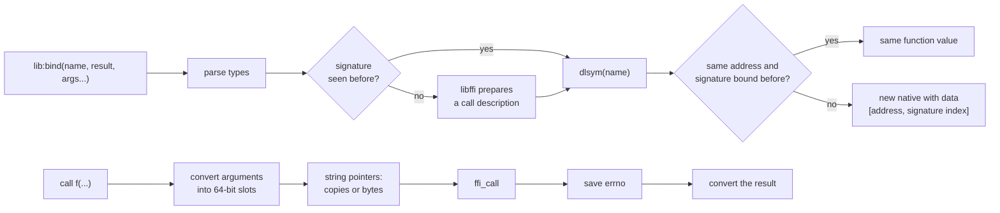

# The `ffi` library

Status: Accepted (with ADR-9, 2026-10-18). Crate `orbit-ffi`; `orbit-std` feature `ffi`.

The `ffi` library lets Lua and OrbitScript code call C functions in shared libraries directly, without writing a C module. A script opens a library, binds a function by name with its C signature, and calls the result like any other function:

```lua
local libc = ffi.open("libc.so.6")
local strlen = libc:bind("strlen", "size", "cstr")
print(strlen("hello"))  --> 5
```

```rust
// OrbitScript: the same library, `::` for plain calls and `.` for methods.
let libc = ffi::open("libc.so.6");
let strlen = libc.bind("strlen", "size", "cstr");
print(strlen("hello"));
```

Declaration syntax for OrbitScript (`extern fn`) is a planned follow-up that will lower to `bind` calls.

## Who gets it

The library gives scripts the same power a C module has: they can call any function the process can load and read or write any address. So it is a capability the host grants:

- **Embedders** need the `ffi` Cargo feature on `orbit-std`, which is off by default, and must also call `orbit_std::install_ffi(&mut isolate)`. Without that call, scripts see no `ffi` global and `require "ffi"` fails, even when the feature is compiled in.
- **The `orbit` CLI** builds with the feature and enables it, unless it is started with `--no-ffi`.

Once enabled, the library is the `ffi` global and `package.loaded.ffi`. It is also part of OrbitScript's prelude, so `.orb` code can use it without declaring it.

## Reference

### Libraries and functions

| Call | Result |
|---|---|
| `ffi.open([name])` | Opens a shared library by file name or path (`"libm.so.6"`, `"/usr/lib/libz.so"`, `"user32.dll"`). With no name it gives the symbols already in the process on Unix (libc, plus anything the host linked), and the program's own module on Windows. Raises `cannot open library '<name>': <reason>` on failure. Libraries are never closed. |
| `lib:bind(name, result, args...)` or `ffi.bind(lib, name, result, args...)` | The C function `name` in `lib`, as a function value. Raises `cannot find C function '<name>': <reason>` if the symbol is missing. Binding the same function with the same signature again returns the same value. |
| `ffi.errno()` | `errno` as the most recent FFI call left it. It is read right after the call, before the VM does anything that could change it. |

### Types

Type names are strings. Aliases are listed after the main name.

| Type | As an argument | As a result |
|---|---|---|
| `void` | not allowed | no results |
| `i8` (`char`, `schar`), `u8` (`uchar`), `i16` (`short`), `u16` (`ushort`), `i32` (`int`), `u32` (`uint`) | An integer (or a float with an integral value) that either the signed or the unsigned type of that width can hold, otherwise `value out of range` | An integer, sign-extended or zero-extended from its own width |
| `i64` (`long`, `llong`, `ssize`, `intptr`), `u64` (`ulong`, `ullong`, `size`, `uintptr`) | Any integer | An integer; `u64` values above 2^63−1 wrap to negative |
| `double` (`f64`), `float` (`f32`) | A number | A float |
| `ptr` | Light userdata, an `ffi.buffer`, or `nil` for NULL | Light userdata, or `nil` for NULL |
| `cstr` | A string, copied with a NUL added; the copy lasts only for the call; a string containing a NUL byte is an error | The NUL-terminated string at the pointer, copied; `nil` for NULL |
| `bytes` | A string's own bytes, without a copy or a NUL, for C to read during the call (pair it with a length) | not allowed |

`long` is always 64 bits here, as on 64-bit Unix; on Windows, where C's `long` is 32 bits, declare it as `i32`.

### Memory

| Call | Result |
|---|---|
| `ffi.buffer(size)` | A zero-filled buffer of `size` bytes that the script owns. It is freed when collected, and its address never changes while it lives. `#buf` is its size. |
| `ffi.buffer(s)` | A buffer holding the bytes of `s` plus a NUL: a C string that C may keep pointers into. |
| `ffi.string(p [, len [, offset]])` | `len` bytes at `p` (plus `offset`), or with no `len`, the bytes up to the first NUL. |
| `ffi.get(p, type [, offset])` | The value of a sized `type` stored at `p + offset`, in native byte order. A `cstr` field reads the pointer stored there, then the string it points to. |
| `ffi.set(p, type, offset, value)` | Stores `value` as `type` at `p + offset`. A `cstr` can't be stored; store a `ptr` to a buffer instead. |
| `ffi.offset(p, n)` | The raw pointer `n` bytes past `p`. |
| `ffi.sizeof(type)` | The size of a type in bytes: 1, 2, 4 or 8 (`ptr` and `cstr` are 8). |

`p` can be a buffer or a raw pointer:

- **Buffer:** every access is bounds-checked (`out of the buffer's bounds`), so a script that sticks to buffers can't touch memory outside them.
- **Raw pointer:** nothing is checked; the script is trusted to know the memory is there. A pointer from `ffi.offset(buffer, n)` is raw, and it is only valid while the buffer lives.

### Example: an out-parameter and `errno`

```lua
local libc = ffi.open()
local strtol = libc:bind("strtol", "long", "ptr", "ptr", "int")
local text = ffi.buffer("123abc")    -- not a cstr: the end pointer points into it
local endp = ffi.buffer(ffi.sizeof("ptr"))
print(strtol(text, endp, 10), ffi.string(ffi.get(endp, "ptr")))  --> 123  abc

local fopen = libc:bind("fopen", "ptr", "cstr", "cstr")
local strerror = libc:bind("strerror", "cstr", "int")
if not fopen("/missing", "r") then print(strerror(ffi.errno())) end
```

## How a call works



- **Function values are plain natives.** `Control::register_native` (on `orbit::stack`) registers a native with two data words: the C address and the index of its signature in the library's per-VM state (`native_data`). A call takes the VM's direct native path.
  - The C module shim's functions are native closures. Their call goes through a stub Lua frame, which costs 15-20 ns per call (measured in the FFI spike).
  - Natives are never freed, so bindings are interned per (address, signature). The count is bounded by the distinct functions scripts bind.
- **libffi makes the call** (`orbit-ffi/src/sys.rs`). Each distinct signature gets one call description (`ffi_cif`), prepared by `ffi_prep_cif` when it is first bound. A call fills one 64-bit slot per argument, passes libffi a pointer to each, and reads the result from a 64-bit slot.
- **Linking libffi.** By default the `libffi-sys` crate builds libffi from its bundled sources and links it statically (needs a C compiler, `sh` and `make` at build time). The `ffi-system-libffi` feature of `orbit-std` and `orbit-cli` (`system-libffi` on `orbit-ffi`) links the system's shared `libffi` instead.
- **Strings.**
  - Conversions that can allocate run before any string pointer is taken, because allocating can move short strings, which live inline in the heap (ADR-5).
  - `cstr` copies go into a 256-byte stack buffer while they fit, and into their own allocations after that.
  - `bytes` passes the string's own address. Nothing runs in the VM during the C call, so that address can't move.
- **No re-entry.** C code can't call back into the VM. There are no callbacks.

## Limits

- **Platforms:** 64-bit targets libffi supports. Linux x86_64 is tested; macOS, Windows and aarch64 Linux are checked to compile only.
- **Signatures:**
  - No variadic functions (`printf`) yet.
  - No structs or unions by value.
  - No callbacks (C calling a Lua function).
- **Not freed:** library handles are never closed, and bindings live as long as the VM.

## Costs

Measured on the cloud container (x86_64 Ubuntu 24.04), plain release without PGO, with a 5M-call loop. Each figure is the best of 5 runs, in ns per iteration including the loop. Runs vary by about ±20%. The trampolines column is the first version of this library, before it moved to libffi.

| Call | `ffi` (libffi) | `ffi` (own trampolines) | C module (orbit-capi) | Rust native | lua5.5 C module |
|---|---|---|---|---|---|
| `labs(-5)` | 43.7 | 22.0 | 45.4 | 11.0 (`math.abs`) | 16.1 |
| `sqrt(2.0)` | 43.3 | 23.5 | 51.0 | 15.3 (`math.sqrt`) | 14.9 |
| `strlen(20 chars)` | 59.6 | 40.3 | 68.3 | 17.4 (`string.len`) | 17.8 |
| 3-int `add3` | 70.0 | 36.8 | 59.0 | | 25.0 |

Most of the difference is libffi's `ffi_call` itself: a C program calling `add3` through it takes about 40 ns per call on the same machine, against 1.3 ns for a direct call.

Size: the feature adds about 55 KiB to the release `orbit` binary with libffi built in (1,909,488 to 1,965,320 bytes), or about 37 KiB when linking the system's libffi (1,946,736 bytes), no PGO, x86_64. The VM's data words cost nothing measurable without the feature.
