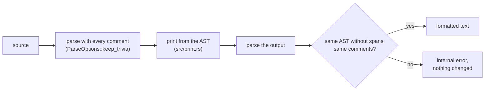

# Formatter (`orbit-fmt`)

**Status: Proposed.** The formatter of tier L3 in the [developer tooling plan](../adr/0012-developer-tooling.md) (ADR-12). The style rules are Tym's decisions F1 to F12 (2026-10-22).

## Summary

`orbit-fmt` gives OrbitScript one canonical layout, close to `rustfmt` with its default options. It is a library, which the language server uses for `textDocument/formatting` and `rangeFormatting` (the VS Code extension formats on save), and a command:

```sh
orbit-fmt FILE|DIR...          # formats .orb and .orbi files in place
orbit-fmt --check FILE|DIR...  # changes nothing; lists unformatted files and exits 1
orbit-fmt < in.orb > out.orb   # standard input to standard output
```

It formats OrbitScript only (F9) and has no options or configuration file (F11).

## How it works



- **It prints from the AST.** Literals, names and comments are copied from the source as written, so no string, number or comment is ever rewritten (F8). Type annotations are re-spaced token by token from the source, so parentheses the type tree flattens stay.
- **Each node first tries one line.** When that is wider than 100 columns (F1), or can't be one line (a block body, a comment inside it), it breaks the way its kind does: lists one entry per line with a trailing comma (F5), operator chains before each operator of the loosest kind, method chains of two or more calls before each `.`. A call whose last argument is a closure or a table literal keeps the earlier arguments on its line and breaks inside the last one (`f(a, #{` ... `})`).
- **Comments are placed between entries**: statements, items, list entries, fields, variants, `match` arms, parameters and `use` names. A comment on an entry's last line stays at the end of that line, a comment on its own line goes with the entry after it, and a comment after an opening `{`, `(` or `[` stays there. A comment anywhere else (inside an expression, say `1 + /* x */ 2`) can't be placed yet, and the module is refused.
- **It refuses rather than breaks.** A module with a syntax error is not formatted. The printer's output is parsed again and compared with the input: each top-level statement's AST is dumped without spans, with names written out, and the comments are compared as text. Any difference is an internal error and the input is left alone.

## The style

| Rule | Decision |
|---|---|
| Width and indentation | 100 columns, 4 spaces (F1, F2) |
| Bodies | Always split, as rustfmt does (F3): `fn`, `impl`, `struct`, loops and statement blocks put their entries on their own lines. An `if c { a } else { b }` whose branches are one expression each stays on one line when it fits in 50 columns, and an expression closure (`\|a, b\| a < b`) stays on one line when it fits |
| Tables | `#{ a: 1 }` with spaces inside, in literals and types; `#{}` when empty; arrays `[1, 2]` (F4) |
| Trailing commas | Only in a list that breaks (F5) |
| `use` | Each run of `use` lines with no blank line between them is sorted by path, and the names in `{}` are sorted (F6). Comments above a run stay above it |
| Blank lines | At most one in a row; none at the start or end of a block (F7) |
| Kept as written | Literals, string quoting, parentheses (F8), a `#!` first line, the `;` after a block's last `loop { .. }` (without it the loop would be the block's value) |

## Range formatting

`format_range` formats the top-level items and statements a range touches, whole, and returns one edit replacing their lines. The rest of the module must parse but isn't changed.

## Testing

`crates/orbit-fmt/tests/format.rs` has hand-written cases for each rule, and formats every `.orb` and `.orbi` file in the repository twice: the first pass must succeed and the second must change nothing.
