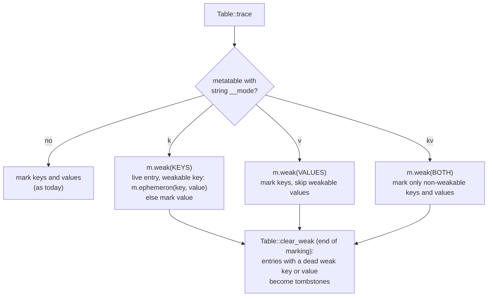

# GC semantics: weak tables, finalizers and `collectgarbage` (compat C4)

Status: Proposed. Crates: `orbit-gc` (collector), `orbit-core` (the table and metatable hooks), `orbit-vm` (running finalizers, closing a VM), `orbit-stdlib` (`collectgarbage`). Milestone C4 of the Lua 5.5 compatibility plan; exit is `gc.lua`, `gengc.lua` and `big.lua` from the official suite.

This builds on ADR-2 (own collector in `orbit-gc`, independent of the rest of the runtime) and on what `orbit-gc` already provides: per-object weak modes, ephemerons that wait on their key, and finalizer registration with resurrection. What is missing is the Lua side: tables don't read `__mode`, nothing registers or runs `__gc`, and `collectgarbage` knows six of its options. Every rule below comes from the 5.5 manual and from what the reference `lua5.5` binary does; the probes are listed at the end.

## What a program can observe

| Area | Rule (checked against `lua5.5`) |
|---|---|
| Weak modes | A table is weak when its metatable has a string `__mode` (read raw) containing `k` (weak keys), `v` (weak values) or both. Any other value, `__mode = 34` included, means strong. The field is read each cycle, so setting `__mode` after `setmetatable` takes effect. |
| What can be removed | Tables, Lua functions, userdata and threads. Strings, numbers, booleans and native functions (`print`) are values: an entry is never removed because of them. |
| Weak values | An entry goes when its value is collected. Values are cleared **before** finalizers are queued, so a weak value never hands out an object about to be finalized. |
| Weak keys (ephemerons) | A value is reachable through the entry only while its key is reachable from elsewhere. Cycles through keys and values (`e[k] = {k}`, `e[k1] = k2; e[k2] = k1`) are collected. Keys are cleared **after** finalizers are queued: an entry keyed by an object being finalized is still there inside its `__gc` and goes one cycle later ("finalized keys are removed in two cycles"). |
| `__gc` registration | `setmetatable(o, mt)` marks `o` for finalization when `mt` has a non-nil `__gc` at that moment (raw). `__gc = false` registers too. Adding `__gc` to the metatable later does not, unless `setmetatable` is called again. |
| `__gc` call | When a registered object becomes unreachable, it and everything it reaches are kept for one more cycle, and `mt.__gc(o)` runs with whatever `__gc` holds then: nil skips the call, a non-callable value is an error, a callable table works. An object is finalized once; a finalizer that calls `setmetatable` again re-registers it. |
| Order | Most recently registered first, among the objects found unreachable in the same cycle. |
| Errors | An error in a finalizer never propagates. It becomes the warning `error in __gc (msg)`; a non-string error object gives `error object is not a string`, `error()` gives `<no error object>`, calling a non-function gives `attempt to call a boolean value (metamethod '__gc')`. Warnings are off unless `warn("@on")`. |
| Inside a finalizer | The collector is not re-entered. Automatic collection is suspended, and every `collectgarbage` option returns a single `nil` (`param` returns `-1`) and changes nothing. |
| When finalizers run | During allocation-driven collection (gc.lua's `repeat u = {} until finish` loops), at the end of `collectgarbage()`, after a `step`, and when the state closes. |
| Closing | Normal end of the main chunk, an uncaught error and `os.exit(code, true)` close the state: every object still registered is finalized, most recent first; objects registered during closing are not. `os.exit(code)` without `true` runs none. |

## Weak tables in `orbit-core`

- **Finding `__mode` without the interner.** `Table::trace` has only the `Marker`. It looks the key up in the metatable by bytes: the string hash is a function of the bytes and the process seed (`hash_bytes`), so `"__mode"`'s hash is computed once, and the probe compares candidate keys' bytes through `Marker::get`. One probe per traced table that has a metatable; tables without one pay nothing. The same helper reads `__gc` for registration (`orbit_core::gc::metatable_field`).
- **Which entries are weak.** `gc::weak_target(Value) -> Option<AnyGc>` returns the handle for tables and closures (later userdata and threads; thread 2 extends it when it adds those tags, together with `table::mark`). Strings, numbers, booleans and natives return `None` and are marked normally.
- **Dead entries.** In strong tables a key whose value was set to nil stays marked, so `next` can still find it (unchanged). In weak tables those keys are not marked, and `clear_weak` turns every entry whose weak key or weak value died, and every dead entry whose key died, into a **tombstone**: key `false`, value nil, hash 0. Real keys never hash to 0 (`hash_bytes` and `hash_word` never return 0), so no lookup matches a tombstone, while probe chains still pass through it and inserts reuse it like any dead entry; the next rebuild drops it. No handle to a freed object stays in a table, so a reused slot can't alias a dead key and checked handles never trip. The array part just gets nil.
- **Cost on strong tables.** One `Option` test on the metatable, which tables without metatables already pay in `trace`. No new field in `Table`.

## Finalizers

`orbit-gc` keeps doing what ADR-2 describes: registration sets a FIN bit and records the object; at the end of marking, unreachable registered objects are resurrected (they and what they reach are marked) and queued newest first; the host takes them one at a time. The Lua parts:

- **Registration** (`orbit_core::gc::metatable_set(heap, obj, mt)`): called by `setmetatable` (thread 2) and `debug.setmetatable` on userdata after storing the metatable. Registers when `mt` has a non-nil `__gc`. `Heap::register_finalizer` already ignores an object that is registered.
- **Running** (`orbit-vm/src/gc.rs`): `Vm::run_finalizers` takes each queued object, looks up `__gc` in its current metatable, and calls it as a nested protected call with the object as its argument. While it runs, automatic collection is stopped (and restored after) and `GcState::finalizing` is set, which makes `collectgarbage` return `nil`. Finalizers are not yieldable, as in Lua. An error is formatted as above and passed to `Runtime::warn`, which thread 2's `warn` implements (until then it drops the message, which matches the default warnings-off state).
- **Where they run.** (1) In the interpreter's `safepoint!`, after `heap.step`, if `heap.pending_finalizers() > 0`: one cold call. The nested call saves and restores `Runtime::top`, and the window is reloaded after it as after any step. (2) `collectgarbage("collect")` and `collectgarbage("step")`: natives can't call Lua directly, so they return through `NativeReturn::CallThen` into a continuation that calls the next pending finalizer (protected, error to warning) until the queue is empty. (3) `Vm::close()`: `heap.finalize_all()` then the runner; objects registered from here on are not finalized. `orbit-cli` calls it at the end of a script, after an uncaught error, and from `os.exit(code, true)` (thread 4).
- **Safety.** A resurrected object's children are marked in the same cycle before the sweep, and the object stays marked from the finalize queue (a root) until the host takes it; the host then roots it on the VM stack for the call. That is the case boa_gc got wrong in the S0 spike (resurrected children freed). It is covered by `orbit-gc`'s tests and, for C4, by gc.lua and the compat corpus under `ORBIT_GC_STRESS=1` and with checked handles.

## `collectgarbage`

| Option | Behaviour |
|---|---|
| `"collect"` (default) | Finish any cycle, run a full one, run pending finalizers. Returns `0`. |
| `"count"` | `Heap::bytes() / 1024` as a float (objects and what they own; not the VM's stacks). |
| `"step", n` | `n` = 0: one basic step. `n` > 0: work as if `n` KiB had been allocated. Runs pending finalizers. Returns true if the step finished a cycle. Works while the collector is stopped and does not restart it. In generational mode it does a whole cycle and returns false (a minor collection collects all young garbage; ours collects all garbage). |
| `"stop"`, `"restart"` | `Heap::stop` / `restart`. Return `0`. |
| `"isrunning"` | Not stopped. |
| `"incremental"`, `"generational"` | Set the reported mode, return the previous one. The incremental collector runs underneath in both (plan decision). The CLI starts in `"generational"`, as the standalone `lua5.5` reports. |
| `"param", name [, value]` | Return the old value; set it when `value` is given and not negative. `pause` maps to `Params::growth` (`pause - 100`, floored at 0), `stepmul` to `Params::work_ratio / 4`, `stepsize` to `Params::step_bytes`; `stepsize` 0 makes every step finish its cycle (stop-the-world). `minormul`, `majorminor` and `minormajor` are stored and reported but unused until there is a real generational mode. Unknown names: `bad argument #2 ... (invalid option 'x')`. |
| anything else | `bad argument #1 to 'collectgarbage' (invalid option 'x')`. |

With these mappings the defaults read as `lua5.5`'s: pause 250, stepmul 200. `stepsize` reads 16384 (ours) where `lua5.5` says 9600. Values are stored exactly, where `lua5.5` stores a compressed approximation (`0x7ffffffe` reads back as `396800`); both go in `tests/lua-5.5/DEVIATIONS.md`.

## `orbit-gc` changes

Small, and listed for the ADR-2 amendment:

- `Heap::step_with(roots, bytes)`: one step doing `bytes` of allocation's worth of work (`collectgarbage("step", n)`), next to `step`, which uses the debt.
- `Params::step_bytes == 0` means a step finishes the cycle.
- The ephemeron and finalizer APIs stay as they are, unless the spike below says otherwise.

## Spike: ephemeron and finalizer alternatives

ADR-2 accepted the shape (value waits on key, registration list) without measurements on adversarial cases. The spike compares, in `orbit-gc` behind spike-only features:

- **Ephemerons:** waiting map (current) against the classic convergence approach (rescan ephemeron tables until nothing new is marked), on weak-keyed caches with live and dead keys, adversarial key-value chains (quadratic for rescanning), and heaps with no ephemerons.
- **Finalizers:** the registration list (current) against scanning color bytes for the FIN bit at the end of marking, on registration cost, atomic pause with 1k and 1M registered live objects, and churn.

The results and the proposed ADR-2 amendment (accept as is, or exact edits) go to Tym with the implementation PR.

## Tests

- `tests/diff/compat/gc-*.lua`: weak modes, ephemeron cycles, finalizer order and resurrection, errors in `__gc`, closing, `collectgarbage` options and errors; diffed against `lua5.5`, plain and with `ORBIT_GC_STRESS=1`, and in a debug build (checked handles).
- `orbit-core` unit tests for tombstones and `__mode` lookup with metatables set directly, so the hooks are tested before `setmetatable` lands.
- Exit: gc.lua and gengc.lua in `tests/lua-5.5/expected-orbit.txt`, which also needs thread 2's metatables and coroutines, thread 3's string functions and `require "debug"`. big.lua mostly needs threads 2 and 4.

## Probes

Run against `lua5.5` 5.5.1 on cloud x86_64: `collectgarbage` results and errors for every option, inside and outside a finalizer, in both modes; `param` defaults, clamping and negative values; finalizer order for creation versus registration order; `__gc` set late, set to `false`, `nil` at call time, non-callable and callable tables; error-object formatting; weak modes against strings, natives, closures, coroutines; ephemeron cycles; `__mode` set after `setmetatable`; resurrection with re-registration; closing on normal end, uncaught error, `os.exit` with and without `close`.
