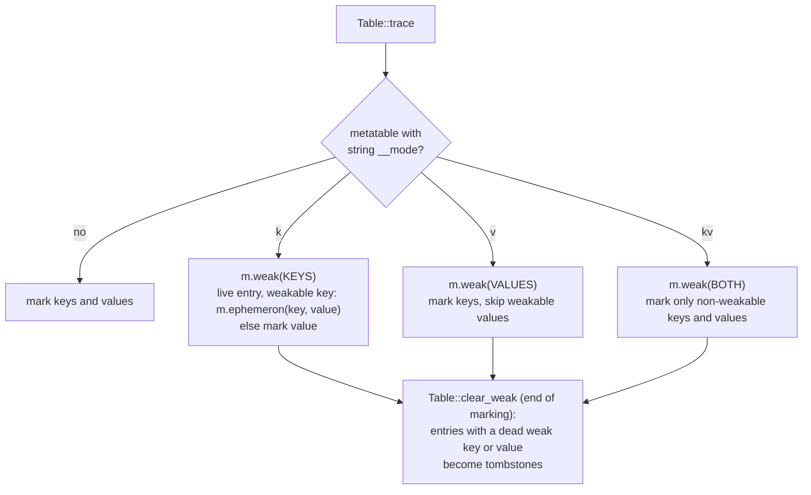

# GC semantics: weak tables, finalizers and `collectgarbage`

Status: Implemented. Crates: `orbit-gc` (the collector), `orbit-runtime` (the table and metatable hooks in `object`, running finalizers and closing a VM in `vm/gc.rs`, `collectgarbage` in `stdlib`).

This builds on ADR-2: our own collector in `orbit-gc`, independent of the rest of the runtime, with per-object weak modes, ephemerons that wait on their key, and finalizer registration with resurrection. This document is the Lua side: how tables read `__mode`, how `__gc` is registered and run, and what `collectgarbage` does. Every rule comes from the 5.5 manual and from what the reference `lua5.5` binary does.

## What a program can observe

| Area | Rule (checked against `lua5.5`) |
|---|---|
| Weak modes | A table is weak when its metatable has a string `__mode` (read raw) containing `k` (weak keys), `v` (weak values) or both. Any other value, `__mode = 34` included, means strong. The field is read each cycle, so setting `__mode` after `setmetatable` takes effect. |
| What can be removed | Tables, Lua functions, userdata and threads. Strings, numbers, booleans, light userdata and native functions (`print`) are values: an entry is never removed because of them. |
| Weak values | An entry goes when its value is collected. Values are cleared **before** finalizers are queued, so a weak value never hands out an object about to be finalized. |
| Weak keys (ephemerons) | A value is reachable through the entry only while its key is reachable from elsewhere. Cycles through keys and values (`e[k] = {k}`, `e[k1] = k2; e[k2] = k1`) are collected. Keys are cleared **after** finalizers are queued: an entry keyed by an object being finalized is still there inside its `__gc` and goes one cycle later. |
| `__gc` registration | `setmetatable(o, mt)` marks `o` for finalization when `mt` has a non-nil `__gc` at that moment (raw). `__gc = false` registers too. Adding `__gc` to the metatable later does not, unless `setmetatable` is called again. |
| `__gc` call | When a registered object becomes unreachable, it and everything it reaches are kept for one more cycle, and `mt.__gc(o)` runs with whatever `__gc` holds then: nil skips the call, a non-callable value is an error, a callable table works. An object is finalized once; a finalizer that calls `setmetatable` again re-registers it. |
| Order | Most recently registered first, among the objects found unreachable in the same cycle. |
| Errors | An error in a finalizer never propagates. It becomes the warning `error in __gc (msg)`; a non-string error object gives `error object is not a string`, `error()` gives `<no error object>`, and calling a non-function gives `attempt to call a boolean value (metamethod '__gc')`. Warnings are off unless `warn("@on")`. |
| Inside a finalizer | The collector is not re-entered. Automatic collection is suspended, and every `collectgarbage` option returns a single `nil` (`param` returns `-1`) and changes nothing. |
| When finalizers run | During allocation-driven collection, at the end of `collectgarbage()`, after a `step`, and when the state closes. |
| Closing | Normal end of the main chunk, an uncaught error and `os.exit(code, true)` close the state: every object still registered is finalized, most recent first; objects registered during closing are not. `os.exit(code)` without `true` runs none. |

## Weak tables

- **Finding `__mode` without the interner.** `Table::trace` has only the collector's `Marker`. It looks the key up in the metatable by bytes: the string hash is a function of the bytes and the process seed, so `"__mode"`'s hash is computed once, and the probe compares candidate keys' bytes through the marker. One probe per traced table that has a metatable; tables without one pay nothing. The same helpers (`object::gc::weak_mode` and `object::gc::field`) read `__gc` for registration.
- **Which entries are weak.** `object::gc::object(v)` returns the collectable handle of a table, closure, userdata or thread. Strings, numbers, booleans, light userdata and natives have none and are marked normally.
- **Dead entries.** In strong tables a key whose value was set to nil stays marked, so `next` can still find it. In weak tables those keys are not marked, and `clear_weak` turns every entry whose weak key or weak value died, and every dead entry whose key died, into a **tombstone**: key `false`, value nil, hash 0. Real keys never hash to 0, so no lookup matches a tombstone, while probe chains still pass through it and inserts reuse it like any dead entry; the next rebuild drops it. No handle to a freed object stays in a table, so a reused slot can't alias a dead key and checked handles never trip. In the array part a dead value just becomes nil.
- **Cost on strong tables.** One `Option` test on the metatable, which `trace` does anyway. No extra field in `Table`.

How ephemerons are marked and finalizable objects found was chosen by measurement; see [gc-spike-ephemerons.md](gc-spike-ephemerons.md).

## Finalizers

`orbit-gc` does what ADR-2 describes: registration sets a FIN bit and records the object; at the end of marking, unreachable registered objects are resurrected (they and what they reach are marked) and queued newest first; the host takes them one at a time. The Lua parts:

- **Registration** (`object::gc::set_metatable`): `setmetatable` and `debug.setmetatable` on a table or userdata store the metatable through it, and it registers the object when the metatable has a non-nil `__gc`. Registering an object twice does nothing.
- **Running** (`vm/gc.rs`): `Vm::run_finalizers` takes each queued object, looks up `__gc` in its current metatable, and calls it as a nested protected call with the object as its argument. While it runs, automatic collection is stopped (and restored after), and `collectgarbage` returns `nil`. Finalizers can't yield, as in Lua. An error is formatted as above and passed to `warn`.
- **Where they run.**
  1. In the interpreter's safe point, after a collection step, if finalizers are pending: one out-of-line call. The nested call saves and restores the stack top, and the register window is reloaded after it as after any step.
  2. In `collectgarbage("collect")` and `collectgarbage("step")`. Natives can't call Lua directly, so they return through `CallThen` into a continuation that calls the next pending finalizer (protected, errors to warnings) until the queue is empty.
  3. In `Vm::close()`: every registered object is queued, then the runner runs; objects registered from then on are not finalized. `orbit-cli` calls it at the end of a script and after an uncaught error. `os.exit(code, true)` closes through `close_then`, the same steps run from a native through `CallThen`: it works inside a finalizer too (the finalizers still queued run), and the collector stays stopped afterwards because the process exits next.
- **Safety.** A resurrected object's children are marked in the same cycle, before the sweep, and the object stays marked from the finalize queue (a root) until the host takes it; the host then roots it on the VM stack for the call. Freeing a resurrected object's children is the bug that ruled out `boa_gc` ([s0-spike.md](s0-spike.md)); it is covered by `orbit-gc`'s tests and by the GC compatibility programs under `ORBIT_GC_STRESS=1` with checked handles.

## `collectgarbage`

| Option | Behaviour |
|---|---|
| `"collect"` (default) | Finish any cycle, run a full one, run pending finalizers. Returns `0`. |
| `"count"` | The heap's bytes / 1024, as a float (objects and what they own; not the VM's stacks). |
| `"step", n` | `n` = 0: one basic step. `n` > 0: work as if `n` KiB had been allocated (`Heap::step_with`). Runs pending finalizers. Returns true if the step finished a cycle. Works while the collector is stopped and does not restart it. In generational mode it runs one collection, minor or major as pacing decides, and returns true if it was a major one. |
| `"stop"`, `"restart"` | Stop or restart automatic collection. Return `0`. |
| `"isrunning"` | Not stopped. |
| `"incremental"`, `"generational"` | Switch the collector's mode, return the previous one. Switching to generational runs a full collection. Isolates start in `"generational"` (`Config::gc_mode`), as the standalone `lua5.5` does. Generational mode puts a 1 MiB floor under the heap size that starts a major collection (`ORBIT_GC_MIN_THRESHOLD` changes it, `0` turns it off; ADR-2); incremental mode has none. |
| `"param", name [, value]` | Return the old value; set it when `value` is given and not negative. `pause` maps to `Params::growth` (`pause - 100`, floored at 0), `stepmul` to `Params::work_ratio / 4`, `stepsize` to `Params::step_bytes`; `stepsize` 0 makes every step finish its cycle (stop-the-world). `minormul`, `minormajor` and `majorminor` map to the generational parameters (`minor_percent`, `major_percent`, `minor_return_percent`); their defaults are ours, not `lua5.5`'s. Unknown names: `bad argument #2 ... (invalid option 'x')`. |
| anything else | `bad argument #1 to 'collectgarbage' (invalid option 'x')`. |

With these mappings the defaults read as `lua5.5`'s: pause 250, stepmul 200. `stepsize` reads 16384 where `lua5.5` says 9600. Values are stored exactly, where `lua5.5` stores a compressed approximation (`0x7ffffffe` reads back as `396800`). Both differences are in `tests/lua-5.5/DEVIATIONS.md`.

## Tests

- `tests/diff/compat/c4_gc_*.lua`: weak modes, ephemeron cycles, finalizer order and resurrection, errors in `__gc`, closing, and `collectgarbage` options and errors, diffed against `lua5.5` plain, with `ORBIT_GC_STRESS=1`, and in a debug build (checked handles).
- Unit tests in `orbit-runtime` for tombstones and the `__mode` lookup, and in `orbit-gc` for ephemerons, finalization and resurrection.
- The official suite's `gc.lua`, `gengc.lua` and `big.lua`.
