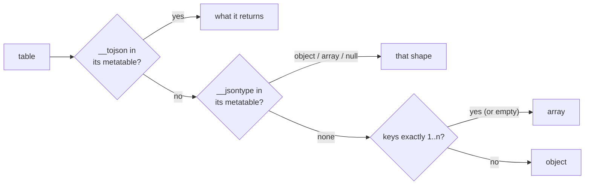

# The `std.json` module

Status: **Proposed**. Tym decided that JSON is a standard library module backed by `serde_json` (2026-10-18, ADR-12 D13); the API below is the plan's default, to settle in review.

`orbit-std` has it behind the `json` feature, which the `orbit` CLI (feature `json`, on by default) and `liborbit` turn on. It uses only the public `orbit` API (the stack layer), so `orbit-runtime` takes no JSON dependency (D4).

## Reaching it

```lua
local json = require "std.json"
```

```rust
use std::json;
```

[`examples/json`](../../examples/json/) uses the whole API in OrbitScript (`json.orb`) and Lua (`json.lua`), and is checked with the other examples.

It is never a global and never the bare name `json`, so a program that ships its own `json.lua` keeps loading that.

## API

| Call | Gives |
|---|---|
| `json.encode(value [, options])` | The JSON text. Raises an error for anything JSON can't hold, saying what and where (`cannot encode a function at value.handlers[2]`) |
| `json.decode(text [, options])` | The value, or `nil` and `serde_json`'s message (`expected value at line 1 column 7`) |
| `json.null` | Stands for JSON's `null`, so it survives inside tables; `tostring` gives `null`, and it can't be changed |
| `json.object([t])`, `json.array([t [, n]])` | `t` (or a new table) marked to encode as an object or an array whatever its keys. A marked array may have holes, written as `null`; with `n` it has length `n` |
| `json.int(v)`, `json.float(v)`, `json.string(v)`, `json.bool(v)` | `v` converted by the rules of OrbitScript's runtime `as` (Tym 2026-10-19): `int` takes integers and integral floats; `float` numbers (numerals are `tonumber`'s job); `string` strings, numbers, booleans and values with `__tostring` (as `tostring` writes them); `bool` is `false` for `nil` and `false`, `true` otherwise (`json.null` included), as conditions treat values. They run OrbitScript's casts themselves (a four-function chunk compiled on first use, since compiling it at install added 11% to `orbit -e ''`'s instructions), so the rules can't drift; an error names the argument (`bad argument #1 to 'int' (cannot cast string to int)`). They give plain values, so `math.tointeger(x)`, `x + 0.0` or `tostring(x)` say the same thing |
| `json.number(numeral)` | A value written exactly as `numeral` (`json.number("19.90")`, a 20-digit ID): for numbers a Lua integer or float can't hold. The numeral must be valid JSON; `tostring` gives it back |

`encode`'s options are a table: `pretty = true` writes one member per line indented by two spaces, and `sort_keys = true` writes object keys in byte order, for output that diffs and tests well. Without it members come in `next` order. `decode`'s option `keep_null = false` decodes `null` as `nil`: object members go away, and an array with holes is marked with its length, so it encodes back with its `null`s.

Lua's own types already decide each scalar's JSON type (`1`, `1.0` and `"1"` all write differently), so the scalar helpers are conversions that give plain values (Tym 2026-10-19: a plain cast is as good a way to say what to write). The markers cover what a plain value can't say: an empty table's shape, an array's holes and length, and a numeral beyond Lua's numbers.

## Values



- **`__tojson`**: a table or userdata whose metatable has a `__tojson` function is written as whatever that function returns for it, so a type picks its own JSON form (`fn __tojson(self) { json::array([self.x, self.y]) }` in an OrbitScript `impl`). A table it returns must be marked with `json.array` or `json.object` (or have a `__tojson` of its own), so the hook says the shape it writes; strings, numbers, booleans and `json.null` are written as they are. Its errors go to `encode`'s caller; giving back the value itself, or a table that holds it, is a cycle error.
- **Tables**: an array when the keys are exactly `1..n` (an empty table is `[]`), otherwise an object. Object keys are strings, or numbers written as text (`{[1] = "a", [3] = "c"}` is `{"1":"a","3":"c"}`); other key types are an error. A metatable's `__jsontype` field (`"object"`, `"array"` or `"null"`) decides instead, which is what the markers and `json.null` use, and lets a class pick its shape. A table marked as an array whose keys aren't positive integers, or go past its length, is an error.
- **Numbers** keep their subtype both ways: `1` and `1.0` encode differently and decode back to an integer and a float. A numeral past the 64-bit integers decodes to the nearest float, as Lua reads it: `serde_json` hands over numbers already converted unless its `arbitrary_precision` feature is on, which passes them through a private map key, so keeping them exact on decode waits for a cleaner way in. NaN and infinities are an error.
- **Strings** must be valid UTF-8 to encode; decoding gives UTF-8 with escapes resolved.
- **`nil`** at the top encodes as `null`. JSON `null` decodes to `json.null`, so arrays keep their length.
- **Empty objects** decode marked as objects, so `{}` round-trips; empty arrays are `[]` anyway.
- **Limits**: tables nest at most 128 deep both ways (`serde_json`'s decoding limit), and a table that contains itself is an error rather than a hang.

These are the usual Lua JSON library conventions (dkjson's `__jsontype`, lua-cjson's `null` sentinel), observed from their documentation. dkjson's `__tojson` returns JSON text instead; returning a value keeps the hook independent of `encode`'s options and lets the result be checked like any other value.

## How it's built

`encode` walks the value with the stack API and writes into one buffer; `serde_json` writes the strings (escaping) and floats (shortest round-trip form). `decode` runs `serde_json`'s parser with a visitor that pushes values straight onto the stack, so there is no intermediate `serde_json::Value` tree. The scoped handle API isn't used because each handle keeps a window slot until the call ends, which a large document would grow without bound.

## Costs

Measured 2026-10-19, cloud x86_64, release builds without PGO:

- **Size**: +72.7 KiB on the static `orbit` (2,201,200 → 2,275,680 bytes), mostly `serde_json`'s parser and number formatting. Builds without the feature carry nothing.
- **Speed**: a 2.2 MB document of 20,000 small records encodes in about 46 ms and decodes in about 45 ms (about 48 MB/s each way, best of three), decoding including building the tables.

## Not yet

- Decoding big numbers exactly (as `json.number`), and keys as integers.
- Streaming (reading from a file without the whole text in memory).
