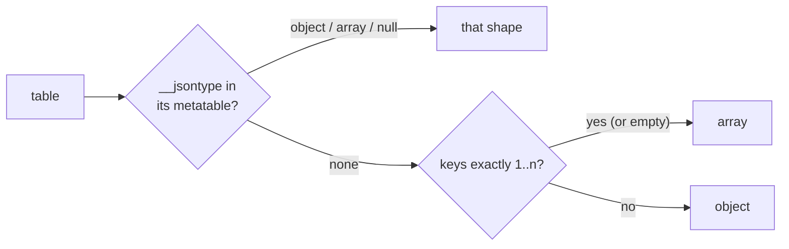

# The `std.json` module

Status: **Proposed**. Tym decided that JSON is a standard library module backed by `serde_json` (2026-10-18, ADR-12 D13); the API below is the plan's default, to settle in review.

`orbit-std` has it behind the `json` feature, which the `orbit` CLI (feature `json`, on by default) and `liborbit` turn on. It uses only the public `orbit` API (the stack layer), so `orbit-runtime` takes no JSON dependency (D4).

## Reaching it

```lua
local json = require "std.json"
```

```rust
use std::json;
```

It is never a global and never the bare name `json`, so a program that ships its own `json.lua` keeps loading that.

## API

| Call | Gives |
|---|---|
| `json.encode(value [, options])` | The JSON text. Raises an error for anything JSON can't hold, saying what and where (`cannot encode a function at value.handlers[2]`) |
| `json.decode(text)` | The value, or `nil` and `serde_json`'s message (`expected value at line 1 column 7`) |
| `json.null` | Stands for JSON's `null`, so it survives inside tables; `tostring` gives `null`, and it can't be changed |
| `json.object([t])`, `json.array([t])` | `t` (or a new table) marked to encode as an object or an array whatever its keys |

`encode`'s options are a table: `pretty = true` writes one member per line indented by two spaces, and `sort_keys = true` writes object keys in byte order, for output that diffs and tests well. Without it members come in `next` order.

## Values



- **Tables**: an array when the keys are exactly `1..n` (an empty table is `[]`), otherwise an object. Object keys are strings, or numbers written as text (`{[1] = "a", [3] = "c"}` is `{"1":"a","3":"c"}`); other key types are an error. A metatable's `__jsontype` field (`"object"`, `"array"` or `"null"`) decides instead, which is what the markers and `json.null` use, and lets a class pick its shape. A table marked as an array whose keys aren't `1..n` is an error.
- **Numbers** keep their subtype both ways: `1` and `1.0` encode differently and decode back to an integer and a float. A numeral past the 64-bit integers decodes to the nearest float, as Lua reads it. NaN and infinities are an error.
- **Strings** must be valid UTF-8 to encode; decoding gives UTF-8 with escapes resolved.
- **`nil`** at the top encodes as `null`. JSON `null` decodes to `json.null`, so arrays keep their length.
- **Empty objects** decode marked as objects, so `{}` round-trips; empty arrays are `[]` anyway.
- **Limits**: tables nest at most 128 deep both ways (`serde_json`'s decoding limit), and a table that contains itself is an error rather than a hang.

These are the usual Lua JSON library conventions (dkjson's `__jsontype`, lua-cjson's `null` sentinel), observed from their documentation.

## How it's built

`encode` walks the value with the stack API and writes into one buffer; `serde_json` writes the strings (escaping) and floats (shortest round-trip form). `decode` runs `serde_json`'s parser with a visitor that pushes values straight onto the stack, so there is no intermediate `serde_json::Value` tree. The scoped handle API isn't used because each handle keeps a window slot until the call ends, which a large document would grow without bound.

## Costs

Measured 2026-10-19, cloud x86_64, release builds without PGO:

- **Size**: +72.7 KiB on the static `orbit` (2,201,200 → 2,275,680 bytes), mostly `serde_json`'s parser and number formatting. Builds without the feature carry nothing.
- **Speed**: a 2.2 MB document of 20,000 small records encodes in about 46 ms and decodes in about 45 ms (about 48 MB/s each way, best of three), decoding including building the tables.

## Not yet

- Decoding options (a different value for `null`, keys as integers).
- `__tojson` metamethods.
- Streaming (reading from a file without the whole text in memory).
