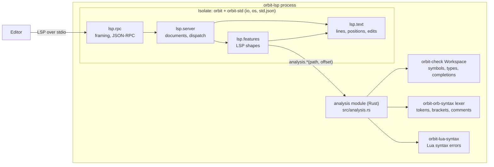

# Language server (`orbit-lsp`)

Status: Implemented. Crate: `orbit-lsp`. Decisions: [ADR-12](../adr/0012-developer-tooling.md).

## Summary

`orbit-lsp` is the language server for OrbitScript and Lua. An editor starts it and talks LSP over its standard input and output. It is a small Rust program on the public `orbit` API, and most of it is OrbitScript:

- **The protocol layer is OrbitScript**, bundled in the binary (`crates/orbit-lsp/scripts/lsp/`). It handles the framing, JSON (`std.json`), the open documents and their edits, positions in UTF-16 or UTF-8, and turns answers into LSP's shapes.
- **The analysis is the checker.** The host registers a module `analysis` whose functions ask `orbit-check`'s library what it knows about a file at a byte offset. The scripts call it the way any embedder's scripts call a host module.



## What it answers

| LSP request | OrbitScript (`.orb`, `.orbi`) | Lua (`.lua`) |
|---|---|---|
| `publishDiagnostics` | Syntax, name, module and type errors and warnings from the checker | Syntax errors, several per file (recovering parser) |
| `documentSymbol` | Items and their members, as a tree | none |
| `foldingRange` | Each bracketed block, up to the line before its closing bracket; runs of comment lines | none |
| `selectionRange` | Token, inside of each enclosing bracket pair, the pair, the file | the file |
| `semanticTokens/full` | Keywords, literals, comments (doc comments with the `documentation` modifier), names by what they name | none |
| `definition`, `references`, `documentHighlight` | Through `use`, into other modules and the bundled stubs | none |
| `prepareRename`, `rename` | Locals, items and members the workspace owns (not the stubs) | none |
| `hover` | The declaration's first line and its `///` comment, or a value's type | none |
| `completion` | Names in scope, keywords, `use` paths, `Type::` items, fields and methods after `.` | none |
| `signatureHelp` | The call's signature and the active parameter | none |
| `inlayHint` | Types of `let` bindings without an annotation | none |
| `workspace/symbol` | Items in every `.orb` file under the root (up to 2,000 files), fuzzy-matched | none |
| `formatting`, `rangeFormatting` | `orbit-fmt`'s layout ([formatter.md](formatter.md)), as one edit covering only what changes; a range formats the whole top-level items it touches. A file with a syntax error gets no edits; one the formatter can't format yet (a comment inside an expression) fails the request with the line | none |

A request at the position right after a name (where the cursor usually is) answers for that name.

## Documents, files and modules

- **Open documents** are kept by the scripts (`lsp::documents`) and their text is given to the checker (`analysis.open`), which uses it in place of the file on disk. Edits are incremental (`textDocumentSync.change = 2`); each change is applied in order. After every open, change and close the server publishes the diagnostics of every open document, because an edit to one module can change what another reports.
- **Files that aren't open** can still be asked about (an outline of a file the editor shows from a search, say): the server reads them from disk for that request.
- **Modules.** The root is the editor's folder (`rootUri`, else `rootPath`). `use a::b` is found the way `package.path` would find it: the `searchPath` initialization option first (a list of templates), then `LUA_PATH_5_5` or `LUA_PATH` if set (`;;` stands for the defaults), else the defaults `?.orb;?/init.orb;?.lua;?/init.lua`. A Lua module with a `.orbi` stub beside it is checked through the stub.
- **The standard library's stubs** are bundled in the checker. So that go to definition can open them, the server copies each one it points at to the cache directory (`$XDG_CACHE_HOME`, else `%LOCALAPPDATA%`, else `~/.cache`, then `orbit-lsp/<version>/builtin/`).

## Positions

LSP counts columns in UTF-16 code units unless both sides agree otherwise. The server offers UTF-8 when the editor lists it in `general.positionEncodings` (byte columns, as the checker counts) and uses UTF-16 otherwise. `lsp.text` keeps each document's line starts and converts between byte offsets and positions per line, so a long file costs a binary search and a walk over one line.

## Errors

- A handler that fails (an error in a script, or in the checker) answers that request with `InternalError` and its message, and the server keeps going.
- Requests before `initialize` get `ServerNotInitialized`; unknown requests `MethodNotFound`; unknown notifications are ignored.
- `exit` ends the process with status 0 after `shutdown`, 1 without it.
- Logging goes to standard error, which editors show in their output panel.

## Building and packaging

`orbit-lsp` is a workspace member but not a default member, so a root `cargo build --release` (and the PGO profile) are unchanged. `cargo build --release -p orbit-lsp` gives a self-contained binary (feature `runtime`, the default). Built with `--no-default-features --features shared` it uses the runtime in `liborbit` instead (ADR-10) and finds it through its run path (`../lib`, then its own directory), as `orbit` does. `./build.sh` puts it in both layouts as `bin/orbit-lsp`: the shared one beside `orbit` and `orbitc` over `liborbit`, and the static one (`--static`) as a third self-contained program. It is built with the same PGO profile, which covers its runtime.

| Build (cloud x86_64, release, no PGO, `./build.sh --no-pgo`, 2026-10-22) | Size |
|---|---|
| `orbit-lsp`, runtime linked in (`--static`) | 2,597,040 bytes (2.48 MiB) |
| `orbit-lsp` with `shared`, beside `liborbit` | 1,546,952 bytes (1.48 MiB): the checker, both front ends, `orbit-std` and the scripts |

## Using it from an editor

The VS Code extension (`editors/vscode`) starts it. Other editors need only a few lines:

**Neovim** (0.11 or later):

```lua
vim.lsp.config("orbit", {
  cmd = { "orbit-lsp" },
  filetypes = { "orbitscript", "lua" },
  root_markers = { ".git" },
})
vim.filetype.add({ extension = { orb = "orbitscript", orbi = "orbitscript" } })
vim.lsp.enable("orbit")
```

**Helix** (`languages.toml`):

```toml
[language-server.orbit-lsp]
command = "orbit-lsp"

[[language]]
name = "orbitscript"
scope = "source.orbitscript"
file-types = ["orb", "orbi"]
comment-token = "//"
language-servers = ["orbit-lsp"]
```

To add module paths, pass `initializationOptions = { searchPath = { "lib/?.orb" } }` (Neovim) or `config = { searchPath = ["lib/?.orb"] }` (Helix).

## Testing

`crates/orbit-lsp/tests/session.rs` runs the binary as an editor would, over pipes, against a small workspace: diagnostics on open and after incremental edits with wide characters before them, every request in the table above, UTF-8 positions when offered, Lua files, and the protocol's error cases. The scripts are fully annotated and marked `//! orbit-check: strict`; one test runs the checker over them in strict mode against `scripts/analysis.orbi`, the typed stub of the host module, so they stay checker-clean.

## Not supported

- Lua files get syntax errors only; definitions and completion for Lua need name resolution in the checker's Lua path.
- `semanticTokens/range` and `/delta`, code actions, and pull diagnostics.
