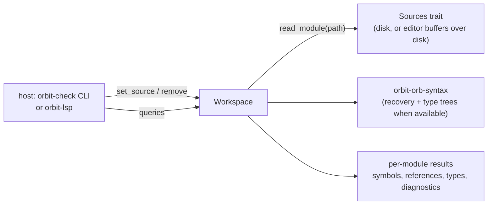

# `orbit-check` library API

Status: Implemented in `crates/orbit-check`. The language server ([language-server.md](../language-server.md)) links this library, so this API, not the command line, is the checker's main interface. What the checker checks and why: [proposal.md](proposal.md).

## Shape



- **One `Workspace` per project.** It owns every module it has loaded, the bundled stdlib stubs and the configuration. No global state, so the CLI and a server use it the same way and tests can run several in parallel.
- **Sources come from the host** through a small trait, so the language server can serve unsaved buffers and fall back to disk for everything else. The workspace never writes files.
- **Lazy and per module.** `set_source` only records new text and marks the module and everything that depends on it, directly or not, stale. A query on a module (re)checks it and, first, any stale module it depends on.
- **Positions are byte offsets** into the module's source, as `orbit_hir::Span` is. Converting to LSP's line and UTF-16 column is the server's job (it has the text). Definition and reference locations cover just the name token, so a rename edits exactly those spans.
- **One id per file:** paths are made absolute (`std::path::absolute`) and `.`/`..` folded lexically, so `./a.orb`, `a.orb` and `/cwd/a.orb` share one `FileId`. Symlinks are not resolved.
- **Plain data:** results (`Diagnostic`, `Symbol`, `DocumentSymbol`, `Location`) are `Clone` and own their strings, since the server copies them into OrbitScript values.
- **Lua modules** reached through `use` resolve to `any` with no errors Navigation inside Lua files comes from the Lua front end on the server's side.

## Types

```rust
pub struct Workspace { /* modules, interners, config */ }

pub struct Config {
    /// The directory `search_path` entries are relative to (`--root`, default `.`).
    pub root: PathBuf,
    /// `package.path`-style templates for `use a::b` (`--path`): `?` becomes `a/b`, tried in order.
    /// Default: ["?.orb", "?/init.orb", "?.lua", "?/init.lua"]. A `.orbi` stub beside a
    /// `.lua` module wins over it; the bundled standard library comes last.
    pub search_path: Vec<String>,
    /// Check every module strictly, as `//! orbit-check: strict` does for one (`--strict`).
    pub strict: bool,
}

pub trait Sources {
    /// The bytes of `path` if it exists. The language server overlays open buffers.
    fn read(&self, path: &std::path::Path) -> Option<Vec<u8>>;
}

#[derive(Clone, Copy, PartialEq, Eq, Hash)]
pub struct FileId(u32);          // stable for a path for the workspace's lifetime

pub struct Location { pub file: FileId, pub span: Span }

// `orbit_hir::Diagnostic`, the type the compiler's front ends report with too.
pub struct Diagnostic {
    pub span: Span,
    pub line: u32,               // 1-based line of `span.start`
    pub severity: Severity,      // Error, Warning, Hint
    pub code: Code,              // stable; prints as `T0101`
    pub message: String,
    pub near: Option<Near>,      // Lua messages only
    pub kind: DiagnosticKind,    // `UnexpectedEof` for input cut short
}

pub struct SymbolId(u32);        // a definition: local, parameter, item, field, variant, method
pub enum SymbolKind { Local, Param, Function, Struct, Enum, Variant, Field, Method, AssocFn, Const, Module, Global }
```

## Calls

```rust
impl Workspace {
    pub fn new(config: Config, sources: Box<dyn Sources>) -> Workspace;

    /// Adds or replaces a module's text (the server calls this on open and change). Returns its id.
    pub fn set_source(&mut self, path: &Path, text: Vec<u8>) -> FileId;
    /// Adds a file to check, read through `Sources` (the CLI's way in).
    pub fn add_file(&mut self, path: &Path) -> FileId;
    /// Forgets the buffer; the module is read from `Sources` again if something still `use`s it.
    pub fn remove(&mut self, file: FileId);
    pub fn file_id(&self, path: &Path) -> Option<FileId>;
    pub fn path(&self, file: FileId) -> &Path;
    pub fn line_col(&self, file: FileId, offset: u32) -> (u32, u32);

    // Diagnostics: parse (with recovery), name resolution, then types.
    pub fn diagnostics(&mut self, file: FileId) -> &[Diagnostic];
    pub fn check_all(&mut self) -> Vec<(FileId, &[Diagnostic])>;

    // Names (resolution and the module graph)
    pub fn document_symbols(&mut self, file: FileId) -> Vec<DocumentSymbol>;   // tree: items, impl members, fields, variants
    pub fn symbol_at(&mut self, file: FileId, offset: u32) -> Option<SymbolId>; // a definition or a reference to one
    pub fn definition(&self, symbol: SymbolId) -> Option<Location>;
    pub fn references(&mut self, symbol: SymbolId) -> Vec<Location>;          // whole workspace for pub items
    pub fn symbol(&self, symbol: SymbolId) -> Option<&Symbol>;               // name, kind, name span, item span, doc spans
    pub fn can_rename(&self, symbol: SymbolId) -> bool;                       // for prepareRename: false for globals, the prelude and stubs
    pub fn completions_at(&mut self, file: FileId, offset: u32) -> Completions;
    pub fn is_builtin(&self, file: FileId) -> bool;                           // the prelude or a bundled stdlib stub
    pub fn builtin_source(&self, file: FileId) -> Option<&'static str>;       // its text, for going to a definition in it

    // Types
    pub fn type_at(&mut self, file: FileId, offset: u32) -> Option<String>;   // display form, for hover and inlay hints
    pub fn signature_at(&mut self, file: FileId, offset: u32) -> Option<SignatureHelp>;
    pub fn inlay_hints(&mut self, file: FileId, range: Span) -> Vec<InlayHint>;
    pub fn display_type(&self, t: TypeId) -> String;
}
```

`Completions` is the items plus `replace`, the span of the partly typed name they replace (empty at the position when there is none). A `Completion` carries a label, a `SymbolKind`, an optional detail (signature or type) and whether it is a keyword. Completion after `.` lists fields and methods of the receiver's type (a string's are the `string` library's functions), after `::` associated functions, variants and module members, and otherwise the names in scope, innermost first, then the prelude's names, then keywords. A bare `p.` or `m::` (a statement that didn't parse) works when the receiver is a plain name. With no type known (`any`), `.` completion returns nothing rather than guessing. At a field name in a struct or variant literal (just after `{` or `,`, not inside a value), it lists the fields not written yet, in declaration order; a name being typed that parsed as a shorthand field still counts as missing. That needs the literal's closing `}` (editors insert it), since a literal cut off at the end of the file doesn't parse.

`SignatureHelp` is the label (`new(x: float, y: float) -> Vec2`), each parameter's byte range in the label, the active parameter and the called function's `SymbolId` (for its doc comment). For `obj.m(...)` the label leaves out `self`. `InlayHint` is an offset just after a name bound without an annotation (a `let`, a pattern, a closure parameter) and a label such as `: int`; names whose type is `any` get none. `TypeId` values come with `display_type`, which writes a type the way messages do (`Vec2?`, `fn(int) -> string`, `#{ x: float }`). A `TypeId` holds until the next `set_source` or `remove`: types are interned for the whole workspace, and once the store holds twice what its last rebuild needed (at least 4096 types), the next edit rebuilds it by rechecking the modules that were up to date. Without that, a long editing session would keep every type it ever made, since an edit that shifts a module's symbols makes new types for everything naming them.

## Diagnostic codes

Codes are stable: one never changes meaning, and a retired code isn't reused. T0003 is the code of a compile error from a front end that doesn't give each of its rules a code (Lua's); the checker reads only OrbitScript and never reports it.

A code marked **compiler** is a rule of the language that the compiler enforces: `orbit` refuses the module with the same message (it prints no codes). The codes are defined in the front end (`orbit_orb_syntax::code`), which is what reports them, to the compiler and to the checker alike. The rest are the checker's alone (`orbit_check::code`) and never stop a module from running. `orbit_check::code::all()` lists both.

| Code | Severity | Reported by | Meaning |
|---|---|---|---|
| T0001 | error | compiler | the module doesn't parse |
| T0002 | error | checker | `use a::b` names no module on the search path |
| T0101 | error | compiler | unknown name |
| T0102 | error | compiler | an item used before its definition in the same function |
| T0103 | error | checker | the module has no public item of that name |
| T0104 | error | compiler | the struct or enum has no such variant or associated item |
| T0105 | error | compiler | a struct literal or pattern names a field the struct doesn't have |
| T0106 | error | checker | a type annotation names something undefined |
| T0107 | error | checker | a type annotation names a value |
| T0108 | error | compiler | a struct literal leaves out a field |
| T0111 | error | compiler | assigning to a `let` or a parameter that isn't `mut` |
| T0112 | error | compiler | assigning to an item (a function, constant, struct, enum or `use`d module) |
| T0113 | error | compiler | assigning to a prelude name that wasn't declared with `extern` |
| T0114 | error | compiler | assigning to something that isn't a name, a field or an element |
| T0201 | error | checker | a value of the wrong type (argument, `let`, field, result, pattern) |
| T0202 | error | checker | too many or too few arguments |
| T0203 | error | checker | no such field or method on the value's type |
| T0204 | error | checker | calling something that isn't a function |
| T0205 | error | checker | `let (a, b) = f()` binds more names than `f` returns |
| T0206 | error | checker | an operator on operand types it doesn't take |
| T0207 | error | checker | a value that may be nil used where nil isn't allowed |
| T0208 | error | checker | `?` in a function whose results can't be `nil, err` |
| T0209 | error | checker | an `as` cast that can never succeed, or `as bool` on a value that is never false |
| T0210 | error | compiler | an `as` target the program can't check while it runs (structural types, `table`, type parameters, aliases) |
| T0301 | warning | checker | `==` or `!=` between types that are never equal |
| T0302 | warning | checker | a bitwise operator on a float |
| T0303 | warning | checker | a condition that is always true |
| T0304 | warning | checker | a record field named like a type (the old map spelling `#{string: int}`) |
| T0305 | warning | checker | an `orbit-check: ignore` that ignores nothing (strict mode) |
| T0306 | warning | checker | an `orbit-check:` comment that isn't a pragma, or names an unknown code |
| T0307 | warning | checker | `t[0]` on an array (arrays start at 1) |
| T0308 | warning | checker | `for i in 0..#t` that reads `t[i]`: it reads `t[0]` and skips the last element |
| T0309 | warning | checker | a local that is never read (names starting with `_` and `let scope` bindings are exempt) |
| T0310 | warning | checker | a `use`d module or name that is never used (`pub use` is exempt) |
| T0401 | error | checker | a `match` on an enum, `bool` or optional value that misses cases |
| T0501 | error | checker | a `pub fn` parameter without a type (strict mode) |
| T0502 | error | checker | a `pub fn` that returns values without a result type (strict mode) |
| T0503 | error | checker | a condition that isn't `bool` (strict mode) |
| T0504 | error | checker | `use` of a Lua module with no `.orbi` stub (strict mode) |
| T0601 | error | compiler | `break` or `continue` outside a loop |
| T0602 | error | compiler | a label no enclosing loop has |
| T0603 | error | compiler | `break` with a value in a `while` or `for` |
| T0604 | error | compiler | `return`, `?`, `break` or `continue` that would leave a `scope` action |
| T0605 | error | compiler | `self` outside a method |
| T0606 | error | compiler | `Self` outside an `impl` block |
| T0607 | error | compiler | a `pub` item below module level |
| T0608 | error | compiler | `use` below module level |
| T0609 | error | compiler | `return` at the top level of a module with `pub` items |
| T0610 | error | compiler | a range used as a value |
| T0611 | error | compiler | a tuple used as a value |
| T0612 | error | compiler | a spread `...` that isn't last in its list |
| T0613 | error | compiler | a spread `...` of something that can't be spread, or where no list takes it |
| T0614 | error | compiler | `.rev()` or `.step_by(s)` misused on a `for` range |
| T0615 | error | compiler | a declaration without a body or value outside a stub file |
| T0616 | error | compiler | a format spec in a template string that isn't supported or is malformed |
| T0701 | error | compiler | a `let` that needs a value and has none |
| T0702 | error | compiler | a pattern a `let` can't take (one that may not match; more than one name for `let scope`) |
| T0703 | error | compiler | a pattern a `for` can't take |
| T0704 | error | compiler | a `mut` loop variable |
| T0705 | error | compiler | a binding inside a `\|` pattern |
| T0706 | error | compiler | a name bound twice in one pattern |
| T0707 | error | compiler | a tuple pattern that isn't a whole `match` arm |
| T0708 | error | compiler | a range pattern whose bounds aren't both numbers or both strings |
| T0709 | error | compiler | a struct pattern that leaves out a field without `..` |
| T0710 | error | compiler | an enum named where one of its variants is needed |
| T0711 | error | compiler | braces after a variant without fields, or none after one with fields |
| T0801 | error | compiler | a parameter name used twice |
| T0802 | error | compiler | a field declared twice |
| T0803 | error | compiler | a variant declared twice |
| T0804 | error | compiler | an `impl` member the type already has, as a member or a variant |
| T0805 | error | compiler | a field given twice in a struct literal |
| T0806 | error | compiler | a `const` that isn't a literal or another `const` |
| T0807 | error | compiler | an `impl` for something that isn't a struct or enum of the module |

## Pragmas and strict mode

- `// orbit-check: ignore` drops everything reported on its line, and `// orbit-check: ignore[T0207, T0201]` only those codes. It cannot drop a syntax error or what stops the module compiling (the codes marked compiler above): the module wouldn't run. The comment goes at the end of the line it covers.
- `//! orbit-check: strict` checks the module strictly, and `//! orbit-check: off` reports only syntax and compile errors for it. `Config::strict` (`--strict`) makes every module strict except those marked `off`; the bundled stubs are never strict.
- Strict mode adds T0501-T0504, and T0305 for an `ignore` with nothing to ignore. A `pub fn` in a module or a `pub` method needs types on its parameters (`self` aside) and, when it returns values, a result type. A condition must be `bool` (or `any`): `if n` becomes `if n > 0`, `if x` on an optional becomes `if x != nil`. An untyped Lua module is reported once, at its `use`, rather than at every use of a value from it.
- `orbit-check --deny-warnings` exits with status 1 on warnings too.

## Broken code

- The checker parses with recovery (`parse_recovering`): every syntax error is reported, and a statement or item that didn't parse becomes an `Error` node. Resolution and checking treat it as `any` and report nothing further about it. Names it would have defined are unknown to the code after it.
- Every module is also lowered as the compiler lowers it, by the compiler's own lowering in its collecting mode (`lower_collecting`, see [the front end](../orbitscript-front-end.md)): it goes on after an error, passes over `Error` nodes, and leaves the tree for the checker. Each error is reported with its code and the compiler's message. So a module with no errors from the checker is one the compiler accepts, and the server should take `.orb` diagnostics from the checker only, not from both. The checker still has rules of its own for a few of the same mistakes (an unknown name, a use before the definition, a missing or unknown field, an `as` target that can't be checked); when it reports one under the same code at the same place, the compiler's copy is left out. No pragma hides a compile error: the module doesn't run until it is fixed. Stubs are not lowered. `tests/agreement.rs` holds the checker to this: every `.orb` file in the repository, and a few thousand broken variants of them, must compile whenever the checker reports no errors.

## Stubs

The prelude and the standard library come from bundled `.orbi` files (`crates/orbit-check/stubs/`), shown as `<builtin>/NAME.orbi`; `std.json` is `stubs/std/json.orbi`, shown as `<builtin>/std/json.orbi`. `tests/stubs.rs` fails when a stub and the runtime's libraries, or the prelude and the front end's list, disagree.

### How the stubs are written

- A body-less function with no `->` has unknown results (each `any`). `-> ()` means no results. A function whose result count depends on the arguments says what it can with a variadic result: `pcall` is `-> (bool, ...any)`, `string.byte` is `-> ...int`, `table.unpack` is `<T>(list: [T] | table, ...) -> ...T`.
- `...T` results: each name a `let` binds from them, and each position a caller reads, has type `T` (leniently, as array indexing does, though there may be fewer values), and a `let` binding more names than the fixed results is not a T0205. A `return` checks every extra value against `T`. A function whose inferred results include a call ending in `...T` ends in `...T` too.
- A parameter written `T?` may be left out; an unannotated or `any` parameter needs an argument.
- Strings take the `string` stub's functions as methods: `s.upper()` checks as `string::upper(s)`.
- A stub may declare a body-less function more than once (overloads): a call takes the first declaration its arguments fit, so `math::random()` is `float` and `math::random(1, 6)` is `int`. When none fits, the error lists every form (T0201). Hover and signature help show the last declaration. Overloads exist only in stubs; OrbitScript code can't declare them.
- Lua functions whose result type depends on the arguments' types otherwise return the argument's type through a generic (`math::abs<T>(x: T) -> T`), or `any` where nothing simpler is right (`os::date`, whose result depends on the format string's value).

## Language server contract

- The workspace owns a `Box<dyn Sources>`; open buffers go through `set_source`.
- No cancellation: the server drops stale requests, and checks are per module.
- Doc comments: the parser attaches `docs: Vec<Span>` to items; the checker passes the spans on and the server slices the text.
- Parser options (type trees, stub files, recovery, doc comments and trivia) are one `ParseOptions` design in the shared parser, every flag off for `load`. With `recover`, the AST gets `Error` nodes in expressions, statements, items and types, which the checker treats as `any` without further errors.
- Lints: assigning to a local counts as using it, so a value that is only ever written is not reported by T0309.
