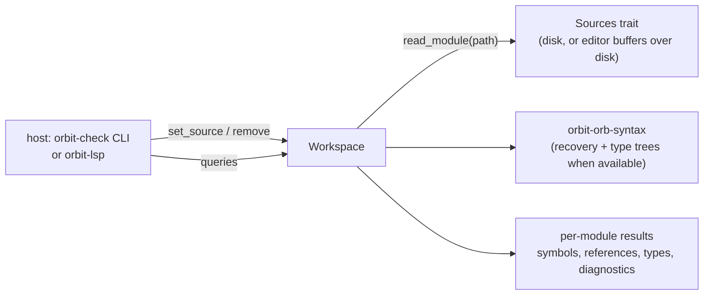

# `orbit-check` library API (draft for the language server)

Status: **Agreed with the language server thread** (2026-10-18). The first part (names) is implemented in `crates/orbit-check`. Tym decided the language server links this library (dev tooling D1), so this API, not the command line, is the checker's main interface. Design background: [proposal.md](proposal.md).

## Shape



- **One `Workspace` per project.** It owns every module it has loaded, the bundled stdlib stubs and the configuration. No global state, so the CLI and a server use it the same way and tests can run several in parallel.
- **Sources come from the host** through a small trait, so the language server can serve unsaved buffers and fall back to disk for everything else. The workspace never writes files.
- **Lazy and per module.** `set_source` only records new text and marks the module stale. A query on a module (re)checks it and, first, any stale module it depends on. A module's dependents are rechecked only if its exported signatures changed, so an edit inside a function body doesn't recheck the project.
- **Positions are byte offsets** into the module's source, as `orbit_hir::Span` is. Converting to LSP's line and UTF-16 column is the server's job (it has the text). Definition and reference locations cover just the name token, so a rename edits exactly those spans.
- **One id per file:** paths are made absolute (`std::path::absolute`) and `.`/`..` folded lexically, so `./a.orb`, `a.orb` and `/cwd/a.orb` share one `FileId`. Symlinks are not resolved.
- **Plain data:** results (`Diagnostic`, `Symbol`, `DocumentSymbol`, `Location`) are `Clone` and own their strings, since the server copies them into OrbitScript values.
- **Lua modules** reached through `use` resolve to `any` with no errors (T11). Navigation inside Lua files comes from the HIR on the server's side.
- **Rechecks:** an edit rechecks the file and everything that depends on it. Narrowing that to dependents whose imports actually changed is a later optimization.

## Types

```rust
pub struct Workspace { /* modules, interners, config */ }

pub struct Config {
    /// `package.path`-style search templates for `use a::b`, tried in order.
    /// Default: ["./?.orb", "./?/init.orb", "./?.lua", "./?/init.lua"], plus stubs (`?.orbi`) beside each.
    pub search_path: Vec<String>,
    pub strict: bool,
    /// `extern` names the host provides, with optional types (`--extern NAME: T`).
    pub externs: Vec<(String, Option<String>)>,
}

pub trait Sources {
    /// The bytes of `path` if it exists. The language server overlays open buffers.
    fn read(&self, path: &std::path::Path) -> Option<Vec<u8>>;
}

#[derive(Clone, Copy, PartialEq, Eq, Hash)]
pub struct FileId(u32);          // stable for a path for the workspace's lifetime

pub struct Location { pub file: FileId, pub span: Span }

pub struct Diagnostic {
    pub file: FileId,
    pub span: Span,
    pub severity: Severity,      // Error, Warning, Hint
    pub code: Code,              // stable, e.g. T0101; `Code::as_str()`
    pub message: String,
    pub related: Vec<(Location, String)>,   // "defined here", "previous arm"
}

pub struct SymbolId(u32);        // a definition: local, parameter, item, field, variant, method
pub enum SymbolKind { Local, Param, Function, Struct, Enum, Variant, Field, Method, AssocFn, Const, Module, Global }
```

## Calls

```rust
impl Workspace {
    pub fn new(config: Config, sources: Box<dyn Sources>) -> Workspace;

    /// Adds or replaces a module's text (the server calls this on open and change). Returns its id.
    pub fn set_source(&mut self, path: &Path, text: Vec<u8>) -> FileId;
    /// Adds a file to check, read through `Sources` (the CLI's way in).
    pub fn add_file(&mut self, path: &Path) -> FileId;
    /// Forgets the buffer; the module is read from `Sources` again if something still `use`s it.
    pub fn remove(&mut self, file: FileId);
    pub fn file_id(&self, path: &Path) -> Option<FileId>;
    pub fn path(&self, file: FileId) -> &Path;

    // Diagnostics: parse (with recovery), name resolution, then types.
    pub fn diagnostics(&mut self, file: FileId) -> &[Diagnostic];
    pub fn check_all(&mut self) -> Vec<(FileId, &[Diagnostic])>;

    // L1: names (resolution and the module graph)
    pub fn document_symbols(&mut self, file: FileId) -> Vec<DocumentSymbol>;   // tree: items, impl members, fields, variants
    pub fn symbol_at(&mut self, file: FileId, offset: u32) -> Option<SymbolId>; // a definition or a reference to one
    pub fn definition(&mut self, symbol: SymbolId) -> Location;
    pub fn references(&mut self, symbol: SymbolId) -> Vec<Location>;          // whole workspace for pub items
    pub fn symbol(&self, symbol: SymbolId) -> Option<&Symbol>;               // name, kind, name span, item span; later signature and doc spans
    pub fn can_rename(&self, symbol: SymbolId) -> bool;                       // for prepareRename: false for globals, the prelude and stubs
    pub fn completions_at(&mut self, file: FileId, offset: u32) -> Vec<Completion>;
    pub fn workspace_symbols(&mut self, query: &str) -> Vec<(SymbolId, Location)>;

    // L2: types
    pub fn type_at(&mut self, file: FileId, offset: u32) -> Option<String>;   // display form, for hover and inlay hints
    pub fn signature_at(&mut self, file: FileId, offset: u32) -> Option<SignatureHelp>;
    pub fn inlay_hints(&mut self, file: FileId, range: Span) -> Vec<InlayHint>;
}
```

`Completion` carries a label, a `SymbolKind`, an optional detail (signature or type) and whether it is a keyword. Completion after `.` lists fields and methods of the receiver's type, after `::` associated functions, variants and module members, in a struct literal the missing fields, and otherwise names in scope plus keywords. With no type known (`any`), `.` completion returns nothing rather than guessing.

## Broken code (dev tooling D3)

- With parser recovery on, the AST contains `Error` nodes. Resolution and checking treat an `Error` expression or type as `any` and report nothing further about it, so one typo doesn't produce a cascade.
- Until recovery lands, a module that fails to parse keeps the results of its last successful parse for queries (marked stale) and reports the one parse error.
- Lowering is not run. The checker reports the name errors lowering reports today ("cannot find `x` in this scope", "used before its definition"), in the same words, so the server should take `.orb` diagnostics from the checker only, not from both.

## Build order

1. Skeleton (this thread, first PR): `Workspace`, `Sources`, `FileId`, `Diagnostic`, module graph through `use`, name resolution with a kept symbol table, `document_symbols`, `symbol_at`, `definition`, `references`, and an `orbit-check` CLI that prints resolution errors. That is everything L1 needs except completion and types.
2. Types (C2, C3): `diagnostics` gains type errors; `type_at`, `signature_at`, `inlay_hints`, member completion.
3. Stubs (C4): the stdlib from bundled `.orbi` files once the parser has a stub option.

## Agreed with the language server thread (2026-10-18)

- The workspace owns a `Box<dyn Sources>`; open buffers go through `set_source`.
- No cancellation in v1: the server drops stale requests, and checks are per module.
- Doc comments: the front end attaches `docs: Vec<Span>` to items (its C0 work); the checker passes the spans on and the server slices the text.
- Parser work (type trees, stub files, and later recovery and trivia) is done by the OrbitScript front end thread as one `ParseOptions` design, every flag off for `load`. With `recover`, the AST gets `Error` nodes in expressions, statements, items and types, which the checker treats as `any` without further errors.
