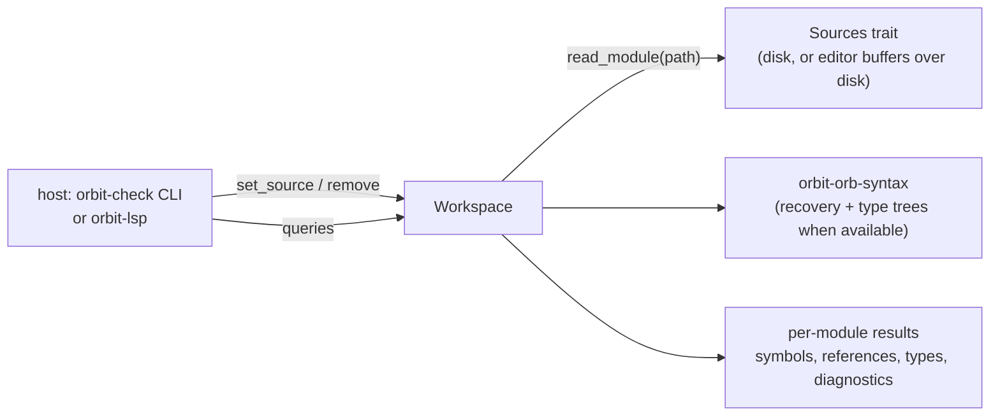

# `orbit-check` library API (draft for the language server)

Status: **Agreed with the language server thread** (2026-10-18). Names (stage 1), types (stage 2) and the bundled stubs (stage 3) are implemented in `crates/orbit-check`. Tym decided the language server links this library (dev tooling D1), so this API, not the command line, is the checker's main interface. Design background: [proposal.md](proposal.md).

## Shape



- **One `Workspace` per project.** It owns every module it has loaded, the bundled stdlib stubs and the configuration. No global state, so the CLI and a server use it the same way and tests can run several in parallel.
- **Sources come from the host** through a small trait, so the language server can serve unsaved buffers and fall back to disk for everything else. The workspace never writes files.
- **Lazy and per module.** `set_source` only records new text and marks the module stale. A query on a module (re)checks it and, first, any stale module it depends on. A module's dependents are rechecked only if its exported signatures changed, so an edit inside a function body doesn't recheck the project.
- **Positions are byte offsets** into the module's source, as `orbit_hir::Span` is. Converting to LSP's line and UTF-16 column is the server's job (it has the text). Definition and reference locations cover just the name token, so a rename edits exactly those spans.
- **One id per file:** paths are made absolute (`std::path::absolute`) and `.`/`..` folded lexically, so `./a.orb`, `a.orb` and `/cwd/a.orb` share one `FileId`. Symlinks are not resolved.
- **Plain data:** results (`Diagnostic`, `Symbol`, `DocumentSymbol`, `Location`) are `Clone` and own their strings, since the server copies them into OrbitScript values.
- **Lua modules** reached through `use` resolve to `any` with no errors (T11). Navigation inside Lua files comes from the HIR on the server's side.
- **Rechecks:** an edit rechecks the file and everything that depends on it. Narrowing that to dependents whose imports actually changed is a later optimization.

## Types

```rust
pub struct Workspace { /* modules, interners, config */ }

pub struct Config {
    /// `package.path`-style search templates for `use a::b`, tried in order.
    /// Default: ["./?.orb", "./?/init.orb", "./?.lua", "./?/init.lua"]. A `.orbi` stub beside a
    /// `.lua` module wins over it; the bundled standard library comes last.
    pub search_path: Vec<String>,
    pub strict: bool,
    /// `extern` names the host provides, with optional types (`--extern NAME: T`).
    pub externs: Vec<(String, Option<String>)>,
}

pub trait Sources {
    /// The bytes of `path` if it exists. The language server overlays open buffers.
    fn read(&self, path: &std::path::Path) -> Option<Vec<u8>>;
}

#[derive(Clone, Copy, PartialEq, Eq, Hash)]
pub struct FileId(u32);          // stable for a path for the workspace's lifetime

pub struct Location { pub file: FileId, pub span: Span }

pub struct Diagnostic {
    pub file: FileId,
    pub span: Span,
    pub severity: Severity,      // Error, Warning, Hint
    pub code: Code,              // stable, e.g. T0101; `Code::as_str()`
    pub message: String,
    pub related: Vec<(Location, String)>,   // "defined here", "previous arm"
}

pub struct SymbolId(u32);        // a definition: local, parameter, item, field, variant, method
pub enum SymbolKind { Local, Param, Function, Struct, Enum, Variant, Field, Method, AssocFn, Const, Module, Global }
```

## Calls

```rust
impl Workspace {
    pub fn new(config: Config, sources: Box<dyn Sources>) -> Workspace;

    /// Adds or replaces a module's text (the server calls this on open and change). Returns its id.
    pub fn set_source(&mut self, path: &Path, text: Vec<u8>) -> FileId;
    /// Adds a file to check, read through `Sources` (the CLI's way in).
    pub fn add_file(&mut self, path: &Path) -> FileId;
    /// Forgets the buffer; the module is read from `Sources` again if something still `use`s it.
    pub fn remove(&mut self, file: FileId);
    pub fn file_id(&self, path: &Path) -> Option<FileId>;
    pub fn path(&self, file: FileId) -> &Path;

    // Diagnostics: parse (with recovery), name resolution, then types.
    pub fn diagnostics(&mut self, file: FileId) -> &[Diagnostic];
    pub fn check_all(&mut self) -> Vec<(FileId, &[Diagnostic])>;

    // L1: names (resolution and the module graph)
    pub fn document_symbols(&mut self, file: FileId) -> Vec<DocumentSymbol>;   // tree: items, impl members, fields, variants
    pub fn symbol_at(&mut self, file: FileId, offset: u32) -> Option<SymbolId>; // a definition or a reference to one
    pub fn definition(&mut self, symbol: SymbolId) -> Location;
    pub fn references(&mut self, symbol: SymbolId) -> Vec<Location>;          // whole workspace for pub items
    pub fn symbol(&self, symbol: SymbolId) -> Option<&Symbol>;               // name, kind, name span, item span; later signature and doc spans
    pub fn can_rename(&self, symbol: SymbolId) -> bool;                       // for prepareRename: false for globals, the prelude and stubs
    pub fn completions_at(&mut self, file: FileId, offset: u32) -> Completions;
    pub fn is_builtin(&self, file: FileId) -> bool;                           // the prelude or a bundled stdlib stub
    pub fn builtin_source(&self, file: FileId) -> Option<&'static str>;       // its text, for going to a definition in it
    pub fn workspace_symbols(&mut self, query: &str) -> Vec<(SymbolId, Location)>;

    // L2: types
    pub fn type_at(&mut self, file: FileId, offset: u32) -> Option<String>;   // display form, for hover and inlay hints
    pub fn signature_at(&mut self, file: FileId, offset: u32) -> Option<SignatureHelp>;
    pub fn inlay_hints(&mut self, file: FileId, range: Span) -> Vec<InlayHint>;
}
```

`Completions` is the items plus `replace`, the span of the partly typed name they replace (empty at the position when there is none). A `Completion` carries a label, a `SymbolKind`, an optional detail (signature or type) and whether it is a keyword. Completion after `.` lists fields and methods of the receiver's type (a string's are the `string` library's functions), after `::` associated functions, variants and module members, and otherwise the names in scope, innermost first, then the prelude's names, then keywords. A bare `p.` or `m::` (a statement that didn't parse) works when the receiver is a plain name. With no type known (`any`), `.` completion returns nothing rather than guessing. The missing fields of a struct literal come later.

`SignatureHelp` is the label (`new(x: float, y: float) -> Vec2`), each parameter's byte range in the label, the active parameter and the called function's `SymbolId` (for its doc comment). For `obj.m(...)` the label leaves out `self`. `InlayHint` is an offset just after a name bound without an annotation (a `let`, a pattern, a closure parameter) and a label such as `: int`; names whose type is `any` get none. `TypeId` values come with `display_type`, which writes a type the way messages do (`Vec2?`, `fn(int) -> string`, `#{ x: float }`).

## Diagnostic codes

Codes are stable: one never changes meaning, and a retired code isn't reused.

| Code | Severity | Meaning |
|---|---|---|
| T0001 | error | the module doesn't parse |
| T0002 | error | `use a::b` names no module on the search path |
| T0101 | error | unknown name |
| T0102 | error | an item used before its definition in the same function |
| T0103 | error | the module has no public item of that name |
| T0104 | error | the struct or enum has no such variant or associated item |
| T0105 | error | a struct literal or pattern names a field the struct doesn't have |
| T0106 | error | a type annotation names something undefined |
| T0107 | error | a type annotation names a value |
| T0108 | error | a struct literal leaves out a field |
| T0201 | error | a value of the wrong type (argument, `let`, field, result, pattern) |
| T0202 | error | too many or too few arguments |
| T0203 | error | no such field or method on the value's type |
| T0204 | error | calling something that isn't a function |
| T0205 | error | `let (a, b) = f()` binds more names than `f` returns |
| T0206 | error | an operator on operand types it doesn't take |
| T0207 | error | a value that may be nil used where nil isn't allowed |
| T0208 | error | `?` in a function whose results can't be `nil, err` |
| T0209 | error | an `as` cast that can never succeed, or `as bool` on a value that is never false |
| T0210 | error | an `as` target the program can't check while it runs (structural types, `table`, type parameters, aliases); same message as the compiler |
| T0301 | warning | `==` or `!=` between types that are never equal |
| T0302 | warning | a bitwise operator on a float |
| T0303 | warning | a condition that is always true |
| T0304 | warning | a record field named like a type (the old map spelling `#{string: int}`) |
| T0401 | error | a `match` on an enum, `bool` or optional value that misses cases |

## Broken code (dev tooling D3)

- The checker parses with recovery (`parse_recovering`): every syntax error is reported, and a statement or item that didn't parse becomes an `Error` node. Resolution and checking treat it as `any` and report nothing further about it. Names it would have defined are unknown to the code after it.
- Lowering is not run. The checker reports the name errors lowering reports today ("cannot find `x` in this scope", "used before its definition"), in the same words, so the server should take `.orb` diagnostics from the checker only, not from both.

## Build order

1. Skeleton (this thread, first PR): `Workspace`, `Sources`, `FileId`, `Diagnostic`, module graph through `use`, name resolution with a kept symbol table, `document_symbols`, `symbol_at`, `definition`, `references`, and an `orbit-check` CLI that prints resolution errors. That is everything L1 needs except completion and types.
2. Types (C2, C3): `diagnostics` gains type errors; `type_at`, `signature_at`, `inlay_hints`, member completion. Merged in #188.
3. Stubs (C4): the prelude and the standard library come from bundled `.orbi` files (`crates/orbit-check/stubs/`), shown as `<builtin>/NAME.orbi`. That includes `std.json` (`stubs/std/json.orbi`, shown as `<builtin>/std/json.orbi`). `tests/stubs.rs` fails when a stub and the runtime's libraries, or the prelude and the front end's list, disagree. Also in this stage: completion of names in scope and keywords, and parsing with recovery.

### How the stubs are written

- A body-less function with no `->` has unknown results (each `any`), for functions whose result count depends on the arguments (`pcall`, `select`, `string.find`). `-> ()` means no results.
- A parameter written `T?` may be left out; an unannotated or `any` parameter needs an argument.
- Strings take the `string` stub's functions as methods: `s.upper()` checks as `string::upper(s)`.
- Lua functions whose result type depends on the arguments' types return the argument's type through a generic (`math::abs<T>(x: T) -> T`), or `any` where nothing simpler is right (`os::date`). Overloads would fix these and are not in the type language yet.

## Agreed with the language server thread (2026-10-18)

- The workspace owns a `Box<dyn Sources>`; open buffers go through `set_source`.
- No cancellation in v1: the server drops stale requests, and checks are per module.
- Doc comments: the front end attaches `docs: Vec<Span>` to items (its C0 work); the checker passes the spans on and the server slices the text.
- Parser work (type trees, stub files, and later recovery and trivia) is done by the OrbitScript front end thread as one `ParseOptions` design, every flag off for `load`. With `recover`, the AST gets `Error` nodes in expressions, statements, items and types, which the checker treats as `any` without further errors.
