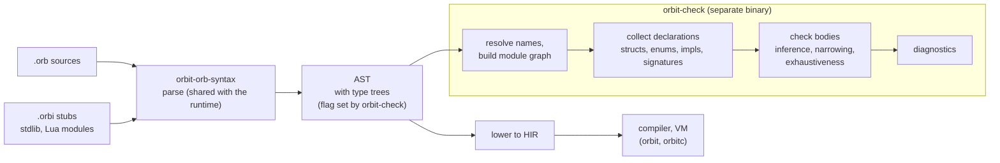
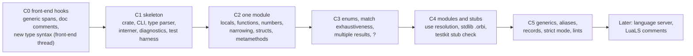

# `orbit-check`: OrbitScript's optional type checker

Status: **All questions decided** (Tym, 2026-10-18). Implementation started in `crates/orbit-check` (names: PR #181; types: branch `check/types`); the library API is in [api.md](api.md). Answers are in [Questions](#questions-for-tym).

Decided (Tym, 2026-10-18 22:13Z): **T4** no implicit `int` to `float`; `number` is `int | float`, and code that wants one representation narrows to it. **T5** union types `A | B`, yes. **T8** no built-in `Result`: Lua-style results are written `(T?, E?)`, keeping the name free for a user enum and for enum-based results later. **T2** (22:25Z) option B: the shared parser builds type trees behind a `ParseOptions` flag; one parser only, optimize later if the cost shows up. **Everything else** (22:26Z): as recommended, including the two assumptions at the end of the questions table.

Already decided, and assumed throughout: OrbitScript's types are optional, erased, and never enforced at run time; a separate mypy-like tool checks them (plan, "Interop model"; syntax proposal, "Optional types"). The syntax proposal's Decisions table is authoritative, and nothing here changes it without a question below.

## Summary

- **One new crate and binary, `orbit-check`**, built only on `orbit-orb-syntax` (plus `orbit-hir` for spans and string pools). It never links the VM, GC or standard library, so `orbit` and `orbitc` don't change size, and it fits either liblua layout unchanged. A parse-only probe of that floor is 445 KiB stripped (Linux x86_64 cloud container), against 2,054 KiB for `orbit`.
- **It checks the OrbitScript AST, not the HIR.** Lowering removes exactly what a checker needs (structs, enums, `impl`, `match`, `?`, `use`), and anything added to the HIR ships in the runtime. That reverses the plan's "orbit-check reads TypeIds in the HIR" line (T1, agreed 2026-10-18).
- **Gradual typing in the mypy, TypeScript and Luau family:** `any` at the edges, local inference inside function bodies, flow-sensitive narrowing for `nil`, `match` and `type()`, nominal structs and enums, exhaustiveness on `match`, and operator typing from `__add`-style metamethods.
- **Lua code isn't checked in v1.** Lua modules and the standard library are typed through stub files (`.orbi`, like Python's `.pyi`); with no stub, a Lua module's exports are `any`.
- **The type grammar needs a few additions** before the checker is useful on real code: unions, record shapes for plain tables, type aliases, Each changes the language's surface, so each is a question.
- **Front-end changes are small** and belong to the front-end thread: build type trees behind a `ParseOptions` flag (T2), keep generic parameter lists and doc comments, and parse whatever T5 to T9 add.

## What "like mypy" means here

| | Goal | Not a goal |
|---|---|---|
| Effect on programs | None. Checking is a separate step; `orbit` runs a file whatever the checker says | Runtime checks, casts, or any code-generation use of types (vm.md: annotations are never trusted) |
| Adoption | Unannotated code checks with few false errors; annotations add precision one function at a time | Requiring annotations everywhere (a strict mode can, per file) |
| Soundness | Sound for fully annotated code that never touches `any`; pragmatic at `any` and Lua boundaries, as mypy and TypeScript are | Full soundness through Lua code, metatables or `debug` |
| Speed | Fast enough to run on save: whole `examples/` in tens of milliseconds | Whole-program inference that grows superlinearly |
| Scope v1 | `.orb` files, stubs for Lua modules and the stdlib, a command-line tool | Language server, Lua checking, traits/interfaces (Q18 deferred them) |

Published designs this draws on (designs only, no code): mypy and PEP 484/526/544 (gradual typing, stubs, `# type: ignore`), TypeScript (control-flow narrowing, structural records, `as`), Pyright (declared type of a variable from all its assignments), Luau (gradual typing on Lua's runtime model, per-file strictness), and LuaLS/LuaCATS (annotation comments in Lua files, for T11).

## Where the checker sits



### Why the AST, not the HIR

The plan and the syntax proposal say the HIR keeps annotations as `TypeId`s and `orbit-check` reads them. Looking at what the front end now does, that doesn't work well:

- **Lowering erases the checker's input.** A `struct` becomes a table plus `setmetatable` calls; `impl` methods become stores into a `methods` table; `match` becomes an `If` chain over hidden locals; `?` becomes an `If` plus `Return`; `use` becomes `require` plus field copies; `scope` becomes a boxed closure. Recovering "this is struct `Point` with fields `x: float`" or "this match covers `Shape::Circle` and `Shape::Rect`" from that HIR means reversing the lowering.
- **The HIR ships in the runtime.** Every field the checker needs there (struct and enum tables, generic parameters, type trees) costs memory during every compile and code size in `orbit`. The front end's compile peak (about 5 KB per function, against Lua's 0.7 KB) is already a known cost.
- **Error positions.** The AST still has every construct as written, with spans, which is what good messages need. Hidden locals and hoisted temporaries in the HIR would leak into messages.
- **Nothing fills them today.** `Local.ty` and `Function.result_type` exist in `orbit-hir` but lowering always sets them to `None`, and the OrbitScript AST keeps annotations only as spans (`ast::Type { span }`), so no consumer depends on them.

So the checker parses the AST with the same parser the runtime uses (one grammar, no drift), then does its own name resolution and type checking. The HIR's two `TypeId` fields can be removed (T1).

### Type annotations: trees from the shared parser (T2, decided)

The runtime parser already parses every type annotation (to reject bad ones) and then keeps only its span. Option A (T2) keeps it that way: `orbit-check` re-parses each annotation span with its own small type parser, reusing the public lexer. The runtime then never allocates a type tree, and type-only syntax added later (unions, records, aliases) costs the runtime parser only the code to skip it. The alternative, a `ParseOptions::keep_types` flag that builds the trees in the shared parser, avoids two type grammars but puts the tree-building code in `orbit`.

| | A. Checker re-parses spans | B. Shared parser builds trees behind a `ParseOptions` flag |
|---|---|---|
| Cost in `orbit` | None: no code, no allocation per annotation | The tree-building code ships but never runs (estimated a few KiB, not measured); no allocation with the flag off |
| Grammars to maintain | Two: the runtime's validating parser and the checker's tree parser. They can drift; a test running both over the same corpus catches it | One, owned by the front end |
| New type syntax | Runtime accepts and skips it; checker parses it | One change in the shared parser |
| Cargo feature instead of a flag | n/a | Would remove the code from `orbit`, but a workspace-wide build unifies features and turns it on for `orbit` too (the same trap that makes workspace release builds miss the PGO profile), so not recommended |

**Decided (Tym, 2026-10-18): B.** One parser to maintain; whether and how to trim its cost in `orbit` is looked at once it exists.

Since then (Tym, 2026-10-18, dev tooling thread, D3), error recovery and trivia go into the shared parsers behind options that `load` leaves off. B fits that pattern: building type trees becomes one more tooling option on the same parser, and a recovering parse can then hand the checker type trees with error nodes in them, which option A would have to reproduce in its own parser.

Places where the parser drops information the checker needs, all small changes for the front-end thread:

| Today | Needed |
|---|---|
| `skip_generics` discards `<T, U>` on `fn`, `struct`, `enum` and `impl` | Keep the span of the generic list |
| `self: T` and `...rest: T` annotations are parsed and dropped | Keep their spans |
| `///` and `//!` doc comments are discarded by the lexer | Keep them as spans on items (for hover text later and for pragmas, T13) |
| Type grammar: names, paths, `Name<..>`, `[T]`, `#{K: V}`, `(A, B)`, `fn(A) -> R`, suffix `?` | Plus whatever T5 to T9 add |

## Packaging

- **Crate `crates/orbit-check`**, a library (the checker, so a language server can reuse it later) with a `[[bin]] orbit-check`. Dependencies: `orbit-orb-syntax`, `orbit-hir`. No external crates; argument parsing hand-written like `orbit-cli`'s.
- **Not part of `orbit` or `orbitc`.** It doesn't need the runtime at all, so it is a plain static Rust program in either liblua layout, and it doesn't touch the PGO profile (none of the profiled crates change). It is not in `default-members`, so `cargo build --release` at the root still builds only the CLI.
- **Size.** Probe: a release binary (fat LTO, one codegen unit, `panic = "abort"`, stripped, no PGO) that only parses `.orb` files is **455,688 bytes**; about 350 KiB of that is std's panic and formatting machinery that every Rust binary carries. The checker's own code comes on top. For comparison, `orbit` is 2,103,016 bytes and `orbitc` 1,471,504 (scoreboard 2026-10-15). Measured on the cloud container, Linux x86_64, Ubuntu 24.04, main `cdb2210`; the probe parsed all eleven `.orb` files in `examples/`.
- **Stdlib stubs** are embedded in the binary (`include_str!`), so the tool is one file. A test in `orbit-testkit` keeps them honest: it loads the real runtime, walks every global and library field, and fails when a stub is missing or names something the runtime doesn't have.

## The type language

### What the syntax already gives

| Written | Meaning |
|---|---|
| `nil bool int float number string table function thread userdata any` | Lua's runtime types; `number` is `int \| float`; `table` is any table; `function` is any function |
| `T?` | `T \| nil` |
| `[T]` | an array table (1-based, sequence) |
| `#{K: V}` | a map table |
| `(A, B)` | multiple results (not a value type: tuples aren't values, Q4) |
| `fn(A, B) -> R` | a function |
| `Point`, `Shape`, `geo::Vec2` | a struct or enum, nominal |
| `Self` | the `impl`'s type |
| `fn first<T>(t: [T]) -> T?` | generic function (parsed, ignored at run time) |

### Gaps that change the surface (questions)

- **Unions (T5).** Only `T?` exists. Lua APIs need `string | number` (`tostring`, `string::rep`), and enums don't cover values from Lua. Proposed: `A | B` in type position. In patterns `|` already means alternatives, and `|x| ...` closures don't appear in types, so there is no clash.
- **Record shapes for plain tables (T6).** Lua modules return plain tables (`#{ name: "x", size: 3 }`), and JSON decoders produce them. Today the only way to describe one is a map type, which can't say "has a `name: string` and a `size: int`". The natural spelling mirrors table literals, where `name: v` is a named key and `[k]: v` a computed one: `#{ name: string, size: int }` is a record and `#{ [string]: int }` a map. That changes today's map spelling `#{string: int}` (used once, in `tests/programs/proposal.orb`), so it needs Tym. Records are structural and open (extra fields allowed), as tables are; structs stay nominal and closed.
- **Type aliases (T7).** `type Point3 = #{ x: float, y: float, z: float };` and `type Pair<T> = (T, T);`. Needs `type` as a contextual keyword, as `scope` is.
- **Lua's `nil, err` convention (T8, decided: no `Result`).** `io::open` returns a file, or `nil` and a message, written `(File?, string?)`. Tym rejected a built-in `Result<T, E>`: it would collide with a user's own `Result` enum, OrbitScript has no `Ok(...)` form so the parallel with Rust breaks down, and enum-based results stay possible later. The cost is that the checker doesn't know the two results are linked: after `let (f, err) = io::open(p); if f == nil { ... }`, `err` is still `string?`. `?` is unaffected (it only looks at the first result).
- **Checker-only assertion `as` (T9).** `as` is reserved. A `expr as T` that only the checker reads (lowered as `expr`, no run-time effect, like TypeScript's `as`) is the standard escape hatch when the checker can't follow the code. The proposal says "no `as` casts at runtime in v1", which this keeps.
- **Generic structs and enums (T10).** The parser already accepts and skips `struct Stack<T> { items: [T] }`. Since there are no traits (Q18), generics are unconstrained: fine for containers, `Option`-like enums and callbacks. Recommended: yes, as parse-only syntax that the checker reads.

Not proposed for v1: interfaces or protocols (they would be traits, deferred by Q18; record shapes cover most structural needs), literal types (`"r" | "w"`), `never`, variance annotations, overloads.

## Checking rules

### Gradual typing and inference

- **`any`** is compatible both ways with every type, as in mypy. A value of type `any` can be called, indexed and passed anywhere; nothing that flows out of `any` is checked.
- **Unannotated parameters are `any`** (T3), so existing code checks with few false errors. In strict mode a missing parameter or `pub fn` result annotation is an error.
- **Unannotated bodies are still checked** (unlike mypy's default, which skips them): locals get types from their values, so `let n = #t; n ~ 1` is fine but `n.len()` on an `int` is an error.
- **`let`**: an immutable local has its initializer's type. A `let mut` local's type is the union of every value assigned to it in scope, so `let mut best = nil; ... best = p;` is `Vec2?`, not `nil` (Pyright's rule).
- **Function results** are inferred from the body when not annotated. A recursive function without an annotated result is `any` where it calls itself.
- **Closures** take parameter types from the expected type when there is one (`table::sort(names, |a, b| a < b)` knows `a: string`), else `any`.
- **Empty literals** `[]` and `#{}` take their type from context (a field type, an annotation, a parameter); otherwise `[any]` and `table`.

### Narrowing

Flow-sensitive narrowing, as TypeScript and mypy do it, on locals and on field paths (`self.next`):

| Code | Effect |
|---|---|
| `if x != nil { ... }`, `if x { ... }` | `x: T` inside, from `T?` |
| `if x == nil { return; }` | `x: T` after the `if` (any exit: `return`, `break`, `continue`, `panic`, `error`) |
| `let f = io::open(p)?;` | `f: File` |
| `if type(x) == "string"`, `math::type(n) == "integer"` | `x: string`, `n: int` |
| `match s { Shape::Circle { r } => ... }` | `s: Shape::Circle` in the arm, `r: float` |
| assignment to `x` or a call that could reassign a field path | narrowing on that path ends |

Field-path narrowing survives calls (TypeScript's trade-off): unsound in theory, but dropping it makes `if self.next != nil { self.next.value }` fail everywhere.

### Numbers, strings and operators

- `int` and `float` are distinct, and neither is accepted where the other is expected (T4, decided). `number` is the union `int | float`: code that works with both takes `number`, and code that needs one representation narrows to it (`math::type(n) == "integer"`, or a literal of the right kind). So the syntax proposal's own example `Vec2::new(3, 4)` with `float` parameters becomes an error; it needs `3.0, 4.0` or `number` parameters.
- Results follow Lua: `int op int` is `int` for `+ - * \ %`; `/` and `**` always give `float`; any `float` operand gives `float`. Bitwise operators want `int` (a `float` operand is a warning, since Lua converts only integral floats).
- `~` takes `string` or `number` on both sides, otherwise the left operand's `__concat`. Arithmetic on a `string` is an error, even though Lua converts `"10" + 1`: in OrbitScript that is almost always a bug.
- Comparisons `< <= > >=` want two numbers, two strings, or a type with `__lt`/`__le`. `==` on unrelated types (`int == string`) is a warning, since it is always false.
- Conditions of a type other than `bool` or `T?` are a warning (Lua truthiness makes `if 0` true; proposal: "orbit-check can warn on non-bool conditions").

### Structs, enums and metamethods

- **Structs are nominal and closed**: field reads and writes must name a declared field, struct literals must give every field (the compiler already checks this when the struct is visible), non-`pub` fields are readable only in their module, and `p.new(...)` on an instance is an error (associated functions aren't on instances).
- **Methods** come from every `impl` block for the type in its module. `p.m(x)` checks against `m`'s signature with `self: Point`; `Point::m(p, x)` the same with `self` explicit.
- **Metamethods type the operators.** `fn __add(self, other: Vec2) -> Vec2` makes `Vec2 + Vec2` a `Vec2`; `__eq`, `__lt`, `__le`, `__len`, `__concat`, `__call`, `__unm`, `__close` likewise. `let scope x = v` requires `v`'s type to have `__close` (or be `nil`). A user `__index` makes reads of unknown fields `any` instead of errors.
- **Enums** are a closed set of variants, each with its own fields. `match` over an enum (or a union, or `bool`, or `T?`) must cover every case or have `_`; the error lists what is missing. Guards don't count toward coverage.

### Multiple results, varargs and `?`

- A function's result is a list of types. `f()` inside an expression or argument list takes the first one (Q4); `...f()` spreads all of them; `let (a, b) = f();` checks the count: binding more names than results is an error unless the extra ones are optional.
- `...args: T` types each vararg; `...args` without a type is `any`.
- `?` needs a first result of type `T?` and gives `T`. Its second result (type `E?`, often `string?`) is what the function returns with `nil`, so the enclosing function's results must accept `(nil, E)`: for example `(Config?, string?)`.

### Modules, globals and the prelude

- `use a::b` resolves statically through a search path that mirrors `package.path` (default `./?.orb`, `./?/init.orb`, then `.lua`, then stubs). The module's type is its `pub` items. A module not found is an error; a Lua module without a stub is `any`.
- Modules are checked in dependency order. For cycles, every module's declarations (signatures, structs, enums) are collected before any body is checked, so only unannotated results inside a cycle fall back to `any`.
- Prelude names and stdlib modules come from the bundled stubs. `extern NAME;` is `any` unless a stub or `--extern NAME: T` declares it; `global x = v;` has `v`'s type.
- Things the checker can't follow (`setmetatable` on a struct type, `rawset`, `debug`, `load`) give `any` or are accepted silently.

### A taste

```rust
use geometry::{Vec2, longest};

let v = Vec2::new(3, "4");
//                   ^^^ error[T0201]: argument 2 of `Vec2::new` expects `float`, found `string`

let p = longest(points);          // first result: Vec2?
print(p.len());
//    ^ error[T0207]: `p` may be nil (type `Vec2?`); check it with `!= nil` first, or use `?`

fn area(s: Shape) -> float {
    match s {
//  ^^^^^ error[T0401]: `match` doesn't cover `Shape::Empty`; add an arm for it or `_`
        Shape::Circle { r } => math::pi * r * r,
        Shape::Rect { w, h } => w * h,
    }
}
```

## Lua code, the standard library and stubs

- **Lua files aren't checked in v1** (T11). Most Lua code has no annotations, and inferring types from unannotated Lua mostly yields `any` while costing a second checker front end. Their exports are `any` unless a stub describes them.
- **Stubs** (T12) are `.orbi` files: OrbitScript declarations without bodies. They describe Lua modules, C modules and the stdlib:

```rust
// io.orbi (bundled)
pub struct File {}
impl File {
    pub fn read(self, ...formats: string | int) -> (string | number)?;   // first result only; see note
    pub fn write(self, ...parts: string | number) -> (File?, string?);
    pub fn close(self) -> (bool?, string?);
    fn __close(self, err: any);
}
pub fn open(path: string, mode: string?) -> (File?, string?);
pub fn lines(path: string?, ...formats: string | int) -> fn() -> string?;
```

  Note: `file:read("l", "n")` returns one value per format, which the type grammar can't say yet. A variadic result `-> ...T` would cover it; until then stubs describe the first result and the rest are `any`.

  A stub next to a module (`lunajson.orbi` beside `lunajson.lua`) wins over the module, as `.pyi` does in Python. Body-less `fn ...;` is stub-only syntax: the shared parser accepts it only under a stub option that `orbit-check` sets (T2: one parser), and the runtime never loads `.orbi` files.
- **Later (not v1):** reading LuaLS-style annotation comments (`---@param x integer`) from `.lua` files, which would type existing annotated Lua libraries with no stub. That needs the Lua lexer to keep comments, a change in the Lua front end.
- **FFI.** `ffi.open(...)` and `lib:bind(...)` give `any`. Once `extern fn` sugar exists (Tym, 2026-10-15: later), its declared signature types the function.

## Diagnostics and use

```text
$ orbit-check src/
src/app.orb:12:20: error[T0201]: argument 2 of `Vec2::new` expects `float`, found `string`
src/app.orb:15:7: error[T0207]: `p` may be nil (type `Vec2?`)
src/shapes.orb:8:5: warning[T0303]: this condition has type `int`, which is always true
2 errors, 1 warning in 4 files (3 checked, 1 stub)
```

- Exit status 1 on errors, 0 otherwise (warnings don't fail unless `--deny-warnings`).
- Codes are stable (`T0201`), grouped by area, documented in one table ([api.md](api.md#diagnostic-codes)), and every message names the expected and found types.
- **Suppression (T13):** `// orbit-check: ignore` or `// orbit-check: ignore[T0207]` at the end of a line, like mypy's `# type: ignore[code]`. Unused suppressions are a warning in strict mode.
- **Strictness (T3, T13):** `--strict` on the command line, or a file pragma `//! orbit-check: strict` (or `off` to skip a file). Strict adds: annotations required on `pub fn` parameters and results, `any` from untyped Lua modules is an error at the point of use, non-`bool` conditions are errors.
- **Configuration:** command-line flags only in v1 (`--strict`, `--path`, `--stubs`, `--extern`). A config file waits until there is a reason, since a TOML parser is a new dependency.
- **Lints the earlier proposals assigned to the checker:** `t[0]` on an array and `0..#t` loops that index `t` (indexing report), non-`bool` conditions, and unused locals and imports.
- **Editor support (Tym, 2026-10-18, dev tooling thread, D1/D2):** the language server is its own binary but reuses the checker in full (its crate, or the `orbit-check` binary). So the `orbit-check` library API, not just its command line, is the product: it takes source text per module, accepts the AST that the shared parser's recovery mode produces (error nodes typed as `any`, with no cascading errors), keeps results per module so one edited file and its dependents can be rechecked, and answers position queries: type at an offset, definition of a name, members of a value for completion, and signature at a call. These queries need the checker to keep a span-to-type table, which the command-line path can skip.

## Implementation plan (later, not part of this ask)



- **Tests:** `tests/check/*.orb` files with expected diagnostics written inline (`//~ T0201`), compared exactly; plus "checks clean" runs over `examples/` and the front end's `tests/programs`. A fuzz target feeds parser output to the checker (it must never panic).
- **Done for v1:** every `.orb` in the repository checks clean in default mode (adding annotations to the examples where they help), the seeded-error corpus is all caught, and checking `examples/` takes well under 100 ms on the cloud container.
- **Same rules as the rest of the code:** stable Rust, no `unsafe`, no dependencies, greenfield (designs above are read as published documentation only).

## Questions for Tym

All answered by Tym on 2026-10-18.

| # | Question | Decision |
|---|---|---|
| T1 | Should the checker read the AST and the HIR drop its unused `TypeId` fields? | **Decided 2026-10-18: AST, drop them** |
| T2 | Where are type annotations turned into trees? | **Decided 2026-10-18: shared parser behind a `ParseOptions` flag** (one parser; optimize later if needed) |
| T3 | What are unannotated parameters by default? | **Decided 2026-10-18: `any`, bodies still checked** |
| T4 | May an `int` be passed where a `float` is expected? | **Decided 2026-10-18: no.** `number` = `int \| float`; narrow to one explicitly |
| T5 | Add union types `A \| B`? | **Decided 2026-10-18: yes** |
| T6 | Record shapes for plain tables, with maps respelled `#{[K]: V}`? | **Decided 2026-10-18: Yes** |
| T7 | Type aliases with a contextual `type` keyword? | **Decided 2026-10-18: Yes** |
| T8 | Built-in `Result<T, E>` for Lua's `nil, err` results? | **Decided 2026-10-18: no**, write `(T?, E?)`; keeps room for enum-based results later |
| T9 | Checker-only `expr as T` assertion, no runtime effect? | **Decided 2026-10-18: Yes** |
| T10 | Generic structs and enums (`struct Stack<T>`)? | **Decided 2026-10-18: Yes** |
| T11 | Check Lua files? | **Decided 2026-10-18: No in v1, stubs only** |
| T12 | Stub files as `.orbi` with body-less declarations? | **Decided 2026-10-18: Yes** |
| T13 | Comment pragmas `// orbit-check: ignore[...]` and `//! orbit-check: strict`? | **Decided 2026-10-18: Yes** |
| T14 | Ship as its own `orbit-check` binary, outside `orbit` and `orbitc`? | **Decided 2026-10-18: Yes** |

Also agreed (2026-10-18): array indexing `t[i]` on `[T]` gives `T`, not `T?` (TypeScript's default; `T?` would make every array read need a check), and structs are closed (assigning an undeclared field is an error).
