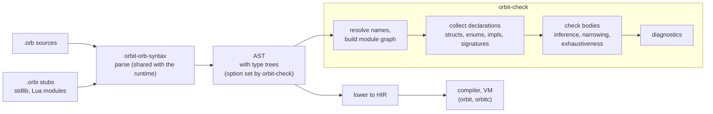

# `orbit-check`: OrbitScript's optional type checker

Status: Implemented in `crates/orbit-check`. The library API, the diagnostic codes and strict mode are in [api.md](api.md).

OrbitScript's types are optional and erased: the compiler never uses them, and `orbit` runs a file whatever the checker says. `orbit-check` is a separate tool, in the family of mypy, TypeScript and Luau, that reads the annotations and reports what doesn't fit.

## Summary

- **Its own crate and binary**, built only on `orbit-orb-syntax` (plus `orbit-hir` for spans and string pools). It never links the VM, the collector or the standard library, so `orbit` and `orbitc` don't change size.
- **It checks the OrbitScript AST, not the HIR.** Lowering removes exactly what a checker needs (structs, enums, `impl`, `match`, `?`, `use`), and anything added to the HIR ships in the runtime.
- **Gradual typing:** `any` at the edges, local inference inside function bodies, flow-sensitive narrowing for `nil`, `match` and `type()`, nominal structs and enums, exhaustiveness on `match`, and operator typing from `__add`-style metamethods.
- **Lua code isn't checked.** Lua modules and the standard library are typed through stub files (`.orbi`, like Python's `.pyi`); with no stub, a Lua module's exports are `any`.
- **The library is the product.** The language server links it, so the API (per-module results, position queries, recovery from broken code) matters as much as the command line.

## Goals

| | Goal | Not a goal |
|---|---|---|
| Effect on programs | None. Checking is a separate step | Code-generation use of types (annotations are never trusted). Runtime checks happen only where the program asks for them, with `as` ([runtime-as.md](../orbitscript-syntax/runtime-as.md)) |
| Adoption | Unannotated code checks with few false errors; annotations add precision one function at a time | Requiring annotations everywhere (strict mode does, per file or per run) |
| Soundness | Sound for fully annotated code that never touches `any`; pragmatic at `any` and Lua boundaries, as mypy and TypeScript are | Full soundness through Lua code, metatables or `debug` |
| Speed | Fast enough to run on save: the whole `examples/` in tens of milliseconds | Whole-program inference that grows superlinearly |
| Scope | `.orb` files, stubs for Lua modules and the standard library, a command-line tool and a library | Lua checking, traits or interfaces |

Published designs this draws on (designs only, no code): mypy and PEP 484/526/544 (gradual typing, stubs, `# type: ignore`), TypeScript (control-flow narrowing, structural records), Pyright (declared type of a variable from all its assignments), and Luau (gradual typing on Lua's runtime model, per-file strictness).

## Where the checker sits



### Why the AST, not the HIR

- **Lowering erases the checker's input.** A `struct` becomes a table plus `setmetatable` calls; `impl` methods become stores into a `methods` table; `match` becomes an `If` chain over hidden locals; `?` becomes an `If` plus `Return`; `use` becomes `require` plus field copies; `scope` becomes a boxed closure. Recovering "this is struct `Point` with fields `x: float`" or "this match covers `Shape::Circle` and `Shape::Rect`" from the HIR would mean reversing the lowering.
- **The HIR ships in the runtime.** Every field the checker needs there (struct and enum tables, generic parameters, type trees) would cost memory during every compile and code size in `orbit`.
- **Error positions.** The AST has every construct as written, with spans, which is what good messages need. Hidden locals and hoisted temporaries in the HIR would leak into messages.

So the checker parses with the same parser the runtime uses (one grammar, no drift), then does its own name resolution and type checking. The HIR's `Local::ty` and `Function::result_type` stay empty.

### Type trees from the shared parser

The runtime parser parses every type annotation (to reject bad ones) and, by default, keeps only its span. With `ParseOptions::type_trees`, which `orbit-check` sets, it also builds the tree. The same parser options give the tooling error recovery (`Error` nodes for what didn't parse), doc comments on items, generic parameter lists and stub files (body-less `fn` declarations); `load` leaves all of them off.

| | Shared parser builds trees behind an option (chosen) | Checker re-parses annotation spans |
|---|---|---|
| Cost in `orbit` | The tree-building code ships but never runs; no allocation with the option off | None |
| Grammars to maintain | One, owned by the front end | Two, which can drift |
| Recovery | A recovering parse hands the checker type trees with error nodes in them | The checker's parser would have to recover the same way |

A Cargo feature instead of a runtime option would remove the code from `orbit`, but a workspace-wide build unifies features and turns it on for `orbit` too, so it isn't used.

## Packaging

- **Crate `crates/orbit-check`**: the library and a `[[bin]] orbit-check`. Dependencies: `orbit-orb-syntax` and `orbit-hir`, no external crates; arguments are parsed by hand, as in `orbit-cli`.
- **Not part of `orbit` or `orbitc`.** It doesn't need the runtime, so it is a plain static Rust program, and it doesn't touch the PGO profile.
- **Size.** A release binary that only parses `.orb` files is about 445 KiB stripped (Linux x86_64), most of it std's panic and formatting machinery; the checker's own code comes on top.
- **Stdlib stubs** are embedded in the binary (`include_str!` of `crates/orbit-check/stubs/`), so the tool is one file. `tests/stubs.rs` (with the runtime as a dev-dependency only) keeps them honest: it loads the real runtime, walks every global and library field, and fails when a stub is missing or names something the runtime doesn't have.

## The type language

| Written | Meaning |
|---|---|
| `nil bool int float number string table function thread userdata any` | Lua's runtime types; `number` is `int \| float`; `table` is any table; `function` is any function |
| `T?` | `T \| nil` |
| `A \| B` | a union |
| `[T]` | an array table (1-based, a sequence) |
| `#{[K]: V}` | a map table |
| `#{ name: T, size: U }` | a record: a plain table with those fields, others allowed. Records are structural and open; structs are nominal and closed |
| `(A, B)` | multiple results (not a value type: tuples aren't values) |
| `-> ...T`, `-> (A, ...T)` | any number of `T` results, alone or after fixed ones |
| `fn(A, B) -> R` | a function |
| `Point`, `Shape`, `geo::Vec2` | a struct or enum, nominal |
| `Self` | the `impl`'s type |
| `fn first<T>(t: [T]) -> T?`, `struct Stack<T>` | generic functions, structs and enums; unconstrained, since there are no traits |
| `type Pair<T> = (T, T);` | an alias; `type` is a contextual keyword |

- **No implicit `int` to `float`.** `int` and `float` are distinct, and neither is accepted where the other is expected. Code that works with both takes `number`; code that needs one representation narrows to it (`math::type(n) == "integer"`, a literal of the right kind, or `as`).
- **No built-in `Result`.** Lua's `nil, err` convention is written `(T?, E?)`: `io::open` returns `(File?, string?)`. A built-in `Result<T, E>` would collide with a user's own `Result` enum, and OrbitScript has no `Ok(...)` form, so the parallel with Rust would break down. The cost is that the checker doesn't know the two results are linked: after `let (f, err) = io::open(p); if f == nil { ... }`, `err` is still `string?`. `?` only looks at the first result, so it is unaffected.
- **`as`** is a runtime cast ([runtime-as.md](../orbitscript-syntax/runtime-as.md)). The checker types `v as T` as `T` (`T?` for `as?`), accepts wider sources, reports a source that can never pass (T0209) and a target the runtime can't check (T0210), and narrows a plain local after a checked cast. `as any` is the unchecked escape hatch.

Not in the language: interfaces or protocols (they would be traits; records cover most structural needs), literal types (`"r" | "w"`), `never`, variance annotations, and overloads outside stubs.

## Checking rules

### Gradual typing and inference

- **`any`** is compatible both ways with every type, as in mypy. A value of type `any` can be called, indexed and passed anywhere; nothing that flows out of `any` is checked.
- **Unannotated parameters are `any`**, so existing code checks with few false errors. In strict mode a missing parameter or `pub fn` result annotation is an error.
- **Unannotated bodies are still checked** (unlike mypy's default, which skips them): locals get types from their values, so `let n = #t; n ~ 1` is fine but `n.len()` on an `int` is an error.
- **`let`**: an immutable local has its initializer's type. A `let mut` local's type is the union of every value assigned to it in scope, so `let mut best = nil; ... best = p;` is `Vec2?`, not `nil` (Pyright's rule).
- **Function results** are inferred from the body when not annotated. A recursive function without an annotated result is `any` where it calls itself.
- **Closures** take parameter types from the expected type when there is one (`table::sort(names, |a, b| a < b)` knows `a: string`), else `any`.
- **Empty literals** `[]` and `#{}` take their type from context (a field type, an annotation, a parameter); otherwise `[any]` and `table`.
- **Array reads** `t[i]` on `[T]` give `T`, not `T?` (TypeScript's default; `T?` would make every array read need a check).

### Narrowing

Flow-sensitive narrowing, as TypeScript and mypy do it, on locals and on field paths (`self.next`):

| Code | Effect |
|---|---|
| `if x != nil { ... }`, `if x { ... }` | `x: T` inside, from `T?` |
| `if x == nil { return; }` | `x: T` after the `if` (any exit: `return`, `break`, `continue`, `panic`, `error`) |
| `let f = io::open(p)?;` | `f: File` |
| `if type(x) == "string"`, `math::type(n) == "integer"` | `x: string`, `n: int` |
| `match s { Shape::Circle { r } => ... }` | `s: Shape::Circle` in the arm, `r: float` |
| `let p = x as Point;` | `x: Point` after it |
| assignment to `x` or a call that could reassign a field path | narrowing on that path ends |

Field-path narrowing survives calls (TypeScript's trade-off): unsound in theory, but dropping it would make `if self.next != nil { self.next.value }` fail everywhere.

### Numbers, strings and operators

- Results follow Lua: `int op int` is `int` for `+ - * \ %`; `/` and `**` always give `float`; any `float` operand gives `float`. Bitwise operators want `int` (a `float` operand is a warning, since Lua converts only integral floats).
- `~` takes `string` or `number` on both sides, otherwise the left operand's `__concat`. Arithmetic on a `string` is an error, even though Lua converts `"10" + 1`: in OrbitScript that is almost always a bug.
- Comparisons `< <= > >=` want two numbers, two strings, or a type with `__lt`/`__le`. `==` on unrelated types (`int == string`) is a warning, since it is always false.
- A condition whose type can never be false (`int`, `string`, a struct) is a warning, because Lua's truthiness makes `if 0` true. In strict mode every condition must be `bool` (or `any`).

### Structs, enums and metamethods

- **Structs are nominal and closed**: field reads and writes must name a declared field, struct literals must give every field, non-`pub` fields are readable only in their module, and `p.new(...)` on an instance is an error (associated functions aren't on instances).
- **Methods** come from every `impl` block for the type in its module. `p.m(x)` checks against `m`'s signature with `self: Point`; `Point::m(p, x)` the same with `self` explicit.
- **Metamethods type the operators.** `fn __add(self, other: Vec2) -> Vec2` makes `Vec2 + Vec2` a `Vec2`; `__eq`, `__lt`, `__le`, `__len`, `__concat`, `__call`, `__unm` and `__close` likewise. `let scope x = v` requires `v`'s type to have `__close` (or be `nil`). A user `__index` makes reads of unknown fields `any` instead of errors.
- **Enums** are a closed set of variants, each with its own fields. A `match` over an enum (or a union, `bool` or `T?`) must cover every case or have `_`; the error lists what is missing. Guards don't count toward coverage.

### Multiple results, varargs and `?`

- A function's result is a list of types. `f()` inside an expression or argument list takes the first one; `...f()` spreads all of them; `let (a, b) = f();` checks the count: binding more names than results is an error unless the extra ones are optional.
- `...args: T` types each vararg; `...args` without a type is `any`.
- `?` needs a first result of type `T?` and gives `T`. Its second result (type `E?`, often `string?`) is what the function returns with `nil`, so the enclosing function's results must accept `(nil, E)`: for example `(Config?, string?)`.

### Modules, globals and the prelude

- `use a::b` resolves statically through a search path that mirrors `package.path` (default `?.orb`, `?/init.orb`, `?.lua`, `?/init.lua`, relative to `--root`, then the bundled stubs). The module's type is its `pub` items. A module that isn't found is an error; a Lua module without a stub is `any`.
- Modules are checked in dependency order. For cycles, every module's declarations (signatures, structs, enums) are collected before any body is checked, so only unannotated results inside a cycle fall back to `any`.
- Prelude names and standard modules come from the bundled stubs. `extern NAME;` is `any`; `global x = v;` has `v`'s type.
- Things the checker can't follow (`setmetatable` on a struct type, `rawset`, `debug`, `load`) give `any` or are accepted silently.

### A taste

```rust
use geometry::{Vec2, longest};

let v = Vec2::new(3.0, "4");
//                     ^^^ error[T0201]: argument 2 of `Vec2::new` expects `float`, found `string`

let p = longest(points);          // first result: Vec2?
print(p.len());
//    ^ error[T0207]: `p` may be nil (type `Vec2?`); check it with `!= nil` first, or use `?`

fn area(s: Shape) -> float {
    match s {
//        ^ error[T0401]: `match` doesn't cover `Shape::Empty`; add an arm for it or `_`
        Shape::Circle { r } => math::pi * r * r,
        Shape::Rect { w, h } => w * h,
    }
}
```

## Lua code, the standard library and stubs

- **Lua files aren't checked.** Most Lua code has no annotations, and inferring types from unannotated Lua mostly yields `any` while costing a second checker front end. Their exports are `any` unless a stub describes them.
- **Stubs** are `.orbi` files: OrbitScript declarations without bodies. They describe Lua modules, C modules and the standard library:

```rust
// io.orbi (bundled, abridged)
/// An open file.
pub struct File {}
impl File {
    /// Closes the file; a `popen` file also gives the command's exit status.
    pub fn close(self);
    /// Reads one value per format: `"l"` a line, `"n"` a number, `"a"` everything, or a count.
    pub fn read(self, ...formats: string | int) -> ...any;
    /// Writes each string or number; returns the file.
    pub fn write(self, ...values: string | number) -> (File?, string?);
    fn __close(self, err: any) -> ();
}
/// Opens `filename` in `mode` (`"r"`, `"w"`, `"a"`, with `"+"` and `"b"`).
pub fn open(filename: string, mode: string?) -> (File?, string?, int?);
```

- A stub next to a module (`lunajson.orbi` beside `lunajson.lua`) wins over the module, as `.pyi` does in Python. Body-less `fn ...;` and value-less `const N: int;` are stub-only syntax: the shared parser accepts them only under the stub option, and the runtime never loads `.orbi` files. [api.md](api.md#how-the-stubs-are-written) has the rules stubs follow.
- **FFI.** `ffi.open(...)` and `lib:bind(...)` give `any`.

## Diagnostics and use

```text
$ orbit-check src/
src/app.orb:12:20: error[T0201]: argument 2 of `Vec2::new` expects `float`, found `string`
src/app.orb:15:7: error[T0207]: `p` may be nil (type `Vec2?`); check it with `!= nil` first, or use `?`
src/shapes.orb:8:5: warning[T0303]: this condition has type `int`, which is always true
2 errors, 1 warning in 2 files
```

- Exit status 1 on errors, 0 otherwise; `--deny-warnings` fails on warnings too.
- Codes are stable (`T0201`), grouped by area and listed in [api.md](api.md#diagnostic-codes); every type message names the expected and found types.
- **Suppression:** `// orbit-check: ignore` or `// orbit-check: ignore[T0207]` at the end of a line, like mypy's `# type: ignore[code]`.
- **Strictness:** `--strict`, or a file pragma `//! orbit-check: strict` (`off` skips a file). Strict mode requires types on `pub fn` signatures, `bool` conditions and a stub for every `use`d Lua module ([api.md](api.md#pragmas-and-strict-mode)).
- **Configuration:** command-line flags only (`--strict`, `--deny-warnings`, `--path`, `--root`). A config file would need a TOML parser, a new dependency.
- **Lints:** `t[0]` on an array and `0..#t` loops that index `t` (see [indexing-report.md](../orbitscript-syntax/indexing-report.md)), unused locals and unused imports (T0307 to T0310).

## Tests

- `crates/orbit-check/tests/cases/` holds `.orb` files whose expected diagnostics are written inline (`//~ T0201`) and compared exactly, grouped by area (names, types, stdlib, strict, lints). `tests/check.rs` also checks every `.orb` under `examples/` and the front end's test programs.
- `tests/mutations.rs` stands in for a fuzz target (cargo-fuzz needs nightly): every `.orb` and stub in the repository is broken in reproducible ways (bytes cut, copied or replaced by tokens), and each result is checked and queried as the language server would. The checker must never panic.
- `tests/stubs.rs` compares the stubs with the runtime's libraries.
