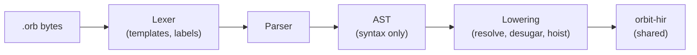

# OrbitScript front end

Status: Proposed. Crate: `orbit-orb-syntax`. Spec: the locked [syntax proposal](orbitscript-syntax/proposal.md) (a copy of the project's planning document; its Decisions table is authoritative).

The OrbitScript front end turns `.orb` source into the same [HIR](hir.md) as the [Lua front end](lua-front-end.md), so everything after it (compiler, VM, stdlib) is shared and a function written in one language is an ordinary function to the other. Like the Lua front end it never touches the VM or the GC heap, and depends only on `orbit-hir`.

## Delivery

| Step | Contents | State |
|---|---|---|
| 1 | Lexer, parser, AST, tests (this document's first half) | This PR |
| 2 | Lowering to HIR: resolution, items, structs, enums, `match`, `?`, hoisting, templates | Next |
| 3 | `.orb` in the CLI, `require`'s searcher, `orbitc --hir`, behind a Cargo feature | After 2 |
| 4 | HIR and VM additions the proposal decided: `NumericFor { exclusive }` (Q15) and `StmtKind::Defer` for `scope stmt;` (Q13) | After 2 |

Until step 4, lowering reports exclusive ranges and `scope stmt;` as "not supported yet".

## Lexer

Hand-written and pull-based, like the Lua lexer. Rust's spelling throughout: `//` and nesting `/* */` comments (`///` and `//!` are ordinary comments for now), `"..."` with Rust's escapes (`\xHH` takes any byte, since strings are byte strings), `r"..."`/`r#"..."#`, `1_000`, `0b`, `0o`, `0x`. Line numbers come from `SourceInfo::new` over the whole source, so they're exact everywhere, including inside templates.

Where the proposal is silent, the lexer chooses:

- **Integer literals.** A decimal literal that doesn't fit in `i64` is an error ("write `9223372036854775808.0` for a float") instead of Lua's silent conversion to a float. Hexadecimal, octal and binary literals keep Lua's rule and give the 64-bit pattern written (`0xffff_ffff_ffff_ffff == -1`), which bit masks need.
- **No leading-dot floats** (`.5`), as in Rust; `1..10` lexes as a range.
- **`#!` first line** is skipped, as the standalone Lua interpreter does for scripts.
- **Templates** (`f"..."`) are split by the lexer into literal text and holes. A hole's expression is kept as a source range, and the parser parses it in place (so spans and lines are right). Brackets nest inside a hole and strings inside it are skipped whole, so `{t[#{a: 1}.a]}` and `{m["}"]}` work. The format spec starts at the first `:` at bracket depth 0 that isn't part of `::`.

## Parser

Recursive descent for items and statements, precedence climbing for expressions, with a depth limit (200) so deep nesting is an error, not a stack overflow.

Precedence, low to high, is Rust's table with the proposal's additions: `||`, `&&`, comparisons, `|`, `^`, `&`, `<<` `>>`, `+` `-` `~`, `*` `/` `\` `%`, prefix `-` `!` `~` `#`, `**` (right-associative), then postfix calls, fields, indexing and `?`.

Rust rules the parser follows where the proposal doesn't say otherwise:

- **Struct literals are not parsed in `if`, `while`, `match` and `for` headers**, so `if x == y { ... }` reads the block as the body. Parenthesise a literal there.
- **A block-like expression** (`if`, `match`, `loop`, `while`, `for`, `{ }`) at the start of a statement ends the statement, so it needs no `;`; it is the block's value only when it's the last thing in the block.
- **Comparisons don't chain**: `a < b < c` is an error.
- `return`, `break` and `continue` are expressions, so `_ => return 0,` works in a `match` arm.
- `scope` is a keyword at the start of a statement only when followed by a name, a keyword, a literal or `{`; `let scope` only when followed by a name. Everywhere else `scope` is an ordinary name.
- Generic parameters (`fn first<T>`) and every type annotation are parsed and kept only as spans: the compiler ignores them, and `orbit-check` will define their structure.
- Not in v1, each with a specific message: tuple structs and tuple variants, traits (`impl X for Y`), `as` casts, `()` as a value, `if let`/`while let`.

## Lowering (step 2)

These are the lowering rules the proposal leaves open; each follows Rust where it can and costs nothing at run time.

- **Items are visible in their whole block**, as in Rust, so module-level functions can call each other in any order. An item used before its definition becomes a local declared at the top of its block and assigned at the definition; others lower exactly as the proposal says (`LocalFunction`, `Let`).
- **`~` chains are right-nested** in the HIR (`a ~ b ~ c` as `a ~ (b ~ c)`), so the compiler's concatenation fusion turns them into one `Concat` op, as for Lua's `..`. Parentheses keep their meaning.
- **A spread (`...f()`) must be the last** argument, array element or return value, because the HIR expands only the last item of a list.
- **Parameters are immutable** unless written `mut x`, like `let`.
- `impl` blocks must be in the module that defines the struct or enum (Rust's rule for inherent impls), so the front end knows every variant metatable a metamethod goes on.

## Testing

`tests/parse.rs` checks tree shapes as S-expressions, every example in the proposal (`tests/programs/proposal.orb`), error messages, and a deterministic mutation run that must never panic.
