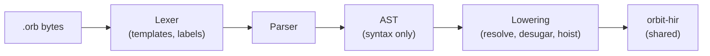
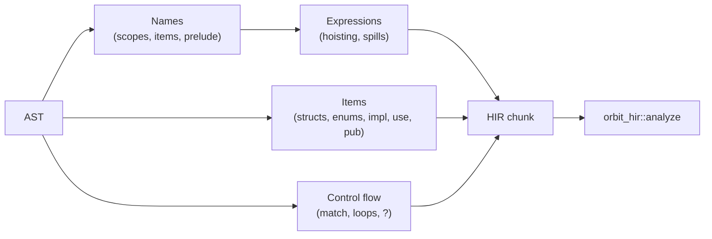

# OrbitScript front end

Status: Implemented. Crate: `orbit-orb-syntax`. Spec: the locked [syntax proposal](orbitscript-syntax/proposal.md) (its Decisions table is authoritative).

The OrbitScript front end turns `.orb` source into the same [HIR](hir.md) as the [Lua front end](lua-front-end.md), so everything after it (compiler, VM, stdlib) is shared and a function written in one language is an ordinary function to the other. Like the Lua front end it never touches the VM or the GC heap, and depends only on `orbit-hir`.



## Delivery

| Step | Contents | State |
|---|---|---|
| 1 | Lexer, parser, AST, tests | Done (#145) |
| 2 | Lowering to HIR: resolution, items, structs, enums, `match`, `?`, hoisting, templates | #146 |
| 3 | `.orb` in the CLI, `require`'s searcher, `orbitc --hir`, behind a Cargo feature | #147 |
| 4a | `NumericFor { exclusive }` (Q15) and the `ForPrepExclusive` op | #148 |
| 4b | `scope stmt;` (Q13), lowered in the front end to a closure in a `<close>` local | This PR |

## Lexer

Hand-written and pull-based, like the Lua lexer. Rust's spelling throughout: `//` and nesting `/* */` comments (`///` and `//!` are ordinary comments for now), `"..."` with Rust's escapes (`\xHH` takes any byte, since strings are byte strings), `r"..."`/`r#"..."#`, `1_000`, `0b`, `0o`, `0x`. A byte literal `b'a'` lexes straight to an integer token, so the parser, patterns and `orbit-check` treat it as any other integer literal. Line numbers come from `SourceInfo::new` over the whole source, so they're exact everywhere, including inside templates.

Where the proposal is silent, the lexer chooses:

- **Integer literals.** A decimal literal that doesn't fit in `i64` is an error ("write `9223372036854775808.0` for a float") instead of Lua's silent conversion to a float. Hexadecimal, octal and binary literals keep Lua's rule and give the 64-bit pattern written (`0xffff_ffff_ffff_ffff == -1`), which bit masks need.
- **No leading-dot floats** (`.5`), as in Rust; `1..10` lexes as a range.
- **Raw names.** `r#name` is an identifier token even when `name` is a keyword (`r#match`); `r#_`, `r#self` and `r#Self` are errors. Inside a template hole, `r#` followed by a letter is a raw name, not a raw string.
- **`#!` first line** is skipped, as the standalone Lua interpreter does for scripts.
- **Templates** (`f"..."`) are split by the lexer into literal text and holes. A hole's expression is kept as a source range, and the parser parses it in place (so spans and lines are right). Brackets nest inside a hole and strings and byte literals inside it are skipped whole, so `{t[#{a: 1}.a]}`, `{m["}"]}` and `{b'}'}` work. The format spec starts at the first `:` at bracket depth 0 that isn't part of `::`.

## Parser

Recursive descent for items and statements, precedence climbing for expressions, with a depth limit (200) so deep nesting is an error, not a stack overflow.

Precedence, low to high, is Rust's table with the proposal's additions: `||`, `&&`, comparisons, `|`, `^`, `&`, `<<` `>>`, `+` `-` `~`, `*` `/` `\` `%`, prefix `-` `!` `~` `#`, `**` (right-associative), then postfix calls, fields, indexing and `?`.

Rust rules the parser follows where the proposal doesn't say otherwise:

- **Keywords as member names.** After `.` and `::`, as field names (struct definitions, literals, patterns, `#{ key: value }`), variant names, and `fn`/`const` names in `impl`, a keyword is read as a name, so `string::match(s, p)` and `s.match(p)` work. Where the name would also bind or read a local (shorthand `P { match }`, the last segment of `use` without `as`), it needs `r#`. `pub` in a field list is the visibility modifier unless a `:`, `,` or `}` follows it. The contextual keyword `scope` is never a keyword when written `r#scope`.
- **Struct literals are not parsed in `if`, `while`, `match` and `for` headers**, so `if x == y { ... }` reads the block as the body. Parenthesise a literal there.
- **A block-like expression** (`if`, `match`, `loop`, `while`, `for`, `{ }`) at the start of a statement ends the statement, so it needs no `;`; it is the block's value only when it's the last thing in the block.
- **Comparisons don't chain**: `a < b < c` is an error.
- `return`, `break` and `continue` are expressions, so `_ => return 0,` works in a `match` arm.
- **A `match` arm body may be an assignment** (`"end" => stack[#stack] = nil,`, or `+=` and the other compound forms), as in Rust, where assignment is a unit expression. It runs the assignment and the arm's value is nil, the same as `"end" => { stack[#stack] = nil; }`. Assignment is still a statement everywhere else.
- **A bare name as a positional `#{ }` entry is an error.** Struct literals read `P { x, y }` as `x: x, y: y`, so `#{ word, count }` looks like the same shorthand but would build `[1] = word, [2] = count`. The message offers both spellings: `word: word` for a field, `(word)` (any other expression stays positional) or `[...]` for an array entry.
- `scope` is a keyword at the start of a statement only when followed by a name, a keyword, a literal or `{`; `let scope` only when followed by a name. Everywhere else `scope` is an ordinary name.
- Generic parameters (`fn first<T>`) and every type annotation are parsed and kept only as spans: the compiler ignores them, and `orbit-check` will define their structure.
- Not in v1, each with a specific message: tuple structs and tuple variants, traits (`impl X for Y`) and generic bounds, `()` as a value, `if let`/`while let`.

### Options for tools

`ParseOptions` has five flags that `load` and the CLI leave off; `orbit-check` and the language server set them. None changes what a program does.

- **`type_trees`**: every `ast::Type` carries a `TypeKind` tree (paths with generic arguments, `nil`, `Self`, `T?`, unions, arrays, maps, records, tuples, `fn` types; `Error` is reserved). Off, the type grammar is still parsed and checked, but only spans are kept and nothing is allocated for it.
- **`stub`**: `.orbi` stubs. `fn` items and `impl` functions may end in `;`, and `const NAME: T;` needs no value. Lowering a stub is an error ("a stub declaration has no body to run").
- **`doc_comments`**: the lexer records `///` (`CommentKind::Doc`) and `//!` (`InnerDoc`) comments in `Ast::comments`, and each item, `impl` members included, gets the `///` lines just before it in `Item::docs`. `////` is an ordinary comment, as in Rust.
- **`keep_trivia`**: `Ast::comments` holds every comment (`Line`, `Block`, `Doc`, `InnerDoc`), in source order, for a formatter or an editor. The tree itself doesn't change.
- **`recover`**: parsing goes on after a syntax error (see below). `parse_recovering` returns the AST and every error; `parse_with` ignores the switch and returns only the first.

Every `Diagnostic` has a `kind`: `UnexpectedEof` when the input stops in the middle of something (an unclosed `{`, string, comment or template hole, or a construct cut short), so a REPL can read another line; `Other` for the rest.

### Error recovery

`parse_recovering` first parses normally, so a module without errors gets exactly the tree `parse_with` gives (the layout rules below never see valid code). Only a module with errors is parsed again with recovery, where an error is recorded and the parse picks up where the next thing most likely starts, so an editor gets an AST for everything around the broken line:

- **A missing expression** before `;`, `,`, `)`, `]`, `}` or the end (`let x = ;`, `f(a, )`) becomes `ExprKind::Error` and the construct around it is kept.
- **A missing `;`** is reported and parsing goes on as if it were there; the rest of the line, if any, is skipped.
- **A broken statement** becomes `StmtKind::Error`, a broken `impl` member `ItemKind::Error`, and a broken match arm is dropped. The parser skips to a synchronisation point: a `;` (a `,` for an arm), a `}` closing a block the statement opened at the end of a line, the enclosing block's `}`, a statement keyword starting a line, or a line indented no deeper than the statement. Brackets opened before the error are counted (by re-lexing the statement) so their closers aren't mistaken for the block's.
- **A missing `}`** is assumed where an item keyword (`fn`, `pub`, `struct`, `enum`, `impl`, `use`, `const`, `global`, `extern`) starts a line at column 0 inside a block, `impl`, struct or enum, or where `;`, `let` or an item keyword appears where a match arm should start.
- **A lexer error** is recorded and the bad token skipped; a bad string or number becomes an empty string or `0` (a bad byte literal also becomes `0`), so `let s = "\q";` still binds `s`. A parse error right after a lexer error isn't reported (it is most likely the same mistake).
- **A broken template hole** becomes an `Error` expression inside the template.

Lowering rejects `Error` nodes ("this code has a syntax error, so it can't run"). Deleting the first or last token of any line of any OrbitScript file in the repository never loses an item before or after the break (`tests/recover.rs`).

Generic parameter lists (`fn f<T>`, `struct S<T>`, `enum E<T>`, `impl<T> S<T>`, `type A<T>`) and the `self: T` and `...rest: T` annotations are always kept. `type` aliases lower to nothing; `e as T` lowers like `(e)`.

## Lowering (step 2)

`lower` (in `src/lower/`) walks the AST once and builds one `hir::Function` per function body; `to_hir` adds the HIR's shared analysis, as the Lua front end does. Lowering needs no new HIR node: everything below is plain `Let`, `If`, `Goto`, calls and table constructors.



### Names

- A name resolves to the innermost binding, then to an item later in an enclosing block, then to the prelude: Lua 5.5's base functions and standard modules, plus `panic` (`error`). The prelude is read-only. Any other global needs `extern NAME;` (read and write) or `global NAME = value;` (a `Define`). There are no implicit globals; a typo is a compile error that suggests `extern`.
- **Items are visible in their whole block**, as in Rust, so module-level functions can call each other in any order. An item used before its definition, from inside a function, becomes a local declared at the top of its block and assigned at the definition; others lower exactly as the proposal says (`LocalFunction`, `Let`). A use before the definition in the same function (where the value can't exist yet) is a compile error.
- **Parameters are immutable** unless written `mut x`, like `let`. Pattern bindings are immutable unless `mut`.

### Expressions

- **Hoisting.** An expression that needs statements (`if`, `match`, `loop` or a block used as a value, `?`, and `&&`/`||` around those) puts its statements before the statement that contains it and its result in a hidden local. Operands to its left that a statement could change are saved in hidden locals first, so evaluation stays left to right. Constants, closures and locals that are never reassigned are not saved.
- **Values.** Only a spread (`...f()`) or a bare call in a value list (`return f()`, `let (a, b) = f()`, a tail expression) keeps all results; a call anywhere else is one value, so `print(f())` passes one value and `print(...f())` passes all. **A spread must be the last** argument, array element or return value, because the HIR expands only the last item of a list.
- **`~` chains are right-nested** in the HIR (`a ~ b ~ c` as `a ~ (b ~ c)`), so the compiler's concatenation fusion turns them into one `Concat` op, as for Lua's `..`. Parentheses keep their meaning.
- `obj.name(args)` is a method call (`obj:name(args)`); `a::b(args)` is a plain call of a field (`a.b(args)`), so library functions are called as `math::sqrt(x)` and `table::concat(t, ",")`.
- A decimal integer literal that overflows `i64` is an error; hex, octal and binary literals wrap, as in Lua.
- **Templates** become one `string.format` call: text with `%` doubled, `%s` for a plain hole (so `nil`, booleans and `__tostring` work), and a translated conversion for a spec: alignment `<`/`>` and width (`%-8s`, `%8s`), `+`, `#`, `.N` (decimal places, `%.Nf`, or `%.Ne` with `e`/`E`), types `x X o e E`, and `?` for `%q`. A template with no holes is a string constant. The specs the proposal sends to a stdlib helper (zero padding without a numeric type or precision, centering `^`, binary `b`, fill characters other than a space) are compile errors ("not supported yet") until that helper exists.
- `expr?` lowers to `local v, e = expr; if v == nil then return nil, e end`, then `v`.
- **`expr as T` and `expr as? T`** are casts checked while the program runs (`docs/design/orbitscript-syntax/runtime-as.md`, decided 2026-10-19). The parser always builds the target's type tree, whatever the parse options. A scalar, struct, enum or variant target (with or without `?`) lowers to one `Cast` node; `any` lowers to the value itself. A union keeps the value in a hidden local and tests each member's type: `local t = e; if not (is A or is B) then t = fail(t) end`, where `fail` raises `cannot cast number to int | string` (or gives `nil` for `as?`). Lowering resolves the target itself: a type parameter of the enclosing `fn` or `impl`, a `type` alias in an enclosing block, generic arguments and structural types are compile errors, a struct or enum of the module shadows a built-in name, and any other path is evaluated like a `match` pattern's path.

### Control flow

- `loop`, `while` and `for` become `While`/`NumericFor`/`GenericFor`. `continue` jumps to a label at the end of the body; a labelled `break` from an inner loop jumps to a label after the outer loop; `break value` assigns the loop's hidden result first. `(a..=b).rev()` and `.step_by(n)` set the step of a `NumericFor`. `a..b` sets its `exclusive` flag; `(a..b).rev()` counts down from `b - 1` to `a` inclusive, as Rust's does (for an integer range; on a float range it counts down from `b - 1` in steps of 1).
- **`match`** evaluates its scrutinee into hidden locals (one per tuple item for `match (a, b)`). Without guards it is an `if` chain whose first catch-all arm becomes the `else`. With guards, each arm's body ends with a `Goto` to a label after the `match`, so a failed guard falls through to the next arm. When no arm matches, the `match` raises `no match arm for value of type T` (the value's `__name`, or its `type`).
- Pattern tests: literals compare with `==`; a range also checks `type(v)` is `"number"` or `"string"` (so other values don't raise a comparison error); a struct or data-variant pattern compares `getmetatable(v)` with the type's table, then tests its fields; a unit variant compares identity with `rawequal`. `|` alternatives may not bind names yet. Field names in struct patterns and literals, and variant names in patterns, are checked against the definition when it is in the same module.

- **`scope stmt;`** (and `scope { ... }`) lowers to a closure in a box with a `<close>` local holding it, so Lua's to-be-closed machinery runs it on every exit, in reverse order with `let scope` bindings, with no HIR or VM support of its own (Tym, 2026-10-14):

  ```lua
  local _ <close> = setmetatable({ function() stmt end }, scope_meta)
  ```

  `scope_meta` is `{ __close = function(box) box[1]() end }`, built once per chunk in a hidden local of the main function. The action reads the current values of the locals it names (they become upvalues). `return`, `?`, and a `break` or `continue` that would leave the action are compile errors; loops and closures inside it keep their own. Each run costs a closure and a table; a `StmtKind::Defer` compiled to inline code could remove that later without changing any `.orb` program.

### Items

- **Structs.** `struct P` is one table that is both the instances' metatable and the namespace of associated functions: `{ __index = <methods>, __name = "P" }`. A literal `P { x, y }` is `setmetatable({ x = x, y = y }, P)`.
- **Enums.** `enum E` is a namespace table `{ __name = "E" }`. Each data variant `E.V` is a metatable `{ __index = <methods>, __name = "E::V", __enum = E, new = <constructor> }`, so Lua code can build one with `E.V.new{...}`; each unit variant is one shared instance whose metatable refuses writes (`__newindex` raises `cannot modify unit variant E::V`). `__enum` lets `v as E` accept any variant; the namespace's `__name` names the enum in cast errors.
- **`impl`.** Methods go in the methods table and on the type table (the struct, or the enum's namespace), so `P::method(p)` and `pcall(P::method, p)` work wherever `P` is reachable; associated functions go only on the type table, so instances don't see them. A method and an associated function can't share a name, and an enum method can't be named like a variant. Names starting with `__` (and `const __mode = "k"`) go on the metatable: the struct's table, or every variant's metatable. A user `__index` is wrapped so methods are found first, then the user's function or table. `impl` blocks must be in the module that defines the struct or enum (Rust's rule for inherent impls), so the front end knows every variant metatable a metamethod goes on.
- **Modules.** `use a::b;` is `local b = require("a.b")`; `use a::b::{x, y};` requires once and copies the fields into locals; `use a::b as c;` renames. When the module has a top-level `pub` item, the chunk builds an exports table and returns it; a top-level `return` in such a module is an error.

## Running OrbitScript (step 3)

- OrbitScript is always built in: it is the runtime's own language, so there is no Cargo feature or runtime switch that leaves it out (Tym, 2026-10-14). `orbit` (the crate) has `Compiler::compile_orbitscript` and `Language::OrbitScript` for chunks, and `orbit::Isolate` installs the VM's second compiler hook, `Runtime::compile_orbitscript`. Source chunks named `@path.orb` use it, so `loadfile`, `dofile` and the CLI's script pick the language by file name. `load` of a string, `-e`, standard input and interactive mode stay Lua.
- `require` finds `.orb` modules on `package.path`: the default path has `/usr/local/share/orbit/?.orb;/usr/local/share/orbit/?/init.orb;./?.orb;./?/init.orb` after `lua`'s entries, and the Lua searcher picks the compiler by the file name. There is no `package.orbpath` and no extra searcher, so `package.searchers` keeps `lua`'s four entries. `use a::b;` becomes `require("a.b")`, so an `.orb` module can load a Lua module and the other way round.
- `orbit script.orb` runs a script, and `orbitc` compiles and lists `.orb` files and prints their HIR with `--hir`. `--ast` is Lua-only for now.
- **Size** (cloud x86_64, Ubuntu 24.04, release build with the committed PGO profile, stripped): `orbit` was 1,928,592 bytes without OrbitScript and 2,238,000 with it (+302 KiB), measured while it was still an optional feature. `orbitc` grows by the same amount. In an unstripped build, `orbit-orb-syntax`'s own symbols come to 258,560 bytes, against 114,911 for the Lua front end. The largest functions are the lowering of statements and expressions and the parser's `primary` and `item`. Shrinking them is follow-up work.

## Binary size

A few small helpers are called from hundreds of places: the HIR's `Function::add_*` builders, the OrbitScript lowering's node builders (`add_expr`, `push`, `field`, `call_global`, ...), both parsers' token helpers (`advance`, `eat`, `expect`, ...), the compiler's `emit`, `jump`, `label`, `constant` and similar, and the bytecode format's varint readers and writers. With LTO these were inlined at every call site. They are now `#[inline(never)]`.

The HIR's capture analysis and the compiler's operand-origin table also sort packed `u128` keys with one shared `sort_unstable`, instead of instantiating a stable sort for each element type.

Measured on cloud x86_64 (Ubuntu 24.04, release without PGO, stripped `orbit`): 113 KiB smaller in all. The Lua-only build (OrbitScript was then optional) was 43 KiB smaller, and OrbitScript's cost fell from 279 KiB to 208 KiB. Compiling costs about 3 to 4% more instructions (valgrind: 3.9% for 200 loads of the suite's `strings.lua`, 3.0% for `bench/orb/compile.lua`), which is within the noise of wall time. The bytecode produced is unchanged, so scripts run at the same speed.

Sharing more code between the two front ends would save little (about 5 to 10 KiB, estimated): they share the HIR and everything after it already, and OrbitScript's extra size is its desugaring, which Lua doesn't need.

`bench/orb/desugar.orb` exercises every desugaring path and prints a checksum (`orbit bench/orb/desugar.orb [rounds]`). `bench/orb/compile.lua` times compiling it (`orbit bench/orb/compile.lua [times] [file.orb]`).

## Testing

`tests/parse.rs` checks tree shapes as S-expressions, every example in the proposal (`tests/programs/proposal.orb`), error messages, and a deterministic mutation run that must never panic.

`tests/run.rs` lowers programs, compiles them and runs them on the VM, checking what they print: each construct above, a runnable tour (`tests/programs/tour.orb`), the exports table seen from Lua, and compile errors. Its mutation run lowers mutants of the tour and checks that every one that lowers passes `orbit_hir::verify` and never panics the compiler.
