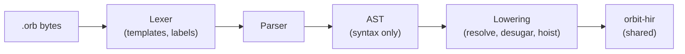
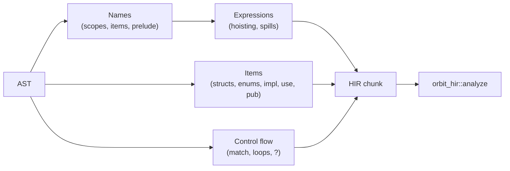

# OrbitScript front end

Status: Proposed. Crate: `orbit-orb-syntax`. Spec: the locked [syntax proposal](orbitscript-syntax/proposal.md) (a copy of the project's planning document; its Decisions table is authoritative).

The OrbitScript front end turns `.orb` source into the same [HIR](hir.md) as the [Lua front end](lua-front-end.md), so everything after it (compiler, VM, stdlib) is shared and a function written in one language is an ordinary function to the other. Like the Lua front end it never touches the VM or the GC heap, and depends only on `orbit-hir`.



## Delivery

| Step | Contents | State |
|---|---|---|
| 1 | Lexer, parser, AST, tests | Done (#145) |
| 2 | Lowering to HIR: resolution, items, structs, enums, `match`, `?`, hoisting, templates | #146 |
| 3 | `.orb` in the CLI, `require`'s searcher, `orbitc --hir`, behind a Cargo feature | #147 |
| 4a | `NumericFor { exclusive }` (Q15) and the `ForPrepExclusive` op | #148 |
| 4b | `scope stmt;` (Q13), lowered in the front end to a closure in a `<close>` local | This PR |

## Lexer

Hand-written and pull-based, like the Lua lexer. Rust's spelling throughout: `//` and nesting `/* */` comments (`///` and `//!` are ordinary comments for now), `"..."` with Rust's escapes (`\xHH` takes any byte, since strings are byte strings), `r"..."`/`r#"..."#`, `1_000`, `0b`, `0o`, `0x`. Line numbers come from `SourceInfo::new` over the whole source, so they're exact everywhere, including inside templates.

Where the proposal is silent, the lexer chooses:

- **Integer literals.** A decimal literal that doesn't fit in `i64` is an error ("write `9223372036854775808.0` for a float") instead of Lua's silent conversion to a float. Hexadecimal, octal and binary literals keep Lua's rule and give the 64-bit pattern written (`0xffff_ffff_ffff_ffff == -1`), which bit masks need.
- **No leading-dot floats** (`.5`), as in Rust; `1..10` lexes as a range.
- **`#!` first line** is skipped, as the standalone Lua interpreter does for scripts.
- **Templates** (`f"..."`) are split by the lexer into literal text and holes. A hole's expression is kept as a source range, and the parser parses it in place (so spans and lines are right). Brackets nest inside a hole and strings inside it are skipped whole, so `{t[#{a: 1}.a]}` and `{m["}"]}` work. The format spec starts at the first `:` at bracket depth 0 that isn't part of `::`.

## Parser

Recursive descent for items and statements, precedence climbing for expressions, with a depth limit (200) so deep nesting is an error, not a stack overflow.

Precedence, low to high, is Rust's table with the proposal's additions: `||`, `&&`, comparisons, `|`, `^`, `&`, `<<` `>>`, `+` `-` `~`, `*` `/` `\` `%`, prefix `-` `!` `~` `#`, `**` (right-associative), then postfix calls, fields, indexing and `?`.

Rust rules the parser follows where the proposal doesn't say otherwise:

- **Struct literals are not parsed in `if`, `while`, `match` and `for` headers**, so `if x == y { ... }` reads the block as the body. Parenthesise a literal there.
- **A block-like expression** (`if`, `match`, `loop`, `while`, `for`, `{ }`) at the start of a statement ends the statement, so it needs no `;`; it is the block's value only when it's the last thing in the block.
- **Comparisons don't chain**: `a < b < c` is an error.
- `return`, `break` and `continue` are expressions, so `_ => return 0,` works in a `match` arm.
- `scope` is a keyword at the start of a statement only when followed by a name, a keyword, a literal or `{`; `let scope` only when followed by a name. Everywhere else `scope` is an ordinary name.
- Generic parameters (`fn first<T>`) and every type annotation are parsed and kept only as spans: the compiler ignores them, and `orbit-check` will define their structure.
- Not in v1, each with a specific message: tuple structs and tuple variants, traits (`impl X for Y`), `as` casts, `()` as a value, `if let`/`while let`.

## Lowering (step 2)

`lower` (in `src/lower/`) walks the AST once and builds one `hir::Function` per function body; `to_hir` adds the HIR's shared analysis, as the Lua front end does. Lowering needs no new HIR node: everything below is plain `Let`, `If`, `Goto`, calls and table constructors.



### Names

- A name resolves to the innermost binding, then to an item later in an enclosing block, then to the prelude: Lua 5.5's base functions and standard modules, plus `panic` (`error`). The prelude is read-only. Any other global needs `extern NAME;` (read and write) or `global NAME = value;` (a `Define`). There are no implicit globals; a typo is a compile error that suggests `extern`.
- **Items are visible in their whole block**, as in Rust, so module-level functions can call each other in any order. An item used before its definition, from inside a function, becomes a local declared at the top of its block and assigned at the definition; others lower exactly as the proposal says (`LocalFunction`, `Let`). A use before the definition in the same function (where the value can't exist yet) is a compile error.
- **Parameters are immutable** unless written `mut x`, like `let`. Pattern bindings are immutable unless `mut`.

### Expressions

- **Hoisting.** An expression that needs statements (`if`, `match`, `loop` or a block used as a value, `?`, and `&&`/`||` around those) puts its statements before the statement that contains it and its result in a hidden local. Operands to its left that a statement could change are saved in hidden locals first, so evaluation stays left to right. Constants, closures and locals that are never reassigned are not saved.
- **Values.** Only a spread (`...f()`) or a bare call in a value list (`return f()`, `let (a, b) = f()`, a tail expression) keeps all results; a call anywhere else is one value, so `print(f())` passes one value and `print(...f())` passes all. **A spread must be the last** argument, array element or return value, because the HIR expands only the last item of a list.
- **`~` chains are right-nested** in the HIR (`a ~ b ~ c` as `a ~ (b ~ c)`), so the compiler's concatenation fusion turns them into one `Concat` op, as for Lua's `..`. Parentheses keep their meaning.
- `obj.name(args)` is a method call (`obj:name(args)`); `a::b(args)` is a plain call of a field (`a.b(args)`), so library functions are called as `math::sqrt(x)` and `table::concat(t, ",")`.
- A decimal integer literal that overflows `i64` is an error; hex, octal and binary literals wrap, as in Lua.
- **Templates** become one `string.format` call: text with `%` doubled, `%s` for a plain hole (so `nil`, booleans and `__tostring` work), and a translated conversion for a spec: alignment `<`/`>` and width (`%-8s`, `%8s`), `+`, `#`, `.N` (decimal places, `%.Nf`, or `%.Ne` with `e`/`E`), types `x X o e E`, and `?` for `%q`. A template with no holes is a string constant. The specs the proposal sends to a stdlib helper (zero padding without a numeric type or precision, centering `^`, binary `b`, fill characters other than a space) are compile errors ("not supported yet") until that helper exists.
- `expr?` lowers to `local v, e = expr; if v == nil then return nil, e end`, then `v`.

### Control flow

- `loop`, `while` and `for` become `While`/`NumericFor`/`GenericFor`. `continue` jumps to a label at the end of the body; a labelled `break` from an inner loop jumps to a label after the outer loop; `break value` assigns the loop's hidden result first. `(a..=b).rev()` and `.step_by(n)` set the step of a `NumericFor`. `a..b` sets its `exclusive` flag; `(a..b).rev()` counts down from `b - 1` to `a` inclusive, as Rust's does (for an integer range; on a float range it counts down from `b - 1` in steps of 1).
- **`match`** evaluates its scrutinee into hidden locals (one per tuple item for `match (a, b)`). Without guards it is an `if` chain whose first catch-all arm becomes the `else`. With guards, each arm's body ends with a `Goto` to a label after the `match`, so a failed guard falls through to the next arm. When no arm matches, the `match` raises `no match arm for value of type T` (the value's `__name`, or its `type`).
- Pattern tests: literals compare with `==`; a range also checks `type(v)` is `"number"` or `"string"` (so other values don't raise a comparison error); a struct or data-variant pattern compares `getmetatable(v)` with the type's table, then tests its fields; a unit variant compares identity with `rawequal`. `|` alternatives may not bind names yet. Field names in struct patterns and literals, and variant names in patterns, are checked against the definition when it is in the same module.

- **`scope stmt;`** (and `scope { ... }`) lowers to a closure in a box with a `<close>` local holding it, so Lua's to-be-closed machinery runs it on every exit, in reverse order with `let scope` bindings, with no HIR or VM support of its own (Tym, 2026-10-14):

  ```lua
  local _ <close> = setmetatable({ function() stmt end }, scope_meta)
  ```

  `scope_meta` is `{ __close = function(box) box[1]() end }`, built once per chunk in a hidden local of the main function. The action reads the current values of the locals it names (they become upvalues). `return`, `?`, and a `break` or `continue` that would leave the action are compile errors; loops and closures inside it keep their own. Each run costs a closure and a table; a `StmtKind::Defer` compiled to inline code could remove that later without changing any `.orb` program.

### Items

- **Structs.** `struct P` is one table that is both the instances' metatable and the namespace of associated functions: `{ __index = <methods>, __name = "P" }`. A literal `P { x, y }` is `setmetatable({ x = x, y = y }, P)`.
- **Enums.** `enum E` is a namespace table. Each data variant `E.V` is a metatable `{ __index = <methods>, __name = "E::V", new = <constructor> }`, so Lua code can build one with `E.V.new{...}`; each unit variant is one shared instance whose metatable refuses writes (`__newindex` raises `cannot modify unit variant E::V`).
- **`impl`.** Methods and associated functions go in the methods table; names starting with `__` (and `const __mode = "k"`) go on the metatable: the struct's table, or every variant's metatable. A user `__index` is wrapped so methods are found first, then the user's function or table. `impl` blocks must be in the module that defines the struct or enum (Rust's rule for inherent impls), so the front end knows every variant metatable a metamethod goes on.
- **Modules.** `use a::b;` is `local b = require("a.b")`; `use a::b::{x, y};` requires once and copies the fields into locals; `use a::b as c;` renames. When the module has a top-level `pub` item, the chunk builds an exports table and returns it; a top-level `return` in such a module is an error.

## Running OrbitScript (step 3)

- `orbit` (the crate) has an `orbitscript` feature, off by default for embedders. It adds `compile_orbitscript` and `Lua::load_orbitscript`, and installs the VM's second compiler hook, `Runtime::compile_orbitscript`. Source chunks named `@path.orb` use it, so `loadfile`, `dofile` and the CLI's script pick the language by file name. `load` of a string, `-e`, standard input and interactive mode stay Lua.
- `require` also searches `package.orbpath` (default `/usr/local/share/orbit/?.orb;/usr/local/share/orbit/?/init.orb;./?.orb;./?/init.orb`, or `ORBIT_PATH` with `;;` for the default). The Lua searcher tries it after `package.path`, so `package.searchers` keeps `lua`'s four entries. When neither path has the module, the message lists only `package.path`'s files, so a missing module's error message is exactly `lua`'s; `package.searchpath(name, package.orbpath)` lists the `.orb` files tried. `use a::b;` becomes `require("a.b")`, so an `.orb` module can load a Lua module and the other way round.
- `orbit-cli` has an `orbitscript` feature, on by default. With it, `orbit script.orb` runs a script, and `orbitc` compiles and lists `.orb` files and prints their HIR with `--hir`. `--ast` is Lua-only for now.
- **Size** (cloud x86_64, Ubuntu 24.04, release build with the committed PGO profile, stripped): `orbit` is 1,928,592 bytes without the feature and 2,238,000 with it (+302 KiB). `orbitc` grows by the same amount. In an unstripped build, `orbit-orb-syntax`'s own symbols come to 258,560 bytes, against 114,911 for the Lua front end. The largest functions are the lowering of statements and expressions and the parser's `primary` and `item`. Shrinking them is follow-up work.

## Binary size

A few small helpers are called from hundreds of places: the HIR's `Function::add_*` builders, the OrbitScript lowering's node builders (`add_expr`, `push`, `field`, `call_global`, ...), both parsers' token helpers (`advance`, `eat`, `expect`, ...), the compiler's `emit`, `jump`, `label`, `constant` and similar, and the bytecode format's varint readers and writers. With LTO these were inlined at every call site. They are now `#[inline(never)]`.

The HIR's capture analysis and the compiler's operand-origin table also sort packed `u128` keys with one shared `sort_unstable`, instead of instantiating a stable sort for each element type.

Measured on cloud x86_64 (Ubuntu 24.04, release without PGO, stripped `orbit`): 113 KiB smaller in all. The Lua-only build is 43 KiB smaller, and the `orbitscript` feature's cost fell from 279 KiB to 208 KiB. Compiling costs about 3 to 4% more instructions (valgrind: 3.9% for 200 loads of the suite's `strings.lua`, 3.0% for `bench/orb/compile.lua`), which is within the noise of wall time. The bytecode produced is unchanged, so scripts run at the same speed.

Sharing more code between the two front ends would save little (about 5 to 10 KiB, estimated): they share the HIR and everything after it already, and OrbitScript's extra size is its desugaring, which Lua doesn't need.

`bench/orb/desugar.orb` exercises every desugaring path and prints a checksum (`orbit bench/orb/desugar.orb [rounds]`). `bench/orb/compile.lua` times compiling it (`orbit bench/orb/compile.lua [times] [file.orb]`).

## Testing

`tests/parse.rs` checks tree shapes as S-expressions, every example in the proposal (`tests/programs/proposal.orb`), error messages, and a deterministic mutation run that must never panic.

`tests/run.rs` lowers programs, compiles them and runs them on the VM, checking what they print: each construct above, a runnable tour (`tests/programs/tour.orb`), the exports table seen from Lua, and compile errors. Its mutation run lowers mutants of the tour and checks that every one that lowers passes `orbit_hir::verify` and never panics the compiler.
