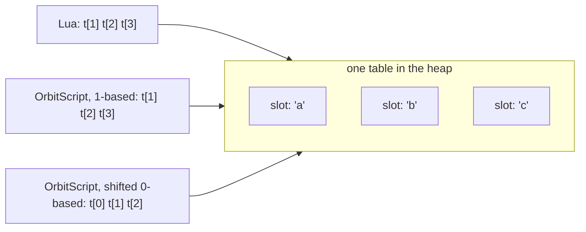

# OrbitScript indexing: 0-based or 1-based (Q5)

Status: **Report**, written for the indexing decision. Companion to [proposal.md](proposal.md). Nothing here is implemented. Performance figures are worked out from the current code (`crates/orbit-core/src/table.rs`, `crates/orbit-bytecode/src/format.rs` on main `cbbac40`), **not measured**: measuring needs the OrbitScript front end, which doesn't exist yet.

## Summary

- **Speed is not the obstacle.** With two extra VM ops, a 0-based OrbitScript costs about nothing at run time. The array fast path actually loses one subtraction. Lua code pays nothing.
- **Interop is the obstacle.** OrbitScript and Lua share the same tables. So 0-based can't mean "arrays start at 0". It has to mean "OrbitScript sees every integer key shifted by one". That shift also hits integer-keyed maps (ids, sparse tables, `arg[0]`), metamethod keys, and every position that crosses between the languages (`string.find` results, `table.insert` positions, user functions that return an index). These bugs are silent: an off-by-one read gives `nil`, and a write lands next to the intended slot.
- **No middle ground avoids that.** A per-table base, a type-directed shift and a separate array type each either break Lua libraries, contradict "types are erased", or need an ADR-1 change. None of them removes the boundary problem.
- **Recommendation: keep 1-based**, and add the ergonomics in [M1](#m1-keep-1-based-make-indices-rare-and-mistakes-loud) so that most code never writes an index and mistakes get caught. If you'd rather have 0-based, the only coherent version is the shifted view with native library twins ([M2](#m2-shifted-view-with-native-library-twins)), and its rules are listed below so it's a decision with known costs.

## What "0-based" would have to mean

One table holds the same data whichever language is looking at it, so the question is which index each language uses for a given slot.



| Option | What it means | Verdict |
|---|---|---|
| **A. 1-based** (current draft) | Both languages use the same keys | Recommended, with M1 |
| **B. Shifted view** | OrbitScript's `t[k]` for an integer `k` uses key `k + 1`; Lua is unchanged | The only coherent 0-based option (M2) |
| C. Per-table base | Tables made in OrbitScript start at 0 for everyone | Rejected: breaks Lua libraries |
| D. Type-directed shift | Shift only where static types prove an array (how TypeScriptToLua compiles JS arrays to Lua) | Rejected: types are optional and erased |
| E. Separate array type | A new 0-based value kind; plain tables stay 1-based | Rejected for now: ADR-1 change, still has the boundary problem |

## Performance of the shifted view (B)

Today every integer access starts with `idx = (i as u64).wrapping_sub(1)` and a bounds check against the array part (`get_int`, `read_int`, `store_int`, `set_int` in table.rs). Under B:

| Path | Lua today | OrbitScript 0-based | Change |
|---|---|---|---|
| Array part (`t[i]`, `i` in range) | `i - 1`, bounds check | `i`, bounds check | one instruction fewer |
| Hash part (sparse key, outside the array part) | hash key `i` | hash key `i + 1` | one add |
| Constant key `t[0]`, table constructor positions (`SetList` start) | as written | shifted by the compiler | free |
| Numeric `for` over `0..n` | n/a | plain `NumericFor`, the shift lives in the index op | free |
| Float keys (`t[2.0]`) | normalised to int | normalised, then shifted | same path |
| `ipairs`/`pairs`/`next` from OrbitScript | n/a | native iterators that shift integer keys back | one branch per step |
| Lua code | unchanged | unchanged (different ops) | none |

The VM cost is two new ops, `GetIndex0`/`SetIndex0`, for register keys. `GetIndexInt`/`SetIndexInt` take constant keys, which the compiler shifts. If #140's int-array ops merge, they'd need twins too. Each new op needs format.rs, verify.rs and flow.rs rows and a PGO retrain, and costs an estimated 1-3 KiB of binary.

**The library boundary is where it can get expensive.** Every stdlib function that takes or returns a position needs a 0-based face for OrbitScript:

| Library | Functions with positions |
|---|---|
| string | `sub`, `byte`, `find`, `match`/`gmatch`/`gsub` (position captures `()` and init), `pack`/`unpack` (init, returned position) |
| table | `insert`, `remove`, `move`, `unpack`, `concat` (i, j), `pack` (keys) |
| utf8 | `offset`, `codepoint`, `len` (i, j), `codes` (positions) |
| base | `select(n, ...)`, `ipairs`, `next`/`pairs` (integer keys) |
| math | `random(m, n)` is a range, not an index; unchanged |

Two ways to provide them:
- **Wrappers written in OrbitScript or Lua** add one extra call to every string or table operation. That probably costs something like 10-40% on string-heavy loops (an estimate from call overhead relative to `string.sub`'s own work, not measured), which would fail the "no speed tax" goal.
- **Native twins** share the implementation with a base parameter. They cost nothing at run time, but about 25 natives get a second registration and the size grows a little.

## Interop hazards of the shifted view

These are the real cost. Each one is a silent off-by-one, not an error.

**H1. Integer-keyed maps shift too.** The VM can't tell an array from a map: both are tables, and the array part is an internal detail.

```lua
-- scores.lua
scores = { [1001] = 7 }       -- player id 1001
```
```rust
// report.orb, 0-based view
print(scores[1001]);           // nil: the entry is at scores[1000]
users[row.id] = row;           // Lua sees it under row.id + 1
```

The same applies to sparse arrays, ids from databases, JSON decoders that produce integer keys, and any table used as a lookup by number.

**H2. Positions crossing the boundary.** Any index produced in one language and consumed in the other needs a manual `± 1`:

```rust
let i = lua_lib::find_index(list, x);  // a Lua function: returns 1-based
print(list[i]);                        // wrong element
let (s, e) = text.find("needle");      // stdlib twin: 0-based, fine
lua_lib::highlight(text, s, e);        // the Lua function expects 1-based
```

Documentation for every mixed-language API would have to say which convention it uses.

**H3. Metamethods.** A proxy's `__index(t, k)` must receive *some* key. If it gets the stored key, a proxy written in OrbitScript sees `k + 1`. If it gets the key as written, a Lua proxy used from OrbitScript sees `k - 1`. Either choice breaks proxies written in one of the languages.

**H4. Lua's own key 0 and negative keys.** In Lua, `arg[0]` is the script name and `arg[-1]` the interpreter. Under B, OrbitScript sees them as `arg[-1]` and `arg[-2]`.

**H5. Messages and tooling.** Stdlib errors report stored positions ("invalid value (at index 3) in table for 'concat'"). Debuggers, `debug` library output and the Rust embedding API (`Table::get(1)`) all use stored keys, so OrbitScript users would see numbers one higher than their code.

**H6. Porting code.** Moving a function from `.lua` to `.orb` means changing every index expression. A missed one still runs: it reads `nil` or writes next to the intended slot.

**H7. Strings would want more than a shift.** Rust developers expect `&s[0..3]`, which is 0-based and half-open. A shifted `s.sub(0, 2)` is 0-based but still inclusive, so it feels Rust-like in neither form. Doing it properly means half-open ranges for every string API, which takes the string functions further from Lua's.

## Middle grounds

### M1. Keep 1-based, make indices rare and mistakes loud

What makes 1-based painful is mostly writing indices by hand. OrbitScript can make that rare:

- **Element iteration first.** `for v in values(t)` (a native iterator over the array part, no index) and `for (i, v) in ipairs(t)` when the index is needed.
- **Inclusive ranges read naturally at 1:** `for i in 1..=#t`. The exclusive form `0..n` is still there for counting.
- **Ends without arithmetic:** `first(t)` and `last(t)` in the prelude, and `table::push(t, v)` / `table::pop(t)` as clearer names for `insert`/`remove` at the end. These are thin natives with no cost.
- **Slices later:** `t[2..=4]` copies a range, with the same 1-based rules.
- **Loud mistakes:** `orbit-check` warns on `t[0]` where `t` is known to be an array, and on `0..#t`-style loops that index `t`. The compiler doesn't error on `t[0]`, because key 0 is legal in maps.
- **Teach it once:** the language guide's first page about tables says "tables are shared with Lua, so arrays start at 1".

Cost: none at run time, a few prelude natives, and some lints in `orbit-check`.

### M2. Shifted view with native library twins

If you choose 0-based, this is the version that works end to end:
- Two new ops (`GetIndex0`, `SetIndex0`); the compiler shifts constant keys and constructors.
- Native twins of the position-taking stdlib functions, registered under the same names in OrbitScript's prelude.
- Fixed rules for the hazards: metamethods get the stored key (H3), integer-keyed maps shift (H1, documented), and boundary APIs say which convention they use (H2).
- Strings move to half-open ranges at the same time (H7).

Run-time cost is close to zero. The cost is the hazards above, plus about 25 extra natives and two ops to maintain.

### Rejected

- **C. Per-table base.** An array literal written in OrbitScript would start at 0 for Lua code too. `ipairs`, `#`, `table.sort` and every Lua library would then silently skip element 0. OrbitScript code reading a Lua table would still use 1, so one `.orb` file would use both conventions.
- **D. Type-directed shift.** TypeScriptToLua adds 1 at index sites that its static types prove are arrays. OrbitScript's types are optional and never trusted for code generation (vm.md), so adding or removing an annotation would change what a program does.
- **E. Separate array type.** A new value kind (an ADR-1 change), or userdata, which Lua would index through metamethods and so more slowly. It would still have H2 and H7, and two kinds of list would confuse more than one base does.

## Precedent

Languages that compile to or embed in Lua have made both choices. Luau (Roblox), whose audience is mostly new programmers, kept 1-based. TypeScriptToLua and Haxe's Lua target shift, but only because their static types tell them where arrays are. Julia, MATLAB, R and Fortran are 1-based and widely used by non-specialists.

## Recommendation

**A + M1.** The promise that a table is the same table in both languages is the core of the interop design, and the shifted view breaks it for every integer key, not just arrays. The newcomers 0-based indexing is meant to help would hit H1-H6 as silent wrong answers instead of learning one rule. M1 removes most hand-written indices and makes the remaining mistakes visible.

## Decision

| Option | One-line consequence |
|---|---|
| **A + M1 (recommended)** | 1-based, `values`/`first`/`last`/`push`/`pop` in the prelude, `orbit-check` lints |
| M2 | 0-based everywhere in OrbitScript: two new ops, ~25 native twins, half-open string ranges, documented boundary rules |
| Spike first | Build M2's two ops and a string twin on a branch and measure, before deciding (needs the parser to exist, so after S1-S2) |
