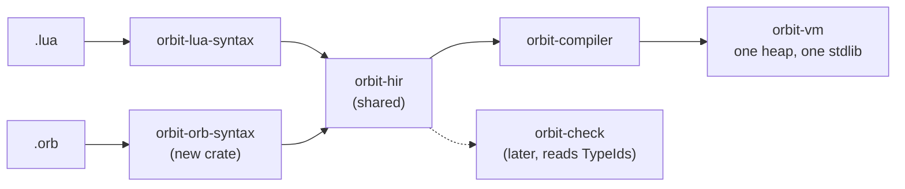
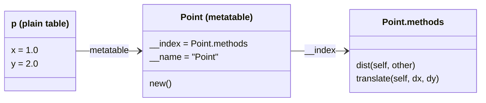
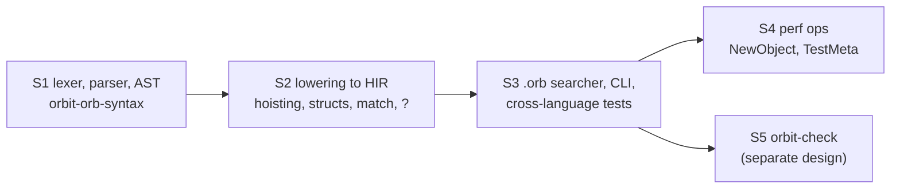

# OrbitScript syntax proposal

Status: **Decided and implemented.** The decisions are in the Decisions table, and `orbit-orb-syntax` implements it ([orbitscript-front-end.md](../orbitscript-front-end.md)).

Every question is decided; see [Decisions](#decisions). The document follows them. Indexing background: [indexing-report.md](indexing-report.md).

## Goals and constraints

- **Feels like Rust**: `fn`, `let`/`let mut`, `struct` + `impl`, explicit `self`, `match`, `::` paths, `//` comments, braces, semicolons, expression-oriented blocks, optional type annotations in Rust positions.
- **Runs on Lua's runtime, unchanged.** Values, tables, metatables, closures, coroutines, errors and the stdlib are the ones Lua 5.5 code sees. OrbitScript is a second spelling of the same semantics plus some sugar, not a second object model. No ownership, borrowing, lifetimes or references: it is a garbage-collected scripting language.
- **One HIR.** Both front ends lower to `orbit-hir` (docs/design/hir.md). Most of this proposal needs no new HIR nodes; the few places that would are marked **[HIR]** and collected in [What it costs the HIR and VM](#what-it-costs-the-hir-and-vm).
- **Free interop.** A `.orb` module can `use` a `.lua` module and the other way round, with no wrappers: an OrbitScript struct is a table with a metatable, a method is a function whose first parameter is `self`.
- **No speed tax.** Nothing in the syntax should make OrbitScript slower than the same program in Lua. Where a feature costs something (an allocation, a native call), it is marked **[cost]**.
- **Types are optional and erased** (plan, "Interop model"): kept in HIR as `TypeId`, ignored by the compiler, checked later by `orbit-check`.



Code blocks for OrbitScript below are tagged `rust` only for highlighting.

## A taste

A small module in both languages. The OrbitScript version is the proposed syntax in full; everything in it is explained in the sections after.

```lua
-- geometry.lua
local M = {}

local Vec2 = {}
Vec2.__index = Vec2

function Vec2.new(x, y)
  return setmetatable({ x = x, y = y }, Vec2)
end

function Vec2:len()
  return math.sqrt(self.x * self.x + self.y * self.y)
end

function Vec2.__add(a, b)
  return Vec2.new(a.x + b.x, a.y + b.y)
end

function Vec2:__tostring()
  return string.format("(%g, %g)", self.x, self.y)
end

M.Vec2 = Vec2

function M.longest(points)
  local best, best_len = nil, -1
  for _, p in ipairs(points) do
    local l = p:len()
    if l > best_len then best, best_len = p, l end
  end
  return best, best_len
end

return M
```

```rust
// geometry.orb
pub struct Vec2 { x: float, y: float }

impl Vec2 {
    pub fn new(x: float, y: float) -> Vec2 {
        Vec2 { x, y }
    }

    pub fn len(self) -> float {
        math::sqrt(self.x * self.x + self.y * self.y)
    }

    // Names starting with `__` are metamethods: they go on the metatable.
    fn __add(self, other: Vec2) -> Vec2 {
        Vec2::new(self.x + other.x, self.y + other.y)
    }

    fn __tostring(self) -> string {
        f"({self.x}, {self.y})"
    }
}

pub fn longest(points: [Vec2]) -> (Vec2?, float) {
    let mut best = nil;
    let mut best_len = -1.0;
    for (_, p) in ipairs(points) {
        let l = p.len();
        if l > best_len {
            best = p;
            best_len = l;
        }
    }
    (best, best_len)
}
```

A Lua caller sees exactly what the Lua version exports:

```lua
local geo = require("geometry")
local v = geo.Vec2.new(3, 4)
print(v:len(), tostring(v + v))   --> 5.0   (6.0, 8.0)
```

## Lexical structure

| | Lua | OrbitScript |
|---|---|---|
| Line comment | `-- x` | `// x` |
| Block comment | `--[[ x ]]` | `/* x */` (nests, like Rust) |
| Doc comment | none | `///` and `//!`, kept for tooling, ignored by the compiler |
| String | `"a\n"`, `'a'` | `"a\n"` only; escapes as Rust: `\n \t \\ \" \0 \x41 \u{1F600}` |
| Long / raw string | `[[ ... ]]`, `[==[ ... ]==]` | `r"..."`, `r#"..."#` |
| Byte | `string.byte("a")` | `b'a'` (the integer 97; see [Strings](#strings)) |
| Interpolation | none | `f"x = {x}"` (see [Strings](#strings)) |
| Numbers | `10 0xff 1e3 3.0` | same, plus `1_000_000`, `0b1010`, `0o17` |
| Statement end | optional `;` | `;` required, except after a block-bodied item and on a block's final expression |
| Labels | `::name::` | `'name:` on a loop (Rust's loop-label form) |

Single quotes are not strings: they are taken by loop labels, as in Rust. There is no char type (Lua has none); `"a"` is a one-byte string, and `b'a'` is the byte 97 as an integer.

Keywords: `fn let mut const pub use struct enum impl for in while loop if else match break continue return self Self nil true false as`, plus `scope` as a contextual keyword (so `scope` stays usable as a variable name). `global` and `extern` are reserved (see [Names and globals](#names-and-globals)).

Keywords are still names where nothing else could be meant: after `.` and `::` (`string::match(s, p)`, `t.loop`), as field names in struct definitions, struct literals, struct patterns and `#{ key: value }`, as variant names, and as the names of functions and constants in `impl`. Anywhere a keyword-named local would be bound or read (`let`, parameters, shorthand fields such as `P { match }`, the last segment of `use`), it is written as a raw name, `r#match`, as in Rust. `r#name` is always a name, so it can also be used just to be explicit, including `r#scope`; `r#_`, `r#self` and `r#Self` are errors.

## Bindings and mutability

```lua
local x = 1
local y <const> = 2
x = x + 1
```

```rust
let mut x = 1;
let y = 2;          // immutable, like Rust: assigning it is a compile error
x += 1;             // compound assignment: += -= *= /= %= &= |= ^= <<= >>= (no compound concatenation)
let (q, r) = divmod(7, 2);   // destructuring multiple results
let x = "shadowed";          // shadowing is allowed, as in Rust
```

- `let` lowers to `Let` with `LocalKind::Const`; `let mut` to `LocalKind::Normal`. No new HIR.
- Immutable by default is a **speed win**: hir.md already notes that a captured local that's never reassigned can be captured by value rather than by heap cell. In OrbitScript that becomes the common case.
- `let x;` without a value is allowed only with `mut` and starts as `nil`.
- Compound assignment `a.b += 1` evaluates `a` once (lowered through a hidden local).
- `const NAME = expr;` at module level is a `Const` local whose initialiser must be a literal or another `const`; the compiler already folds those.

## Functions and closures

```lua
local function add(a, b) return a + b end
local sq = function(x) return x * x end
local function log(fmt, ...) print(string.format(fmt, ...)) end
```

```rust
fn add(a: int, b: int) -> int { a + b }      // last expression is the result
let sq = |x| x * x;                          // closure
let clamp = |x, lo, hi| {
    if x < lo { return lo; }
    if x > hi { hi } else { x }
};
fn log(fmt: string, ...args) {               // named varargs (Lua 5.5 `...t`)
    print(fmt.format(...args));              // `...e` spreads all values
}
```

- `fn` lowers to `LocalFunction` (in scope in its own body, so it can recurse); `|...|` lowers to `Closure`. A block's final expression without `;` is its value; in a function body that is an implicit `Return`.
- `...args` is Lua 5.5's named vararg, which `VarargIndex` already reads without building a table.
- Functions are values, as in Lua; there are no overloads and no default arguments in v1.

## Multiple results

This is the one place where OrbitScript deliberately changes Lua's surface rule (the runtime model stays the same).

Lua expands a call's results only when the call is the last item in a list, and truncates silently elsewhere. That rule is a known source of bugs (`f(g(), 1)` vs `f(1, g())`). OrbitScript makes it explicit:

| Expression | Values |
|---|---|
| `f()` anywhere in an expression or argument list | first result only (`First`) |
| `...f()` / `...args` in an argument list, array literal or `return` | all results |
| `let (a, b) = f();` | destructures the first two results |
| `return f();` | all results (and it is a tail call, as hir.md defines) |
| `(a, b)` in `return` or a block's final position | two values, no allocation |
| `for (k, v) in pairs(t)` | the iterator expression keeps all its values, as Lua's generic `for` needs |

Tuples are therefore *not* first-class values: `let t = (1, 2);` is a compile error ("tuples are multiple results; use `[1, 2]` for a table"). This keeps them free: they lower to `ExprList`s and never allocate. Truncating to one value costs nothing (the call op's result count is 1, which is the cheapest form).

## Tables, arrays and maps

```lua
local arr = { 10, 20, 30 }
local map = { name = "orbit", ["two words"] = true, [k] = v }
print(#arr, arr[1], map.name)
```

```rust
let arr = [10, 20, 30];
let map = #{ name: "orbit", "two words": true, [k]: v };
let mixed = #{ 10, 20, tag: "x" };           // positional and keyed together
print(#arr, arr[1], map.name);
```

- `[...]` is a table with only an array part; `#{...}` is a general table (the `#{` spelling, as in Rhai, avoids Rust's block-vs-literal ambiguity of a bare `{`).
- **Indexing is 1-based** (decided, Q5), because tables are shared with Lua code and the stdlib (`#`, `ipairs`, `table.insert`, `string.sub`). Background: [indexing-report.md](indexing-report.md). Making iteration nicer through the standard library (element iterators and helpers, so less code writes indices) is a planned follow-up.
- Length stays the prefix `#` operator (lowers to `UnOp::Len`). `t.len()` would be a method call and tables have no methods.

## Structs and impl

```rust
pub struct Point { x: float, y: float }

impl Point {
    pub fn new(x, y) -> Point { Point { x, y } }     // associated fn: no self
    pub fn dist(self, other: Point) -> float {       // method: explicit self
        let dx = self.x - other.x;
        let dy = self.y - other.y;
        math::sqrt(dx * dx + dy * dy)
    }
    pub fn translate(self, dx, dy) { self.x += dx; self.y += dy; }  // fields are mutable through any binding
}

let p = Point::new(1, 2);    // path call: Point.new(1, 2)
let q = Point { x: 4, y: 6 };
print(p.dist(q));            // method call: p:dist(q)
```



Lowering, with no new HIR:

- `struct Point { x, y }` creates one table `Point` that is both the metatable of every instance and the namespace for associated functions. Its `__index` is a separate `methods` table, so instances see methods but not associated functions (`p.new(1, 2)` is an error, as in Rust). `__name` is set so `tostring` and error messages say `Point`.
- `Point { x: 4, y: 6 }` is `setmetatable(#{ x: 4, y: 6 }, Point)`. Every field must be given (shorthand `Point { x, y }` takes locals of the same name); a missing or unknown field is a compile error when the struct is visible at compile time.
  **[cost]** As a library call that is a native call per construction. The struct literal has a fixed, known shape, so a fused `NewObject { dst, meta, hash_hint }` op (one new bytecode op, no ADR change) would make it cheaper than Lua's `setmetatable({...}, mt)`. Q19.
- Methods in `impl` blocks go into `methods`; associated functions (no `self`) go into `Point`. Methods also go into `Point`, so `Point::dist(p, q)` and `pcall(Point::dist, p, q)` work from any module, and from Lua as `Point.dist(p, q)`; instances still see only `methods`. A method and an associated function can't share a name. An enum's methods likewise go on its namespace table, and a method named like a variant is an error. Several `impl` blocks for one struct may appear in the same module.
- Fields are public at runtime (they are table fields). A non-`pub` field is a privacy rule for `orbit-check`, not the VM.
- No inheritance, as in Rust. Composition and traits-as-documentation only (Q18).

### Calls: `.` versus `::`

Rust's rule, applied to Lua's two call forms:

| OrbitScript | Lua | Meaning |
|---|---|---|
| `obj.name(args)` | `obj:name(args)` | method call: `obj` passed as `self` (`MethodCall`) |
| `path::name(args)` | `path.name(args)` | plain call of a field, no `self` (`Index` + `Call`) |
| `obj.name` | `obj.name` | field read |
| `(obj.name)(args)` | `obj.name(args)` | call a function stored in a field, no `self` |

So stdlib modules are paths, as in Rust: `math::floor(x)`, `string::format(...)`, `table::insert(t, v)`, `io::write(s)`. Strings keep Lua's string metatable, so `"%d items".format(n)` and `s.upper()` work as method calls exactly like Lua's `("%d"):format(n)` and `s:upper()`. `::` works on any name, not only modules: `handlers::on_click(e)` calls a callback stored in a table.

### Operators and metamethods

Decided (Q10, Q18): no traits for now, including for operators, so user-defined traits stay open later. Metamethods are written by their Lua names inside an `impl` block: functions and `const`s whose names start with `__` go on the metatable, not into `methods`.

```rust
impl Vec2 {
    fn __add(self, other) { Vec2::new(self.x + other.x, self.y + other.y) }
    fn __eq(self, other) { self.x == other.x && self.y == other.y }
    fn __tostring(self) { f"({self.x}, {self.y})" }
    fn __close(self, err) { self.release(); }
    const __mode = "k";
}
```

Every Lua metamethod is reachable this way, with the meaning the Lua manual gives it. **[cost]** A user `__index` replaces `__index = methods`, so the front end makes it a function that tries `methods` first and then the user's `__index`; that type loses the inline-cached method path. Fine as an opt-in.

<details>
<summary>Withdrawn: trait-name mapping (kept for when traits are designed)</summary>

The first draft mapped Rust trait names to metamethods:

| `impl X for T` | method | metamethod |
|---|---|---|
| `Add` `Sub` `Mul` `Div` `Rem` | `add` `sub` `mul` `div` `rem` | `__add` `__sub` `__mul` `__div` `__mod` |
| `Neg` | `neg` | `__unm` |
| `PartialEq` | `eq` | `__eq` |
| `PartialOrd` | `lt`, `le` | `__lt`, `__le` |
| `Display` | `to_string` | `__tostring` |
| `Call` | `call` | `__call` |
| `Len` | `len` | `__len` |
| `Concat` | `concat` | `__concat` |
| `Close` | `close` | `__close` |
| `Index` / `IndexMut` | `index` / `index_set` | `__index` / `__newindex` |

</details>

## Enums and match

```rust
pub enum Shape {
    Circle { r: float },
    Rect { w: float, h: float },
    Empty,
}

impl Shape {
    pub fn area(self) -> float {
        match self {
            Shape::Circle { r } => math::pi * r * r,
            Shape::Rect { w, h } => w * h,
            Shape::Empty => 0.0,
        }
    }
}

let label = match n {
    0 => "none",
    1 | 2 => "few",
    3..=9 => "some",
    x if x < 0 => "negative",
    _ => "many",
};
```

- Each variant is its own metatable (`Shape.Circle`, with `__name = "Shape::Circle"` and `__index` = the shared `Shape` methods); a data variant's value is a table with that metatable; a unit variant is one shared, frozen instance. Lua code can build and inspect them (`Shape.Circle.new{r = 1}`, `getmetatable(s) == Shape.Circle`).
- `match` lowers to an `If` chain over hidden locals (no new HIR). Patterns: literals, `nil`, `true`/`false`, ranges `a..=b`, `|`, bindings, `_`, guards `if`, struct and variant destructuring, multiple results `(a, b)`.
- No arm matching is a runtime error (`no match arm for value of type Shape::Rect`). Exhaustiveness is `orbit-check`'s job, since types are not known at compile time.
- **[cost]** Testing a variant means comparing an object's metatable. Through `getmetatable` that is a native call per arm. A `TestMeta { obj, meta_const }` op (one new op) makes it a load and a compare, and lets a `match` on many variants stay cheap. Q9.
- **[cost, later]** A `match` over dense integer literals could compile to a jump table (one new op). Not needed for v1.

## Control flow

```rust
if x > 0 { a() } else if x < 0 { b() } else { c() }   // no parentheses, braces required
let sign = if x >= 0 { 1 } else { -1 };              // if is an expression

while i < n { i += 1; }
loop { if done() { break; } }                       // `loop` = while true
let found = loop { if let_me_out() { break 42; } };  // break with a value

for i in 1..=10 { }          // numeric for, inclusive
for i in 0..n { }            // exclusive end
for i in (1..=10).rev() { }  // step -1
for i in (0..100).step_by(5) { }
for (i, v) in ipairs(t) { }  // generic for
for k in pairs(t) { }        // extra iterator results are ignored, as in Lua

'outer: for i in 1..=n {
    for j in 1..=n {
        if j == i { continue; }
        if grid[i][j] == 0 { break 'outer; }
    }
}
```

- Range headers in `for` lower straight to `NumericFor`, so they are as fast as Lua's numeric loop; `.rev()` and `.step_by(s)` are recognised syntactically in a `for` header only. Outside a `for` header or a pattern, `a..b` is a compile error in v1 (a range object would allocate).
- **[HIR]** An exclusive end `0..n` on integers lowers to limit `n - 1` with no HIR change, but that is wrong for floats (`0..2.5`) and needs care at `math.mininteger`. A small `exclusive: bool` on `NumericFor` (and the matching count computation in the for-prep op) is cleaner. Q15.
- `continue` and labelled `break`/`continue` lower to `Goto` and `Label`, which hir.md already reserves for this.
- `if`, `match`, `loop` and `{ ... }` blocks are expressions. The front end lowers an expression in the middle of another expression by hoisting: earlier operands go into hidden locals (preserving left-to-right order), the branching statement assigns a hidden result local, and the outer expression reads it. No new HIR (Q2).
- Truthiness is Lua's: only `nil` and `false` are false. `orbit-check` can warn on non-`bool` conditions.

## Operators

| Meaning (Lua semantics) | Lua | OrbitScript | Note |
|---|---|---|---|
| add, sub, mul | `+ - *` | `+ - *` | |
| float division | `/` | `/` | always float, as in Lua (differs from Rust's integer `/`) |
| floor division | `//` | `\` (decided, Q7) | `//` is a comment in Rust syntax; see [Division](#division-q7) |
| floored modulo | `%` | `%` | Lua's floored `%`, not Rust's truncating remainder; documented |
| power | `^` | `**` | Rust has no power operator; `^` is xor in Rust (Q8) |
| concatenation | `..` | `~` (decided, Q6) | `..` is a range in Rust; see [Concatenation](#concatenation-q6) |
| equality | `== ~=` | `== !=` | |
| comparison | `< <= > >=` | same | |
| logical | `and or not` | `&& \|\| !` | short-circuit, return operands as Lua does |
| bitwise and, or, xor | `& \| ~` | `& \| ^` | Rust's spelling (Q8, decided) |
| shifts | `<< >>` | `<< >>` | |
| bitwise not | `~x` | `~x` | kept from Lua: Rust's `!x` on integers would clash with logical `!` on Lua values |
| length | `#t` | `#t` | |

All of these lower to the existing `BinOp`/`UnOp`/`And`/`Or` nodes. Integer overflow wraps (Lua), not panics (Rust). Precedence follows Rust's table, with `**` binding tighter than unary minus and right-associative (`-2 ** 2 == -4`, as Lua's `^`), binary `~` at the level of `+`, and floor division at the level of `*`.

### Concatenation (Q6)

`++` was clunky, and `..` stays reserved for ranges. The candidates:

| Operator | Precedent | Problem |
|---|---|---|
| **`a ~ b`** | D | A Lua reader sees xor (Lua's binary `~`). In OrbitScript xor is `^` (Q8), so binary `~` is free, and unary `~x` (bitwise not) parses alongside it exactly as Lua parses its own unary and binary `~` |
| `a + b` | Rust (`String + &str`), JS, Python, Java | Lua's `+` turns numeric strings into numbers (`"10" + 1 == 11`). OrbitScript `+` would need a new op that picks add or concatenation at run time, `"10" + 1` would mean something different in a `.lua` and an `.orb` file, and for tables it is unclear whether `__add` or `__concat` applies |
| `a <> b` | Haskell, Elixir | Clashes with `<`/`>` and with generics in type annotations |
| `a & b` | Visual Basic | Bitwise and |
| `a . b` | PHP, Perl | Field access |
| `a \|\| b` | SQL | Logical or, and closure bars |
| none (interpolation only) | Rust's `format!` | Building strings in loops (`s = s ~ part`) is everyday Lua; dropping the operator pushes people to `table::concat` or slow interpolation |

**Decided (Q6): `~`, with no compound form.** `~=` would look like Lua's not-equal, so it isn't offered; write `s = s ~ "x";`. It can be added later if it becomes a nuisance. Lowering is unchanged: `BinOp::Concat`, metamethod `__concat`, numbers converted as in Lua. A Lua developer who writes `if a ~= b` gets a compile error (unknown operator), not a silent bug.

If you prefer `+` anyway, it is possible at no speed cost (numbers keep their fast path; strings already take the slow path), but it gives `+` different meanings in the two languages, which is why I don't recommend it.

### Division (Q7)

*Can `/` do integer division too?* It can, but I recommend against it, because OrbitScript's types are dynamic.

In Rust, `a / b` truncates only when the compiler has proven both operands are integers. In OrbitScript the same decision would be made at run time from the values, so `let avg = total / count;` gives `3` or `3.5` depending on where `total` and `count` came from: `#t`, `string::len`, `tonumber("3")` and many JSON decoders give integers, while `3.0` or any float arithmetic gives floats, and both print as plain numbers. That is the Python 2 bug that Python 3 removed (PEP 238), and the reason Lua 5.3 made `/` always produce a float.

Further problems with a type-dependent `/`:
- **Rounding.** Rust truncates toward zero (`-7 / 2 == -3`); Lua floors (`-7 // 2 == -4`). OrbitScript keeps Lua's floored `%`, so `/` would have to floor to keep `a == (a / b) * b + a % b`, which differs from Rust anyway.
- **Division by zero.** Integer `7 / 0` raises an error, float `7.0 / 0` gives `inf`, so whether `/` errors would depend on the runtime type too.
- **Interop.** The same `a / b` would give different results in a `.lua` and an `.orb` file.

Speed is not the issue: either choice is one op with the same fast paths.

**Recommendation:** keep `/` as float division (Lua's meaning) and keep a distinct floor-division operator. `math::floor(a / b)` is not a substitute, because it goes through a float and loses precision above 2^53. Agreed, but with a symbol: `div` would be the only spelled-out arithmetic operator.

| Symbol | Precedent | Problem |
|---|---|---|
| **`a \ b`** | Visual Basic (`\` is integer division) | Backslash reads as an escape at first sight; otherwise free: Rust and Lua use `\` only inside strings |
| `a ~/ b` | Dart | Now that `~` is concatenation, `a ~/ b` looks like a concatenation |
| `a /_ b` | the floor bracket `⌊ ⌋` | `a /_b` is ambiguous with `a / _b`, since `_b` is a valid name |
| `a %/% b` | R | Three characters, unfamiliar outside R |
| `a /| b`, `a /. b` | none (OCaml's `/.` is *float* division) | No precedent; `/.` would mislead OCaml users |
| `a // b` with another comment syntax | Lua, Python | `//` comments are core to the Rust feel |

**Decided (Q7): `\`.** It's a single character, has a real precedent for exactly this meaning, needs no lexer tricks, and sits naturally next to `/` (`a / b` float, `a \ b` floor). Precedence and lowering are unchanged: the level of `*`, `BinOp::IDiv`, metamethod `__idiv`. No compound form, consistent with `~`.


## Strings

`"..."` and raw strings `r"..."`/`r#"..."#`. Strings are Lua byte strings (ADR-5); `\u{...}` encodes UTF-8.

A byte literal `b'a'` is an `int` constant: the value `string::byte` gives for that byte, so `string::byte(s, i) == b'\r'` and `match c { b'0'..=b'9' => ... }` read as what they mean (Rust's spelling, which can't be mistaken for a loop label). It holds one printable ASCII character or one escape that gives one byte: `\n \r \t \\ \0 \' \" \xHH`, where `\xHH` takes any byte. A raw tab or line break, `\u{...}` and a non-ASCII character are errors (`b'é'` would be two bytes in UTF-8; the error suggests `"é"` or `\xc3\xa9`).

### Interpolation: `f"..."` (Q14)

An `f` before a string literal makes it a template. Each `{...}` holds an expression whose value is converted to text and spliced in. It is the same idea as Rust's `format!("{name} has {n} items")` with inline arguments, without needing macros, and the same spelling as Python's f-strings.

```rust
let name = "orbit";
let n = 3;
let pct = 41.666;
print(f"{name} has {n} items");          // orbit has 3 items
print(f"{name} is {pct:.1}% done");      // orbit is 41.7% done
print(f"{n:>4}|{n:<4}|{n:04}|{255:x}");  // "   3|3   |0003|ff"
print(f"total: {a + b}, first: {t[1]}"); // any expression
print(f"{{literal braces}}");            // {literal braces}
print(f"{p}");                           // uses __tostring if p has one
print(f"{nil} {true}");                  // nil true  (no error, unlike Lua's ..)
```

The rules:

- `{expr}` takes any expression. The lexer tracks brace depth, so `{t[#{a: 1}.a]}` works; a string literal inside the braces is allowed. `{{` and `}}` are literal braces.
- **Without a format spec**, the value is converted as by `tostring`: strings as is, numbers as Lua prints them, `nil`/`true`/`false` by name, and tables or userdata through `__tostring` (or `__name`). Unlike Lua's `..`, it never fails on `nil` or a table.
- **With a format spec** after `:`, the spec follows Rust's mini-language where `string.format` can express it: fill and alignment `<` `>` `^`, sign `+`, `#`, zero pad `0`, width, `.precision`, and type `x X o b e E`. Because the value's type is only known at run time, width and alignment apply to the converted text (`{s:>8}` is `%8s`, `{s:<8}` is `%-8s`), precision means decimal places (`{x:.2}` is `%.2f`), and the type letters map directly (`{n:x}` is `%x`). Specs `string.format` can't express on any value (zero padding `0`, centering `^`, binary `b`) go through a small stdlib helper. `{x:?}` gives a quoted, escaped form like Lua's `%q`, which plays the role of Rust's `Debug`.
- Plain `"..."` strings never interpolate, so JSON or Lua patterns in ordinary strings need no escaping.

How it lowers (no new HIR):

```rust
f"{name} has {n} items ({pct:.1}%)"
// v1: one call, format string built at compile time
string.format("%s has %s items (%.1f%%)", name, n, pct)
```

Lua 5.5's `%s` already converts through `tostring` with `__tostring`, so a single `string.format` call with a compile-time format string gives exactly the semantics above. The front end reads `string.format` through the prelude, so a script that rebinds the local name `string` doesn't change what `f"..."` does.

**[cost]** One native call, and `string.format` parses its format at run time: about what the equivalent hand-written Lua costs, and cheaper than chained `..` with `tostring` calls. If profiles show it, a `ToString` op plus `Concat` would remove the call and the format parsing (Q19 rule: only if it measurably helps).


## Errors and the `?` operator

Lua has two error styles: raising (`error`, caught by `pcall`) and returning `nil, message` (`io.open`). OrbitScript keeps both and gives the second Rust's `?`:

```lua
local function read_config(path)
  local f, err = io.open(path)
  if not f then return nil, err end
  local text = f:read("a")
  f:close()
  return text
end
```

```rust
fn read_config(path: string) -> string? {
    let f = io::open(path)?;          // nil, err -> return nil, err
    scope f.close();
    f.read("a")
}

let (ok, err) = pcall(risky, 1, 2);   // raising errors: unchanged
panic(f"bad state {s}");              // alias of error(), Rust's name
```

- `expr?` evaluates `expr` keeping its first two results; if the first is `nil`, the function returns `nil, second`; otherwise `expr?` is the first value. Lowered with hidden locals and an `If` + `Return`; no new HIR, no allocation.
- `false` is not a failure for `?`, only `nil` (Lua's `fail` value is `nil`).

## Scoped cleanup: `scope`

Decided (round 3): one keyword, `scope`, covers both scoped actions (Go's and Swift's `defer`) and scoped bindings (Lua's `<close>`), so the two read as one feature. Attributes are not used here; they are left for a later, language-wide design.

### Scoped actions: `scope stmt;`

```rust
fn copy(src, dst) {
    let a = io::open(src, "rb")?;
    scope a.close();
    let b = io::open(dst, "wb")?;
    scope {
        b.flush();
        b.close();
    }
    b.write(a.read("a"));
}
```

`scope stmt;` (or `scope { ... }`) runs when the enclosing block exits by any route: fall-through, `return`, `break`, `continue`, or an error. Several run in reverse order, interleaved with scoped bindings. A scoped action can read locals in scope where it is written; `return`, `break` and `continue` inside it are compile errors.

**[HIR]** Decided (Q13, changed later): lowered in the front end, with no new HIR or bytecode. The action becomes a closure boxed in a table whose shared metatable's `__close` calls it, held in a `<close>` local, so it reuses Lua's to-be-closed machinery as is. It costs a closure and a table per run. The earlier plan, a `Defer { body: BlockId }` HIR statement compiled to inline code, turned out to need new unwinder states and can still come later without changing any program.

### Scoped bindings: `let scope name = expr;`

```lua
local f <close> = assert(io.open(path))
```

```rust
let scope f = io::open(path)?;
// ... use f; its __close runs when the block ends by any route
```

- Lowers to a `Close` local (`LocalKind::Close`), which the HIR and VM already support: no new HIR, no allocation, the same cost as Lua's `<close>`.
- Behaviour is Lua's: at scope exit the value's `__close(value, err)` runs, in reverse order of declaration. `nil` and `false` are allowed and skipped; a value without `__close` is an error at the `let` ("variable 'f' got a non-closable value").
- The binding is immutable: `let scope mut` is a compile error, as in Lua.
- Your own types get cleanup by defining `__close` in their `impl`:

```rust
pub struct Lock { name: string }

impl Lock {
    pub fn acquire(name) -> Lock { take(name); Lock { name } }
    fn __close(self, err) { release(self.name); }
}

fn update() {
    let scope guard = Lock::acquire("db");
    write_rows()?;        // early return still releases the lock
}
```

**Why not implicit, like Rust's `Drop`?** Rust can drop a value at scope end because ownership proves it wasn't moved elsewhere. OrbitScript has no ownership: `let f = open(p); return f;` must not close `f`, and the compiler can't tell in general whether a value escaped into a table or closure. Checking every `let` for `__close` at run time would also cost something on every binding. So it is opted into per binding, as in Lua.

### `scope` or `scoped`?

What other languages call these two features:

| Language | Scoped action | Scoped binding |
|---|---|---|
| D | `scope(exit) stmt;` (also `scope(success)`, `scope(failure)`) | `scope` storage class on variables |
| Go, Swift, Zig, Nim, V | `defer stmt` (Zig adds `errdefer`) | none |
| C# 8+ | none | `using var f = ...;` |
| JavaScript / TypeScript 5.2+ | none | `using f = ...;` |
| Python | none (`try`/`finally`) | `with expr as f:` |
| Java | none | `try (var f = ...) { }` |
| Lua 5.4+ | none | `local f <close> = ...` |
| Kotlin | none | `expr.use { f -> ... }` |
| Rust, C++ | none | implicit (`Drop`, destructors) |

**Decided (Q21): `scope`, not `scoped`.**
- `scope` works in both positions: `let scope f = ...` reads as "a scope-bound `f`", and `scope f.close();` as "at scope exit, close f". `scoped` reads well only in the binding: `scoped f.close();` sounds like f.close() is the thing being scoped, which isn't what happens.
- D, the one language that has both features under one word, uses `scope` for both.
- It leaves room for D-style qualifiers later, such as an error-only cleanup like Zig's `errdefer` (`scope(fail) rollback();`), which may fit the later `pcall`-style error work (Q12).

One readability risk: `scope { ... }` can look like "open a new block scope". I suggest the block form be allowed but the guide prefer `scope stmt;` for single actions, and the formatter always keep a scoped block visibly attached (`scope {` on its own line). If that still reads badly, `scope(exit) { ... }` in the D style removes the doubt at the cost of noise.

`scope` is a contextual keyword, so existing names like `let scope = 3;` still work: it's a keyword only directly after `let` and before a name, or at the start of a statement when followed by something other than `=`, `.`, `[` or `(`.

## Modules, `use` and `pub`

```lua
local json = require("json")
local util = require("app.util")
local trim, split = util.trim, util.split
-- ... at the end of the module:
return { parse = parse, Config = Config }
```

```rust
use json;                        // let json = require("json")
use app::util::{trim, split};    // one require, then local copies of the fields
use app::util as u;

pub fn parse(s) { ... }          // exported
fn helper() { ... }              // module-private local
pub struct Config { ... }        // exported
pub const VERSION = "1.2";       // exported constant
```

- A module's items are locals; `pub` items are also stored in an export table that the chunk returns. This matches the plan's interop table.
- `use a::b::c` is `require("a.b.c")`, so Lua's `package.path` and `package.searchers` find both `.lua` and `.orb` files (the `.orb` searcher is the planned hook in docs/design/chunks-io-os-cli.md).
- `use` must be at module level (it is a `require` call at load time, not a compile-time import). `use x::{a, b}` copies `a` and `b` once: if the module later replaces `x.a`, the copy keeps the old value, as with Lua's `local a = x.a`.
- A top-level script is allowed to have statements at module level, like a Lua chunk. There is no special `fn main`.

## Names and globals

OrbitScript has no implicit globals. A name that is not a local, an item or a `use` is a compile error, except the standard prelude (`print`, `pairs`, `ipairs`, `tostring`, `type`, `pcall`, `error`, `require`, `setmetatable`, `math`, `string`, `table`, `io`, `os`, `coroutine`, `utf8`, `debug`, ...).

This is Lua 5.5's own `global` declaration mode, always on: the front end behaves as if every chunk started with `global <prelude names>` and nothing else. Prelude names still compile to `Global(name)`, keeping the inline-cached global ops. To read or define another global (for example one a host set), declare it: `extern HOST_API;` (reads and writes through `_ENV`), or `global x = v;` which lowers to `Define`. Q11.

## Optional types

```rust
let n: int = 3;
let names: [string] = ["a", "b"];
let ages: #{[string]: int} = #{};
fn find(t: [Vec2], pred: fn(Vec2) -> bool) -> Vec2? { ... }
fn divmod(a: int, b: int) -> (int, int) { (a \ b, a % b) }
let id: int | string = 1;
let cfg: #{ name: string, size: int } = #{ name: "x", size: 3 };
type Pair<T> = (T, T);
struct Stack<T> { items: [T] }
let n = decode(s) as int;
```

- Built-in type names follow Lua's runtime types, lower case: `nil bool int float number string table function thread userdata any`. `T?` is `T | nil`. `[T]` is an array table, `#{[K]: V}` a map table, `#{ name: T, size: U }` a record (a table with those fields, others allowed), `A | B` a union, `(A, B)` multiple results, `fn(A) -> R` a function type, `-> ...T` any number of `T` results and `-> (A, ...T)` an `A` followed by any number of `T`s (a rest is allowed only at the end of a result); struct and enum names are types. Record and map spelling mirrors table literals, where `name: v` is a named key and `[k]: v` a computed one (type checker T5/T6).
- The parser accepts them in every Rust position and the compiler ignores them (vm.md: annotations are never trusted for code generation). `orbit-check` reads them from the AST (type checker T1/T2). Generics (`fn first<T>(t: [T]) -> T?`, `struct Stack<T>`, `enum`, `impl<T> Stack<T>`) parse but are only meaningful to `orbit-check`; there are no bounds, since there are no traits. Between a closure's `|...|`, a union parameter type needs parentheses: `|x: (int | nil)| ...`.
- `type Name<T> = T;` declares an alias for `orbit-check`; it does nothing at run time. `type` is a keyword only at the start of an item followed by a name, so `type(x)` and a local named `type` keep working (T7).
- `expr as T` is a cast checked while the program runs: it converts to a scalar (`2.0 as int`, `1 as string`) or checks a struct or enum (`v as Point`), and raises when it can't; `expr as? T` gives `nil` instead. `runtime-as.md` has the rules (this replaces T9's checker-only assertion). It binds tighter than `*` and looser than prefix operators, as in Rust, and its type takes no top-level union (`x as (int | nil)`).
- Stubs (`.orbi`, T12) describe Lua and C modules for `orbit-check`: the same syntax, with body-less `fn f(x: int) -> int;` and value-less `const N: int;`. Only `orbit-check` parses them; the runtime never loads `.orbi` files.

## Coroutines

Library calls, unchanged: `coroutine::create(f)`, `coroutine::resume(co, ...)`, `coroutine::yield(v)`, `coroutine::wrap(f)`. Rust's `async`/`await` model doesn't map onto Lua's stackful coroutines, so no syntax in v1. A generator sugar (`gen fn numbers() { yield 1; }` lowering to `coroutine.wrap`) is a natural later addition (Q17).

## Interop both ways

```mermaid
sequenceDiagram
    participant O as app.orb
    participant L as lunajson.lua
    participant G as geometry.orb
    O->>L: use lunajson; lunajson::decode(s)
    L-->>O: plain tables
    O->>G: use geometry::Vec2; Vec2::new(1, 2)
    Note over L,G: Lua sees Vec2.new(1, 2), v:len(), v + w
```

| Lua writes | OrbitScript writes |
|---|---|
| `local m = require("m")` | `use m;` |
| `m.f(x)` | `m::f(x)` |
| `obj:method(x)` | `obj.method(x)` |
| `local a, b = f()` | `let (a, b) = f();` |
| `t[#t + 1] = v` | `t[#t + 1] = v;` |
| `setmetatable(t, mt)` | `Point { ... }` for structs; `setmetatable(t, mt)` otherwise |

What Lua sees of an OrbitScript module: an export table of ordinary functions and tables; structs are tables with `new` (if defined) and other associated functions, instances are tables, methods are called with `:`. What OrbitScript sees of a Lua module: tables and functions, called with `::` for plain functions and `.` for `:`-style methods. Nothing is wrapped or copied.

## What it costs the HIR and VM

Everything not listed here lowers onto existing HIR nodes and bytecode.

| Feature | Without changes | With a change | Kind of change |
|---|---|---|---|
| Expression `if`/`match`/blocks | Front-end hoisting into hidden locals | `ExprKind::Block` | HIR node (not recommended now) |
| Exclusive range `0..n` | Ints only via `n - 1` | `NumericFor { exclusive }` (decided, Q15) | HIR field + for-prep op variant |
| `scope stmt;` | Closure + wrapper table per run | none: a boxed closure in a `Close` local (Q13) | none |
| `let scope` | Already `LocalKind::Close` | none | none |
| Struct literal | `setmetatable` native call | `NewObject` op | One bytecode op, if it measurably helps (Q19) |
| Enum `match` | `getmetatable` native call per arm | `TestMeta` op | One bytecode op; tag-field alternative to be measured (Q9) |
| Interpolation | One `string.format` call | `ToString` op + `Concat` | One bytecode op, only if profiles ask |
| Immutable `let` | Already a `Const` local | Capture by value | Compiler optimisation hir.md already anticipates |

New ops follow the usual rule (format.rs row, verify.rs and flow.rs arms); none of them changes ADR-4.

## Implementation outline (for later, not part of this ask)



Same safety and toolchain rules as the Lua front end: safe Rust, no new dependencies, spans everywhere, a fuzz target, golden HIR dumps (`orbitc --hir file.orb`).

## Decisions

| # | Topic | Decision |
|---|---|---|
| Q1 | Statement terminators | `;` required, except the block's final expression, as in Rust |
| Q2 | Expression `if`/`match`/blocks | Front-end hoisting, no HIR change |
| Q3 | Call forms | `.` = method call (Lua `:`), `::` = plain call |
| Q4 | Multiple results | One value unless spread (`...f()`) or destructured |
| Q5 | Array indexing | 1-based for now; nicer iteration through the stdlib is a follow-up ([indexing-report.md](indexing-report.md)) |
| Q6 | Concatenation | `~`; no `~=` compound form (looks like Lua's not-equal), revisit later if needed |
| Q7 | Floor division | `a \ b`, a separate operator from `/` (Visual Basic's spelling) |
| Q8 | Power and xor | Rust's spelling: `**` power, `^` xor |
| Q9 | Enum representation | Metatable per variant first; once implemented, measure it against a hidden tag field, including tag-only enums such as `enum Color { Red, Yellow, Blue }` |
| Q10 | Operator overloading | Raw metamethod names (`fn __add`) only, no trait names |
| Q11 | Globals | No implicit globals |
| Q12 | `?` operator | On `nil, err` returns as proposed; revisit later how to support `pcall`-style errors |
| Q13 | Scoped actions | Yes, keyword `scope` (round 3) instead of `defer`. Lowered in the front end to a closure boxed in a `<close>` local, with no new HIR or VM support (changed later) |
| Q14 | Interpolation | `f"..."` as described in [Interpolation](#interpolation-f-q14) |
| Q15 | Exclusive ranges | `exclusive` flag on `NumericFor` |
| Q16 | File extension | `.orb` |
| Q17 | Coroutine syntax | Library only; generator sugar is a follow-up |
| Q18 | Traits | Deferred entirely, including operator traits |
| Q19 | New ops | Add one when it measurably improves performance |
| Q20 | Crate name | `orbit-orb-syntax` (matches the file extension) |
| Q21 | Scoped bindings | `let scope f = ...` and `scope stmt;` for actions (not attributes; attributes get a language-wide design later) |
| Q22 | Keywords as names | Allowed where unambiguous (after `.` and `::`, field and member names); `r#name` elsewhere, or to be explicit |
