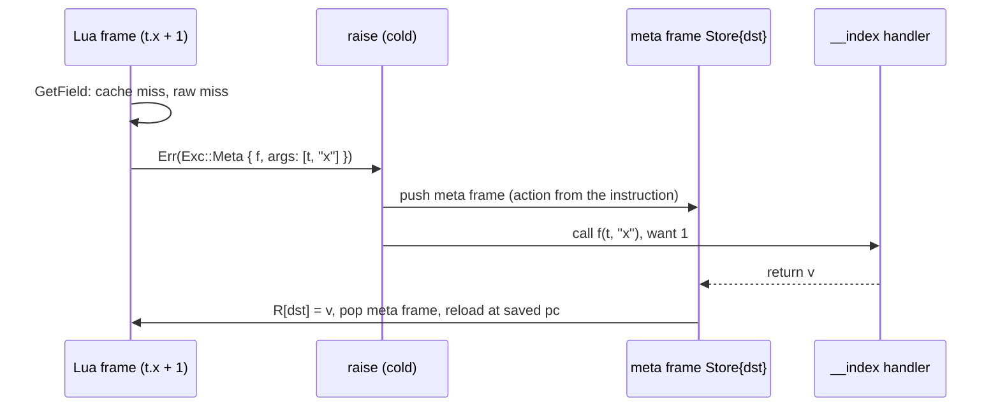
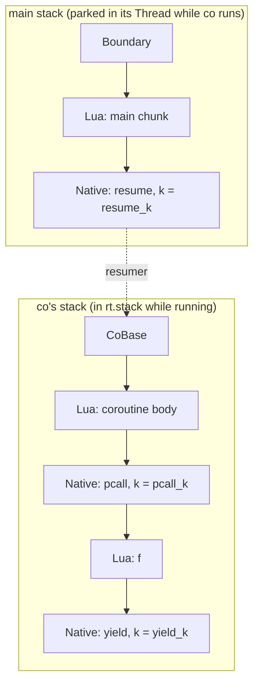

# VM semantics: metatables, userdata, coroutines and to-be-closed variables

Status: Implemented. Milestones C2 and C3 of the Lua 5.5 compatibility plan. Crates: `orbit-runtime::object` (objects), `orbit-runtime::vm` (interpreter), `orbit-compiler` and `orbit-bytecode` (two new instructions), `orbit-runtime::stdlib` (base and `coroutine` libraries). Owns [ADR-3](../adr/0003-frames-and-coroutines.md).

This extends the [VM design](vm.md). It keeps that document's two structural rules: the interpreter is stackless (no Lua call, metamethod or coroutine switch recurses on the Rust stack), and every instruction keeps its common case inline in `run()` with everything else in a cold function. All behaviour here was checked against the reference `lua5.5` binary and the manual; nothing is taken from PUC Lua's sources.

## Summary

| Area | Design |
|---|---|
| Metatables | `Table.meta` and `UserData.meta`; one metatable per other type in the runtime. Metatable field names are interned once, so a lookup is a handle-keyed hash probe |
| Metamethod calls | A slow path that needs a metamethod returns `Exc::Meta(call)`. The cold error path pushes a **meta frame** that records how to finish the instruction, then calls the handler like any function. When it returns, the meta frame stores the result, takes the branch, or re-runs the instruction |
| Fast paths | Unchanged except for one tag compare where a raw miss can now mean "ask the metatable": an inline cache hit on a `nil` value, or an integer read or store that finds `nil`, checks `meta` |
| Userdata | `Value::UserData` (tag 8), a GC object holding any `'static` Rust value (`Box<dyn Any>`), a metatable and one user value. No `Send` requirement |
| Coroutines | `Value::Thread` (tag 9). Each coroutine owns a `Stack` (registers, cells, frames, to-be-closed list); the running one is swapped into the runtime. Resume and yield are continuation frames, so yields cross `pcall`, metamethods, iterators and `CallThen` natives |
| Embedder calls | A **boundary frame** marks where a `Vm::call` entered, replacing the `stop` frame count |
| `<close>` | `Tbc{reg}` and `Close{from}` instructions plus a per-stack list of to-be-closed registers. Errors close them while unwinding, through the same meta frames |
| `xpcall` | The handler runs on top of the erroring stack, before any frame is popped |

## Runtime objects

```rust
#[repr(C, u8)]
pub enum Value {               // still 16 bytes, pinned layout (ADR-1)
    // tags 0..=7 as before
    UserData(Gc<UserData>) = 8,
    Thread(Gc<Thread>) = 9,
}

pub struct UserData {
    pub meta: Option<Gc<Table>>,
    pub user_value: Value,         // one Lua value the host can attach (traced)
    data: Box<dyn Any>,            // the host's Rust value
}
```

- `Tag` gains `UserData = 8` and `Thread = 9`, so table array parts and hash keys store them like any other value.
- **Userdata payloads are opaque to the collector.** A host that wants a userdata to keep Lua values alive puts them in `user_value` (usually a table). That keeps `Trace` out of the embedding API and needs no `unsafe`. `Box<dyn Any>` has no `Send` bound, per the threading decision.
- **Per-type metatables** live in the runtime: `type_meta: [Option<Gc<Table>>; 10]`, indexed by tag (`Int` and `Float` share the `number` slot). Strings get theirs from the string library (`__index = string`); `debug.setmetatable` (thread 6) writes the others.
- **Metatable field names** (`MetaField`, fixed IDs) (`__index`, `__newindex`, `__add` … `__close`, `__gc`, `__mode`, `__name`, `__metatable`, `__pairs`) are interned when the VM starts and held in the runtime (`metas.field_names`), rooted. `Runtime::metamethod(heap, v, MetaField) -> Value` is the one lookup everyone uses, the GC thread's `__gc`/`__mode` included.

### Embedding API

```rust
let ud = vm.new_userdata(MyHandle { fd: 3 });          // Gc<UserData>
vm.set_userdata_meta(ud, Some(mt));
let h: Option<&MyHandle> = vm.userdata_ref::<MyHandle>(ud);
let h: Option<&mut MyHandle> = vm.userdata_mut::<MyHandle>(ud);
```

`NativeCtx` has the same accessors plus `check_userdata::<T>(i, "FILE*")`, which raises Lua's `bad argument #1 to 'read' (FILE* expected, got table)`. `io` file handles (thread 4) are the first user.

## Metamethods

### Where they plug in

Every metamethod is reached from a path that already exists and is already cold:

| Metatable field | Reached from |
|---|---|
| `__index` | A field or global cache miss (`get_str_miss`), an integer or general read that found `nil` in a table with a metatable, indexing a non-table (`index_error`), `SelfCall` on a non-table |
| `__newindex` | `set_str_miss`, an integer store that would fill a `nil` slot of a table with a metatable, a general store on a table with a metatable, storing into a non-table |
| arithmetic, bitwise, `__unm` | `ops::arith_slow` (and the bitwise slow path, when thread 1 adds the instructions) |
| `__concat` | `op_concat` |
| `__len` | `op_len` |
| `__eq` | `ops::equal`, reached only when the operands aren't raw-equal and are both tables or both userdata |
| `__lt`, `__le` | `ops::less_than`, `ops::less_equal` |
| `__call` | `call_value` on a non-function |
| `__close` | `Close`, unwinding, `coroutine.close` |
| `__tostring`, `__name`, `__metatable`, `__pairs` | the base library (`tostring`, `print`, `getmetatable`, `pairs`), through `CallThen` |

**A cache never records a miss.** Field and global inline caches only ever hold a slot where the key was found. A hit whose value is `nil` (a dead entry) counts as a miss only when the table has a metatable, so tables without one keep the old hit path, and `__index` and `__newindex` still only run on a raw miss. The cost on the hit path is a test of `meta`, plus one tag compare when it is set.

`__index` and `__newindex` chains through tables are followed in a loop, without calls; a chain longer than 2000 steps raises `'__index' chain too long; possible loop` (the reference's limit and text). When the next step is a function, it is called. Calling chains of `__call` work the same way: each step inserts the callable as the first argument.

Argument conventions observed from the reference: unary `__unm`, `__bnot` and `__len` get the operand twice; `__close` gets the value alone on a normal exit and `(value, error)` when unwinding; `__concat` works right to left, pair by pair, as soon as a value isn't a string or number (`1 .. 2 .. t` calls `__concat(2, t)` and then concatenates `"1"` with its result); `__eq` is only tried between two tables or two userdata, and its result is converted to a boolean; `__lt` and `__le` are tried for any pair that isn't two numbers or two strings, and there is no `__le` from `__lt` fallback.

### Calling a metamethod without recursion

The slow paths are plain functions over `&LuaHeap`; they can't run Lua code. When one finds a metamethod that is a function, it returns

```rust
Err(Exc::Meta(MetaCall { f: Value, args: [Value; 3], nargs: u8 }))
```

through the error channel every slow path already has, so `run()`'s fast paths and macros are unchanged. `Vm::raise`, the cold handler `throw!` already calls, sees `Exc::Meta` and:

1. decodes the current instruction (at the frame's saved `pc - 1`) into a `MetaAction` that says how to finish it;
2. pushes a **meta frame** (`FrameKind::Meta { action }`) on top of the current Lua frame;
3. writes `f` and the arguments above the frame's registers and calls it with one wanted result, exactly as `call_value` calls anything else.

```rust
enum MetaAction {
    Store { dst: u8 },                     // GetField, Add, Len, ...: result into R[dst]
    Branch { want: bool, off: i32, negate: bool }, // JumpLt, JumpEq, JumpNe, ...
    Discard,                               // SetField, SetIndex, __close on block exit
    Concat { dst: u8, first: u8, left: u8 },// a partly reduced `..`
    Retry { top: u32 },                    // run the instruction again (Close, ReturnClose)
    Unwind { error: bool },                // closing variables while unwinding
    Handler,                               // an xpcall message handler is running
}
```

When the handler returns, its result lands in the slot it was called from, `after_return` finds the meta frame on top, applies the action to the Lua frame below (store a register, adjust the saved `pc`, or continue the concatenation), pops it and reloads. A native handler (say `__index = rawget`) returns straight into the same code path. So a metamethod is an ordinary stackless call: it can recurse (deep `__index` recursion raises `stack overflow`, as `cstack.lua` checks), it can yield, and an error in it unwinds through the meta frame like any other frame.



Meta frames hold no GC references (the action is plain data), are skipped when counting levels for `error(msg, level)` and `debug` functions, and show as `in metamethod 'index'` in tracebacks, as the reference prints them.

### Natives

Natives can't use `Exc::Meta`; they reach metamethods through `CallThen`, which already makes them yieldable. `NativeCtx` gains helpers that either answer at once or set up the call:

```rust
pub enum Meta { Value(Value), Call { f: Value, nargs: usize } }   // args already pushed
ctx.index(obj, key)? ; ctx.set_index(obj, key, v)? ; ctx.len(v)? ; ctx.less_than(a, b)? ; ctx.tostring(v)?
ctx.metamethod(v, MetaField::Name) -> Value; ctx.metatable(v) -> Option<Gc<Table>>
```

A native returns `CallThen { f, nargs, k, .. }` for `Meta::Call` and picks the result up in `k`. The table and string libraries (thread 3) use these for `table.insert`, `sort` comparisons and `gsub` with a table replacement.

### Base library pieces in this milestone

`getmetatable` (honours `__metatable`), `setmetatable` (refuses to change a protected metatable: `cannot change a protected metatable`), `rawget`, `rawset`, `rawequal`, `rawlen`, `tostring` with `__tostring` and `__name` (a non-string result is returned as is, as 5.5 does), `print` through `tostring`'s metamethods, `pairs` with `__pairs`, `ipairs` and `next` respecting `__index` where the manual says so.

## Coroutines

### Stacks and threads

```rust
pub struct Thread {
    stack: Stack,             // empty while this coroutine is running
    status: CoStatus,         // Suspended | Running | Normal | Dead
    resumer: Option<Gc<Thread>>,
}

pub struct Stack {            // as today, plus:
    tbc: Vec<u32>,            // registers holding to-be-closed values, in declaration order
}
```

The runtime always holds the running coroutine's `Stack` in `rt.stack`, so the dispatch loop, natives and the register window work exactly as they do now. Resuming swaps the target's `Stack` into `rt.stack` and the resumer's into its own `Thread`; yielding swaps back. A swap moves three `Vec` headers and the frame-state caches, and allocates nothing. The main thread has a `Thread` object too, so `coroutine.running()` can return it.

Garbage collection: a suspended coroutine's stack is traced through its `Thread`. When a stack moves back into a `Thread` object (yield, or the coroutine finishing), the VM calls `heap.barrier_back(thread)`, because the incremental collector may already have scanned that object as black while its stack was running elsewhere. The running stack is a root, as today.

### Frames

Every switch is a continuation frame, the mechanism `pcall` already uses. Three frame kinds join `Lua`, `Native` and `Meta`:

| Frame | Where | Meaning |
|---|---|---|
| `Boundary` | bottom of each `Vm::call` | Returning into it ends that call; an error unwinding to it is returned to the embedder. Replaces the `stop` frame count, so `run()` no longer needs it |
| `CoBase` | bottom of every coroutine stack | The coroutine's function returning into it finishes the coroutine; an error reaching it kills the coroutine |
| `Native { k: resume_k }` | top of the resumer while it waits | `coroutine.resume` or a `wrap` function waiting for the coroutine to yield, return or fail |



- `coroutine.resume(co, ...)` returns `NativeReturn::Resume { co, nargs }`. The VM pushes the resumer's continuation frame, moves the arguments to `co`'s stack, swaps, and either starts the body (a fresh coroutine: call its function above `CoBase`) or delivers the arguments as the results of the pending `yield`.
- `coroutine.yield(...)` returns `NativeReturn::Yield { nvals }`. The VM pushes a continuation frame for the yield itself (so the next resume's arguments become its results), moves the values to the resumer, swaps back and runs `resume_k` with them. Any frames in between (`pcall`, metamethods, `for` iterators, `table.sort`) stay on the coroutine's stack, which is why yields cross all of them.
- The body returning into `CoBase`, or an error reaching it, marks the coroutine dead and delivers the results or the error to the resumer the same way.
- `coroutine.wrap` returns a **native closure** over its coroutine, whose continuation re-raises errors, adding the position for string errors as the reference does. Native closures are new and general (`string.gmatch` iterators need them too): a `Closure` whose prototype is a shared one-instruction stub, `NativeEntry { id }`, and whose captures are its upvalues. Calling one enters the stub like any Lua function, so the call fast path is unchanged; the stub pops its frame and runs native `id` with the arguments, and `ctx.upvalue(i)` reads the captures. Values a continuation needs later go in the native's window, as for any native.
- `isyieldable` is "not the main thread": natives never re-enter the interpreter, so there is no non-yieldable C boundary inside a coroutine. A `Boundary` inside a coroutine (only possible if an embedder calls `Vm::call` from inside one) makes `yield` fail with `attempt to yield across a C-call boundary`.
- Limits: nested resumes are capped (196, where the reference stops, observed) with `C stack overflow`, which `cstack.lua` expects; each coroutine's own depth is limited by `Limits::max_stack` as today.

`coroutine.close(co)` on a suspended coroutine runs its pending `__close` handlers (newest first) on `co`'s stack through the unwinding machinery below, then marks it dead and returns `true`, or `false, err` if a handler failed. On a dead coroutine it does the same with the error it died with, returning `false, err`.

## To-be-closed variables

Front end (thread 1): `local x <close>` lowers to a local of kind `LocalKind::Close`, and a generic `for` gets a fourth hidden local, its closing value. In OrbitScript the same construct is a scoped-resource binding (`defer`-like). The compiler (this thread) emits:

- `Tbc { reg }` after the declaration: `nil` and `false` are ignored; any other value must have a `__close` metamethod, or it raises `variable 'x' got a non-closable value`. The register goes on the stack's `tbc` list. A captured `<close>` local still keeps its value in a register too, so closing never reads a cell.
- `Close { from }` wherever control leaves a scope with such variables: block fall-through, `break`, `repeat`'s jump back, `goto` out of the scope (a forward `goto` gets a placeholder that is filled in when its label is placed), and before a `return` (a `return f()` in such a scope is not a tail call, as in the reference). It pops entries `>= base + from` one at a time, newest first, and calls `__close(v, nil)` under a `Close` meta frame, so the instruction runs again for the next one. The metamethod is looked up at close time, so one removed in the meantime raises `attempt to call a nil value (metamethod 'close')`.
- Return values stay where they are: the handler is called above the frame's registers and above `top`, and the `Close` meta frame restores `top` before the instruction re-runs, so `return a, f()` keeps its open-ended results.

**Errors.** Unwinding looks for the nearest catching frame (protected native, `Boundary` or `CoBase`). Before popping anything below a to-be-closed register, it pops the frames above that register's owner, pushes an `Unwind` meta frame with the error value in its slot, and calls `__close(v, err)`. When the handler returns, the meta frame raises the same error again and unwinding continues; if the handler raises, unwinding continues with the new error, as the reference does. With `xpcall`, the message handler runs first and the variables get its result.

**Coroutines.** An error that reaches a coroutine's `CoBase` does not close anything: as in the reference, a coroutine that dies with an error keeps its pending variables (and so its stack) for `coroutine.close`. `coroutine.close` (`NativeReturn::Close`) switches to the coroutine, marks it as closing, and unwinds to `CoBase` with its error (nil for a suspended one), ignoring the `pcall` frames in between. A `coroutine.wrap` function whose coroutine fails closes it the same way before raising the error. A `__close` handler can yield in all these cases.

## `xpcall` and errors

`xpcall(f, h, ...)` is `pcall` with a handler stored in its continuation frame's window. When unwinding finds an `xpcall` frame as the catcher, it first calls `h(err)` on top of the erroring stack, with every frame still in place (so a traceback from `h` shows where the error happened), above a `Handler` frame. The handler's result is raised again as an already-handled error, so pending `__close` handlers get it, and is then delivered to `xpcall`'s continuation. An error inside the handler calls the handler again with the new error; after a bounded number of nested attempts, or a stack overflow inside the handler (the stack gets a little headroom for it), the error becomes `error in error handling`, which `cstack.lua` checks.

`warn` (`@on`, `@off`, control messages, `Lua warning: ` prefix on stderr) is a small native in the base library.

## Performance

The fast paths change in four places, each a compare on data the path has already loaded:

1. Field and global cache hits on a table with a metatable reject a `nil` value.
2. An integer-keyed read that produced `nil` checks the table's `meta` (only then).
3. An integer store that would fill a `nil` array slot checks `meta` (only then).
4. `JumpEq`/`JumpNe` on two non-numbers goes through `ops::equal`, which now returns a `Result`.

Everything else is in cold code. Adding two `Value` variants grows `pack`/`unpack`/`type_name` matches but no hot instruction's match. The C2 and C3 PRs each report the five-benchmark table against `lua5.5`, before and after, on the same machine; `bench/oop.lua` (method calls through `__index` tables) and `bench/coroutines.lua` are reported too.

## ADR-3 spike

ADR-3 is Proposed. Its open question is how coroutine stacks are laid out, and the alternatives differ in switch cost, memory per suspended coroutine and how they interact with the 256-register window and the in-place frame switch:

- **A. One stack per coroutine, swapped** (above). Switching is a pointer swap. A suspended coroutine keeps its stack's capacity, which is at least its live registers plus one 256-slot window (4 KiB).
- **B. One shared stack, copied on switch.** Only the chain of running and normal coroutines lives on the shared stack; yielding copies the coroutine's live registers, cells and frames out to an exactly sized buffer and resuming copies them back, relocating frame offsets. Suspended coroutines cost only their live state; a switch costs a copy proportional to the coroutine's depth.
- **C. A shrunk to fit on yield.** A, but a yield releases the window slack, trading an allocation per switch for B's memory.

Stackful coroutines on separate Rust stacks are out: they need `unsafe` (or a dependency built on it) and would put Lua frames back on a Rust stack.

The spike measures, on the cloud container: resume/yield round trips per second for a shallow generator and for one yielding from 20 frames deep (`bench/coroutines.lua` plus a deep variant), peak RSS with 100 000 suspended coroutines, and the five benchmarks (the window and the in-place switch must not get slower). The resolution proposed for ADR-3 follows the numbers.

**Results** (cloud container, x86_64, 4 cores; best of 5 to 7 pinned runs). A fourth option came out of the first three:

- **D. A, plus shrinking cold stacks.** The 16 most recently parked coroutines keep their stacks. One that falls out of that set while still suspended has its stack copied into exact-size storage (a copy, not an in-place shrink, which fragmented the heap). The cooling list is weak.

| Option | Shallow pipeline | Yield 20 frames deep, 1M times | RSS, 100k suspended (depth 0 / 20) |
|---|---|---|---|
| A | 1.25 s | 0.79 s | 829 / 962 MiB |
| B | 1.53 s | 0.93 s | 56 / 208 MiB |
| C | 1.67 s | 0.89 s | 56 / 208 MiB |
| **D (proposed)** | 1.33 s | 0.76 s | 56 / 208 MiB |
| `lua5.5` | 0.77 s | 0.61 s | 124 / 357 MiB |

Creating and dropping a million coroutines stays at about 10 MiB under D. The spike variants live on the `spike/adr3-stacks` branch.

The spike also found that every native call refilled a 4 KiB window with `nil`. Natives now keep their window end in `rt.top`, which took a loop of native calls from 1.91 s to 1.10 s (`lua5.5`: 0.36 s); the rest of that gap is interpreter tuning, deferred until parity.

## Implementation order

1. C2 PR: `UserData`, type metatables, event names, `Exc::Meta` and meta frames, every metamethod, base library pieces, the string metatable, error-message origins for metamethods. Exit: `tests/diff/metatables.lua` (with thread 1's `<close>` gate lifted) and C2 corpus programs, plain and under `ORBIT_GC_STRESS=1`.
2. ADR-3 spike, then C3 PR: `Thread`, boundary frames, the `coroutine` library, yields across everything, `Tbc`/`Close` and unwinding, `xpcall`, `warn`. Exit: `cstack.lua` and the C3 corpus, plain and stressed.
3. The proposed ADR-3 resolution, as edits to the ADR, for Tym.
