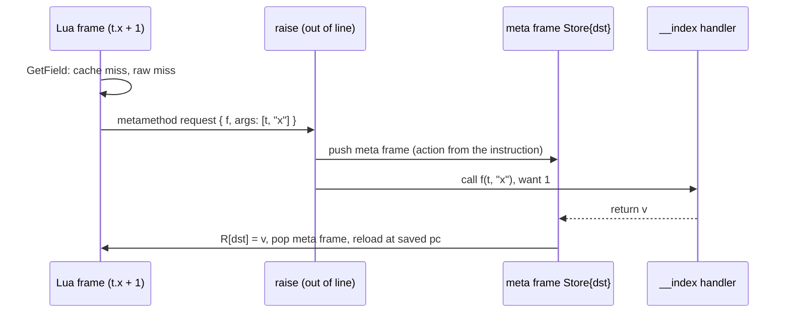
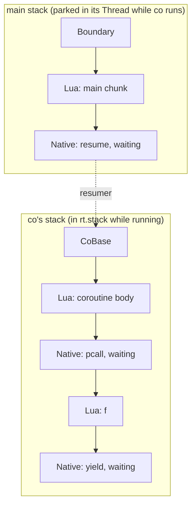

# VM semantics: metatables, userdata, coroutines and to-be-closed variables

Status: Implemented. Crates: `orbit-runtime` (`object` and `vm`; the base and `coroutine` libraries in `stdlib`), `orbit-compiler`. The frame and coroutine decisions are [ADR-3](../adr/0003-frames-and-coroutines.md).

This extends the [VM design](vm.md) and keeps its two structural rules: the interpreter is stackless (no Lua call, metamethod or coroutine switch recurses on the Rust stack), and every instruction keeps its common case inline in the dispatch loop with everything else out of line. All behaviour here was checked against the reference `lua5.5` binary and the manual.

## Summary

| Area | Design |
|---|---|
| Metatables | `Table::meta` and `UserData::meta`; one metatable per other type, in the runtime. Metatable field names are interned once, so a lookup is a handle-keyed probe |
| Metamethod calls | A slow path that needs a metamethod returns a request. The cold error path pushes a **meta frame** that records how to finish the instruction, then calls the handler like any function. When it returns, the meta frame stores the result, takes the branch, or runs the instruction again |
| Fast paths | Unchanged except for one test where a raw miss can mean "ask the metatable": an inline-cache hit on a `nil` value, or an integer read or store that finds `nil`, checks `meta` |
| Userdata | `Value::UserData` (tag 8), a GC object holding any `'static` Rust value, a metatable and one user value. No `Send` requirement. `Value::LightUserData` (tag 10) is an opaque word compared by identity |
| Coroutines | `Value::Thread` (tag 9). Each coroutine owns a stack (registers, cells, frames, to-be-closed list); the running one is swapped into the runtime. Resume and yield are continuation frames, so yields cross `pcall`, metamethods, iterators and natives that allow it |
| Embedder calls | A **boundary frame** marks where a `Vm::call` (or a native's nested call) entered |
| `<close>` | `Tbc` and `Close` instructions plus a per-stack list of to-be-closed registers. Errors close them while unwinding, through the same meta frames |
| `xpcall` | The handler runs on top of the erroring stack, before any frame is popped |

## Runtime objects

```rust
pub struct UserData {
    pub meta: Option<Gc<Table>>,
    pub user_value: Value,         // one Lua value the host can attach (traced)
    data: Box<dyn Any>,            // the host's Rust value
}
```

- `Tag` has `UserData = 8`, `Thread = 9` and `LightUserData = 10`, so table storage keeps them like any other value.
- **Userdata payloads are opaque to the collector.** A host that wants a userdata to keep Lua values alive puts them in `user_value` (usually a table). That keeps `Trace` out of the embedding API and needs no `unsafe`. `Box<dyn Any>` has no `Send` bound, since isolates are single-threaded.
- **Per-type metatables** live in the runtime, one slot per tag (`Int` and `Float` share the `number` slot). Strings get theirs from the string library (`__index = string`); `debug.setmetatable` sets the others.
- **Metatable field names** (`MetaField`: `__index`, `__newindex`, the arithmetic and bitwise events, `__concat`, `__len`, `__eq`, `__lt`, `__le`, `__call`, `__close`, `__gc`, `__mode`, `__name`, `__metatable`, `__pairs`, `__tostring`) are interned when the VM starts and rooted. One lookup, `metamethod(heap, v, MetaField)`, serves the interpreter, the libraries and the collector's `__gc` and `__mode` reads. A table remembers which fields its metatable lookups found absent (`absent_meta`), so a repeated miss is a bit test.

### Embedding API

```rust
let ud = vm.new_userdata(MyHandle { fd: 3 });          // Gc<UserData>
vm.set_userdata_meta(ud, Some(mt));
let h: Option<&MyHandle> = vm.userdata_ref::<MyHandle>(ud);
let h: Option<&mut MyHandle> = vm.userdata_mut::<MyHandle>(ud);
```

`NativeCtx` has the same accessors plus `check_userdata::<T>(i, "FILE*")`, which raises Lua's `bad argument #1 to 'read' (FILE* expected, got table)`. The public `orbit` API wraps them as classes (ADR-11).

## Metamethods

### Where they plug in

Every metamethod is reached from a path that already exists and is already out of line:

| Metatable field | Reached from |
|---|---|
| `__index` | A field or global cache miss, an integer or general read that found `nil` in a table with a metatable, indexing a non-table, `SelfCall` on a non-table |
| `__newindex` | A field or global store miss, an integer store that would fill a `nil` slot of a table with a metatable, a general store on a table with a metatable, storing into a non-table |
| arithmetic, bitwise, `__unm`, `__bnot` | The generic halves of the arithmetic and bitwise instructions |
| `__concat` | `Concat` |
| `__len` | `Len` |
| `__eq` | Equality, reached only when the operands aren't raw-equal and are both tables or both userdata |
| `__lt`, `__le` | Ordering comparisons |
| `__call` | Calling a non-function |
| `__close` | `Close`, unwinding, `coroutine.close` |
| `__tostring`, `__name`, `__metatable`, `__pairs` | The base library (`tostring`, `print`, `getmetatable`, `pairs`), and `Cast` to a string |

**A cache never records a miss.** Field and global inline caches only ever hold a slot where the key was found. A hit whose value is `nil` (a dead entry) counts as a miss only when the table has a metatable, so tables without one keep the plain hit path, and `__index` and `__newindex` still only run on a raw miss.

`__index` and `__newindex` chains through tables are followed in a loop, without calls; a chain longer than 2000 steps raises `'__index' chain too long; possible loop`. When the next step is a function, it is called. A `__call` chain inserts each callable as the first argument, up to 15 deep.

Argument conventions observed from the reference: unary `__unm`, `__bnot` and `__len` get the operand twice; `__close` gets the value alone on a normal exit and `(value, error)` when unwinding; `__concat` works right to left, pair by pair, as soon as a value isn't a string or number (`1 .. 2 .. t` calls `__concat(2, t)` and then concatenates `"1"` with its result); `__eq` is only tried between two tables or two userdata, and its result is converted to a boolean; `__lt` and `__le` are tried for any pair that isn't two numbers or two strings, and there is no `__le` from `__lt` fallback.

### Calling a metamethod without recursion

The slow paths are plain functions over the heap; they can't run Lua code. When one finds a metamethod that is a function, it returns a metamethod request (the function and up to three arguments) through the error channel every slow path already has, so the fast paths are unchanged. `Vm::raise`, the out-of-line handler, then:

1. decodes the current instruction into a `MetaAction` that says how to finish it;
2. pushes a **meta frame** (`FrameKind::Meta { action, field }`) on top of the current Lua frame;
3. writes the function and its arguments above the frame's registers and calls it with one wanted result, exactly as any other call.

```rust
enum MetaAction {
    Store { dst: u8 },                      // GetField, Add, Len, ...: R[dst] = result
    Branch { want: bool, off: i32 },        // JumpLt, JumpEq, ...: jump on the result's truth
    Discard,                                // __newindex
    Concat { dst: u8, first: u8, left: u8 },// a partly reduced `..`
    Close { top: u32 },                     // run Close again for the next variable
    ToStr { dst: u8 },                      // Cast to a string through __tostring
    Unwind { handled: bool },               // a __close handler while an error unwinds
}
```

When the handler returns, its result lands in the slot it was called from; the return path finds the meta frame on top, applies the action to the Lua frame below (store a register, adjust the saved `pc`, or continue the concatenation), pops it and reloads. A native handler (say `__index = rawget`) returns through the same path. So a metamethod is an ordinary stackless call: it can recurse (deep `__index` recursion raises `stack overflow`), it can yield, and an error in it unwinds through the meta frame like any other frame.



Meta frames hold no GC references (the action is plain data), are skipped when counting levels for `error(msg, level)` and the `debug` functions, and show as `in metamethod 'index'` in tracebacks, as the reference prints them.

### Natives

Natives reach metamethods through `CallThen`. `NativeCtx` has helpers that either answer at once or set up the call:

```rust
pub enum Meta<T> { Done(T), Call { f: Value, nargs: usize } }   // arguments already pushed
ctx.index(obj, key)?; ctx.set_index(obj, key, v)?; ctx.length(v)?; ctx.arith(op, a, b)?
ctx.equal(a, b)?; ctx.less_than(a, b)?; ctx.less_equal(a, b)?
ctx.metamethod(v, MetaField::Name) -> Value; ctx.metatable(v) -> Option<Gc<Table>>
```

A native returns `CallThen` for `Meta::Call` and picks the result up in its continuation. The table and string libraries use these for `table.insert`, `sort` comparisons and `gsub` with a table replacement.

### Base library

`getmetatable` honours `__metatable`; `setmetatable` refuses to change a protected metatable (`cannot change a protected metatable`); `rawget`, `rawset`, `rawequal` and `rawlen` skip metamethods; `tostring` uses `__tostring` and `__name` (a non-string result is an error, as in 5.5); `print` goes through `tostring`'s rules; `pairs` uses `__pairs`.

## Coroutines

### Stacks and threads

A `Thread` object holds a coroutine's state: its stack, its status (`Suspended`, `Running`, `Normal`, `Dead`), and the coroutine that resumed it. The runtime always holds the running coroutine's stack in `rt.stack`, so the dispatch loop, natives and the register window work the same in any coroutine. Resuming swaps the target's stack into `rt.stack` and the resumer's into its own `Thread`; yielding swaps back. A swap moves a few vector headers and the frame-state caches and allocates nothing. The main thread has a `Thread` object too, so `coroutine.running()` can return it.

**Suspended stacks shrink when they go cold** (ADR-3). The most recently parked coroutines (16 at first) keep their stacks at full size. One that falls out of that set while still suspended has its stack copied into exact-size storage, and resuming it grows the stack again. If a shrunk coroutine comes back soon after it was shrunk, the set doubles, up to 1,024, so a pipeline of more coroutines than the set holds doesn't shrink and regrow a stack on every switch. The list of cooling coroutines is weak.

Garbage collection: a suspended coroutine's stack is traced through its `Thread`. When a stack moves back into a `Thread` object (on a yield, or when the coroutine finishes), the VM calls `heap.barrier_back(thread)`, because the incremental collector may already have scanned that object as black while its stack ran elsewhere. The running stack is a root.

### Frames

Every switch goes through a continuation frame, the mechanism `pcall` uses:

| Frame | Where | Meaning |
|---|---|---|
| `Boundary` | bottom of each `Vm::call` and each nested call a native makes | Returning into it ends that call; an error unwinding to it is returned to the embedder or the native |
| `CoBase` | bottom of every coroutine stack | The coroutine's function returning into it finishes the coroutine; an error reaching it kills the coroutine |
| `Native` (a resume) | top of the resumer while it waits | `coroutine.resume` or a `wrap` function waiting for the coroutine to yield, return or fail |



- `coroutine.resume(co, ...)` returns `NativeReturn::Resume`. The VM pushes the resumer's continuation frame, moves the arguments to `co`'s stack, swaps, and either starts the body (a fresh coroutine: call its function above `CoBase`) or delivers the arguments as the results of the pending `yield`.
- `coroutine.yield(...)` makes the VM push a continuation frame for the yield itself (so the next resume's arguments become its results), move the values to the resumer, swap back and finish the resume with them. Frames in between (`pcall`, metamethods, `for` iterators) stay on the coroutine's stack, which is why yields cross them.
- The body returning into `CoBase`, or an error reaching it, marks the coroutine dead and delivers the results or the error to the resumer the same way.
- `coroutine.wrap` returns a **native closure** over its coroutine, whose continuation re-raises errors, adding the position for string errors as the reference does. A native closure is a `Closure` whose prototype is a shared one-instruction stub, `NativeEntry { id }`, and whose captures are its upvalues. Calling one enters the stub like any Lua function, so the call fast path is unchanged; the stub runs native `id` with the arguments in place of its frame, and `ctx.upvalue(i)` reads the captures. `string.gmatch` iterators use them too.
- **Yieldability matches the reference.** Natives never re-enter the interpreter, so there is no hidden C boundary inside a coroutine; instead, frames that the reference would hold on the C stack refuse yields: `CallThen` from library natives (a `table.sort` comparator, a `gsub` callback), built-ins written in OrbitScript that are C functions in the reference (`ProtoCode::refuses_yield`), message handlers, and boundaries. A yield across one fails with `attempt to yield across a C-call boundary`. `pcall`, `__pairs` and `dofile` use `CallThenYieldable`, as the reference lets them. `isyieldable` reports whether a yield would succeed.
- **Limits**: nested resumes and calls back into the interpreter are capped where the reference stops (196 nested resumes; 200 open nested calls, a resume counting twice), with `C stack overflow`; each coroutine's own depth is limited by the stack limit.

`coroutine.close(co)` on a suspended coroutine runs its pending `__close` handlers (newest first) on `co`'s stack through the unwinding below, then marks it dead and returns `true`, or `false, err` if a handler failed. On a dead coroutine it does the same with the error it died with.

## To-be-closed variables

`local x <close>` lowers to a `LocalKind::Close` local, and a generic `for` has a fourth hidden local for its closing value. OrbitScript's `scope` lowers to the same thing. The compiler emits:

- `Tbc { reg }` after the declaration: `nil` and `false` are ignored; any other value must have a `__close` metamethod, or it raises `variable 'x' got a non-closable value`. The register goes on the stack's to-be-closed list. A captured `<close>` local keeps its value in a register too, so closing never reads a cell.
- `Close { from }` wherever control leaves a scope with such variables: block fall-through, `break`, `repeat`'s jump back, a `goto` out of the scope (a forward `goto` gets a placeholder that is filled in when its label is placed), and before a `return` (a `return f()` in such a scope is not a tail call, as in the reference). It pops entries at or above `from` one at a time, newest first, and calls `__close(v, nil)` under a `Close` meta frame, so the instruction runs again for the next one. The metamethod is looked up at close time, so one removed in the meantime raises `attempt to call a nil value (metamethod 'close')`.
- Return values stay where they are: the handler is called above the frame's registers and above the top, and the meta frame restores the top before the instruction runs again, so `return a, f()` keeps its open-ended results.

**Errors.** Unwinding looks for the nearest catching frame (a protected native, a `Boundary` or a `CoBase`). Before popping anything below a to-be-closed register, it pops the frames above that register's owner, pushes an `Unwind` meta frame with the error value in its slot, and calls `__close(v, err)`. When the handler returns, the meta frame raises the same error again and unwinding continues; if the handler raises, unwinding continues with the new error, as the reference does. With `xpcall`, the message handler runs first and the variables get its result.

**Coroutines.** An error that reaches a coroutine's `CoBase` closes nothing: as in the reference, a coroutine that dies with an error keeps its pending variables (and so its stack) for `coroutine.close`. `coroutine.close` switches to the coroutine, marks it as closing, and unwinds to `CoBase` with its error (`nil` for a suspended one), ignoring the `pcall` frames in between. A `coroutine.wrap` function whose coroutine fails closes it the same way before raising the error. A `__close` handler can yield in all these cases.

## `xpcall` and errors

`xpcall(f, h, ...)` is `pcall` with a handler (`NativeReturn::CallHandled`). When unwinding finds an `xpcall` frame as the catcher, it first calls `h(err)` on top of the erroring stack, with every frame still in place (so a traceback from `h` shows where the error happened), above a `Handler` frame. The handler's result is raised again as an already-handled error, so pending `__close` handlers get it, and is then delivered to `xpcall`'s continuation. An error inside the handler calls the handler again with the new error; after a bounded number of nested attempts, or a stack overflow inside the handler (the stack gets a little headroom for it), the error becomes `error in error handling`.

`warn` (`@on`, `@off`, control messages, a `Lua warning: ` prefix on standard error) is a native in the base library; hosts can take warnings over (`lua_setwarnf`).

## Cost

The fast paths changed in four places, each a test on data the path has already loaded:

1. Field and global cache hits on a table with a metatable reject a `nil` value.
2. An integer-keyed read that produced `nil` checks the table's `meta` (only then).
3. An integer store that would fill a `nil` array slot checks `meta` (only then).
4. `JumpEq` and `JumpNe` on two non-numbers go through the generic equality, which can request `__eq`.

Everything else is out of line. The coroutine stack options behind ADR-3 were measured on x86_64 (a shallow generator pipeline, a yield 20 frames deep, and memory with 100,000 suspended coroutines):

| Stacks | Shallow pipeline | Yield 20 frames deep, 1M times | RSS, 100k suspended (depth 0 / 20) |
|---|---|---|---|
| One per coroutine, swapped | 1.25 s | 0.79 s | 829 / 962 MiB |
| One shared, copied on switch | 1.53 s | 0.93 s | 56 / 208 MiB |
| One per coroutine, shrunk on every yield | 1.67 s | 0.89 s | 56 / 208 MiB |
| **One per coroutine, cold ones shrunk (built)** | 1.33 s | 0.76 s | 56 / 208 MiB |
| `lua5.5` | 0.77 s | 0.61 s | 124 / 357 MiB |

Stackful coroutines on separate Rust stacks were ruled out: they need `unsafe` (or a dependency built on it) and would put Lua frames back on a Rust stack.
