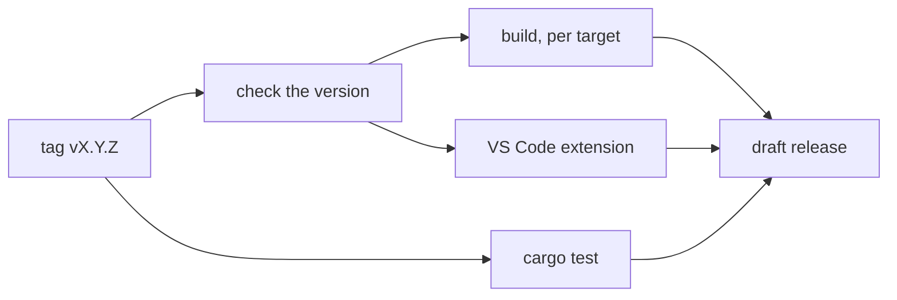

# Cutting a release

`.github/workflows/release.yml` builds a release on GitHub Actions and drafts its GitHub Release. Every archive comes from `./build.sh`, the only packaging path, so a release holds the same files a local `./build.sh` lays out.

## Steps

1. In a pull request against `main`, set the new version in both places that carry it, and merge it:
   - `version` under `[workspace.package]` in `Cargo.toml` (every crate inherits it; `orbit -v` and `orbit-lsp --version` print it);
   - `version` in `editors/vscode/package.json`, then `npm install --package-lock-only` in `editors/vscode` so the lockfile agrees.
2. Tag the merge commit and push the tag:
   ```sh
   git tag -a v0.1.0 -m "OrbitScript 0.1.0"
   git push origin v0.1.0
   ```
   A tag with a suffix (`v0.1.0-rc.1`) becomes a prerelease. The workflow fails at once if the tag doesn't match both versions.
3. The workflow runs `cargo test`, builds every target, packages the VS Code extension and drafts the release with the archives, the `.vsix`, `SHA256SUMS` and notes generated from the merged pull requests.
4. Read the draft on the repository's Releases page, edit the notes, and publish it. Nothing is public until then.

To try the workflow without a release, run it by hand from the Actions tab (Release, "Run workflow") on a branch: it builds everything and keeps the archives as workflow artifacts. Naming an existing tag in `release-tag` drafts that tag's release instead, for example to redo a release whose run failed (delete the old draft first).

## What a release holds



Each target is built on a runner of its own architecture, so it can train its own profile:

| Target | Runner |
|---|---|
| `x86_64-unknown-linux-gnu` | `ubuntu-22.04` (glibc 2.35 and newer) |
| `aarch64-unknown-linux-gnu` | `ubuntu-22.04-arm` (glibc 2.35 and newer) |
| `aarch64-apple-darwin` | `macos-15` |
| `x86_64-pc-windows-msvc` | `windows-2025` |
| `aarch64-pc-windows-msvc` | `windows-11-arm` |

For each target there are two archives (`.tar.gz`, or `.zip` on Windows), each with `LICENSE` and `README.md`:

- `orbitscript-<version>-<target>`: the shared layout of ADR-10 (`bin/`, `lib/` with `liborbit` and Lua 5.5's library names, `include/`); on Windows `bin/` also holds `orbit_lib.dll` and `lua55.dll`.
- `orbitscript-<version>-<target>-static`: the static `orbit`, `orbitc` and `orbit-lsp`, one file each.

Plus `orbitscript-<version>.vsix`, the VS Code extension, and `SHA256SUMS`.

## Profiles

By default each runner trains a profile for its target (`./build.sh --pgo-train`, written to the runner's temporary directory, never committed) and builds both layouts with it, so a release is never built with a stale profile and every target gets one, not only those with a profile in `pgo/`. A run started by hand can instead use the committed `pgo/<target>.profdata` where there is one (`committed`), or build without a profile (`none`).

## Not done yet

- The binaries are not signed. macOS marks a downloaded archive as quarantined, and its programs won't start until the mark is removed (`xattr -dr com.apple.quarantine <dir>`); Windows SmartScreen may warn about the programs.
- The extension is attached to the release, not published to the VS Code Marketplace or Open VSX.
- No crates are published to crates.io.
