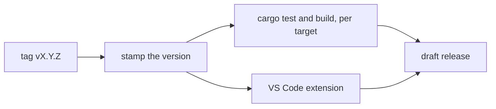

# Cutting a release

`.github/workflows/release.yml` builds a release on GitHub Actions and drafts its GitHub Release. Every archive comes from `./build.sh`, the only packaging path, so a release holds the same files a local `./build.sh` lays out.

## Steps

1. Tag the commit on `main` to release and push the tag:
   ```sh
   git tag -a v0.1.0 -m "OrbitScript 0.1.0"
   git push origin v0.1.0
   ```
   The tag is `v` followed by a [semantic version](https://semver.org). A tag with a prerelease suffix (`v0.1.0-rc`, `v0.1.0-rc.2`) builds the same way and is marked as a prerelease on GitHub.
2. The workflow stamps the tag's version into the build (below), runs `cargo test` on every target and builds it, packages the VS Code extension and drafts the release with the archives, the `.vsix`, `SHA256SUMS` and notes generated from the merged pull requests.
3. Read the draft on the repository's Releases page, edit the notes, and publish it. Nothing is public until then.

## Versions

The tag is the only place a release's version is written. The repository keeps placeholder versions (`0.0.0`; the extension `0.0.1`), and every job of the workflow first runs `tools/set-version.sh <tag>`, which writes the version into its own checkout, never into a commit: the `[workspace.package]` version in `Cargo.toml`, which every crate inherits (so `orbit -v`, `orbitc -v` and `orbit-lsp --version` print it), the VS Code extension's `package.json`, and both lockfiles. It refuses a tag that isn't `v` followed by a semantic version. Run it locally to build a release's version by hand, and `git checkout Cargo.toml Cargo.lock editors/vscode` afterwards.

To try the workflow without a release, run it by hand from the Actions tab (Release, "Run workflow") on a branch: it builds everything and keeps the archives as workflow artifacts. Naming an existing tag in `release-tag` drafts that tag's release instead, for example to redo a release whose run failed (delete the old draft first).

## What a release holds



Each target is tested and built on a runner of its own architecture, so `cargo test` runs on every platform a release ships for and each target can train its own profile:

| Target | Runner |
|---|---|
| `x86_64-unknown-linux-gnu` | `ubuntu-22.04` (glibc 2.35 and newer) |
| `aarch64-unknown-linux-gnu` | `ubuntu-22.04-arm` (glibc 2.35 and newer) |
| `aarch64-apple-darwin` | `macos-15` |
| `x86_64-pc-windows-msvc` | `windows-2025` |
| `aarch64-pc-windows-msvc` | `windows-11-arm` |

For each target there are two archives (`.tar.gz`, or `.zip` on Windows), each with `LICENSE` and `README.md`:

- `orbitscript-<version>-<target>`: the shared layout of ADR-10 (`bin/` with `orbit`, `orbitc`, `orbit-lsp` and `orbit-fmt`, `lib/` with `liborbit` and Lua 5.5's library names, `include/`); on Windows `bin/` also holds `orbit_lib.dll` and `lua55.dll`.
- `orbitscript-<version>-<target>-static`: the static `orbit`, `orbitc`, `orbit-lsp` and `orbit-fmt`, one file each.

Plus `orbitscript-<version>.vsix`, the VS Code extension, and `SHA256SUMS`.

## Profiles

Each runner but Windows ARM64 trains a profile for its target (`./build.sh --pgo-train`, written to the runner's temporary directory, never committed) and builds both layouts with it, so a release is never built with a stale profile and every target gets one, not only those with a profile in `pgo/`. The committed profiles couldn't serve a release anyway: the version is part of every symbol's hash, so a profile trained at `0.0.0` matches nothing in a `0.1.0` build. Windows ARM64 builds without one: there LLVM's profiling runtime writes malformed counts and the instrumented `orbit` crashes at random, so no profile can be trained. A run started by hand can build every target without a profile (`none`).

## Not done yet

- The binaries are not signed. macOS marks a downloaded archive as quarantined, and its programs won't start until the mark is removed (`xattr -dr com.apple.quarantine <dir>`); Windows SmartScreen may warn about the programs.
- The extension is attached to the release, not published to the VS Code Marketplace or Open VSX.
- No crates are published to crates.io.
